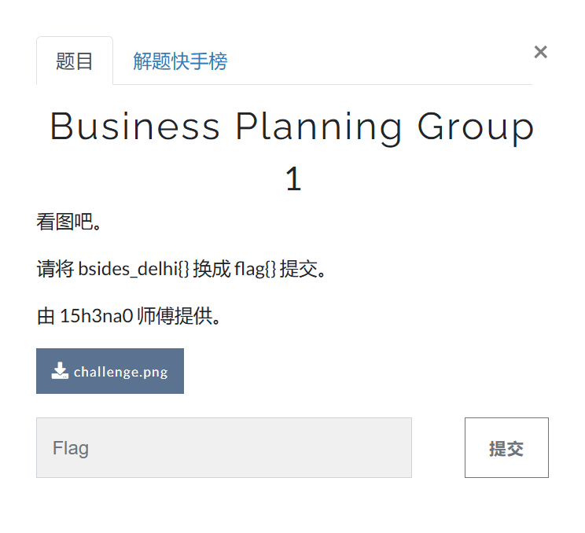
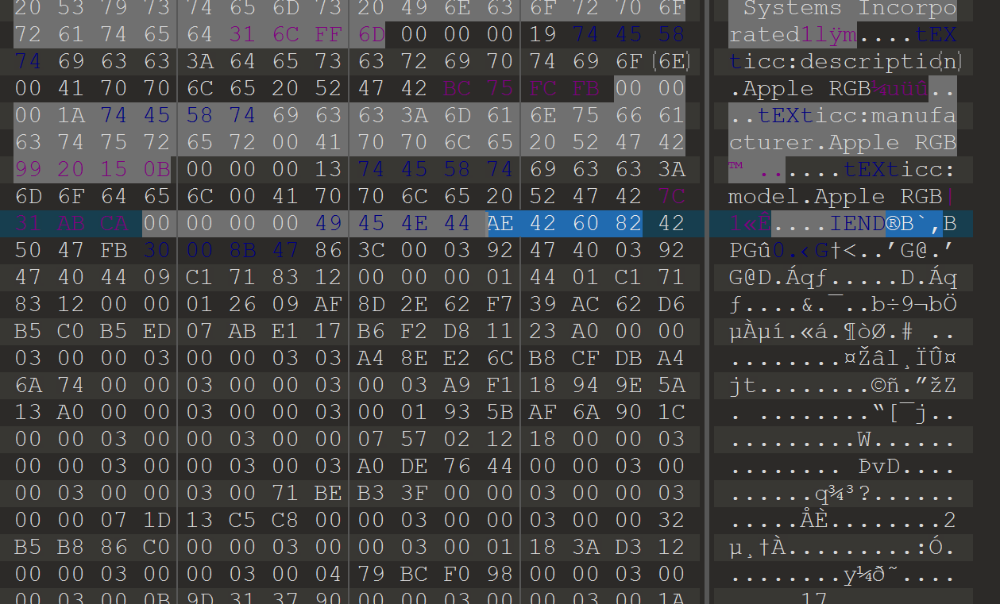
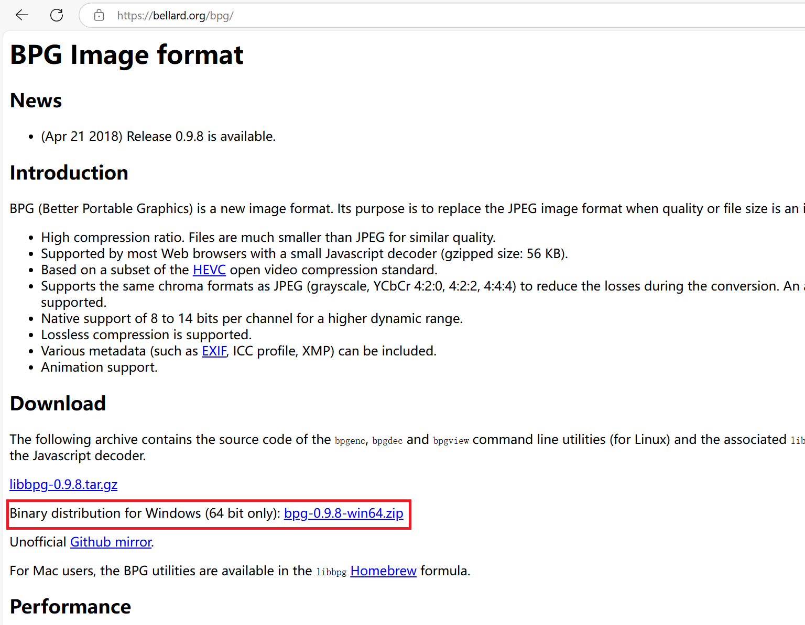
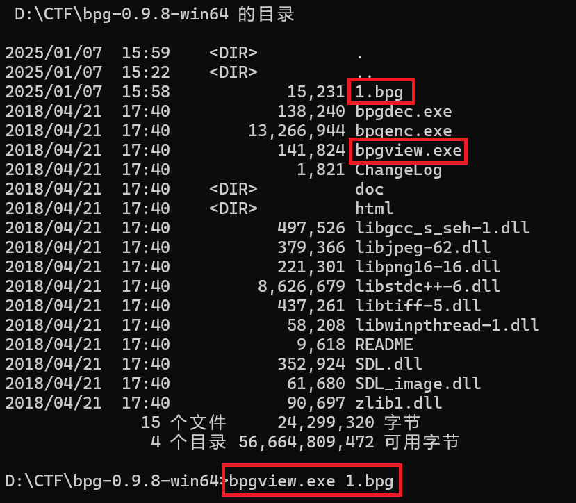
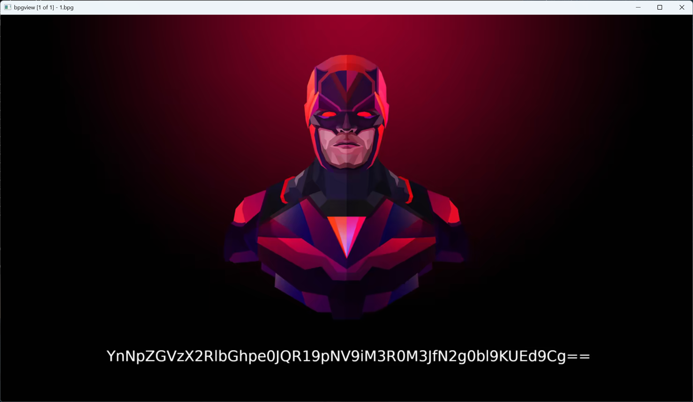

**BUUCTF: [https://buuoj.cn/challenges](https://buuoj.cn/challenges)** 

---

相关阅读

- [CTF Wiki](https://ctf-wiki.org/)
- [Hello CTF](https://hello-ctf.com/HC_Start/)
- [NewStar CTF](https://ns.openctf.net/learn/)
- [BUUCTF：Business Planning Group](https://blog.csdn.net/mochu7777777/article/details/109824966)
- [buuctf-misc-Business Planning Group1](https://blog.csdn.net/qq_29977871/article/details/126110785)


 

### 题目描述：

### 密文：

下载附件，解压得到challenge.png

 

---

### 解题思路：

1、使用010Editor打开challenge.png，发现PNG文件尾（AE 42 60 82）附带一串数据，以 `BPG` 开头。使用搜索引擎了解到这是一种图像格式。

> BPG（Better Portable Graphics，更好的可移植图形）是一种新的图像格式。

 

2、将数据另存为1.bpg文件，下载能打开BPG文件的工具。

下载地址： [https://bellard.org/bpg/](https://bellard.org/bpg/) 

 

在CMD中，使用bpgview.exe打开1.bpg图片，得到如下图：

 

 

3、提取图片中的字符串，应该是Base64编码。

```python
YnNpZGVzX2RlbGhpe0JQR19pNV9iM3R0M3JfN2g0bl9KUEd9Cg==
```

Base64解码得到flag： `bsides_delhi{BPG_i5_b3tt3r_7h4n_JPG}` 

### flag：

```bash
flag{BPG_i5_b3tt3r_7h4n_JPG}
```