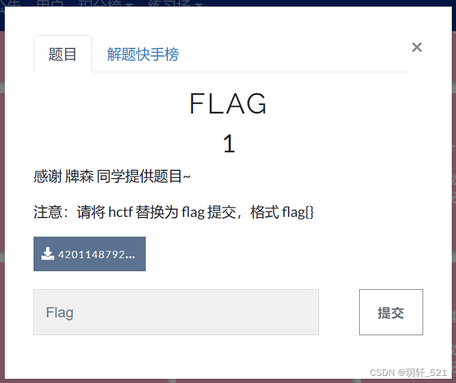
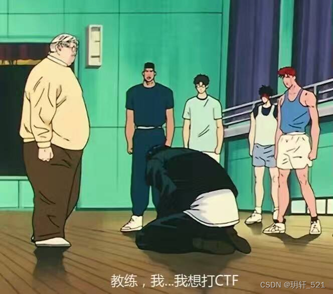
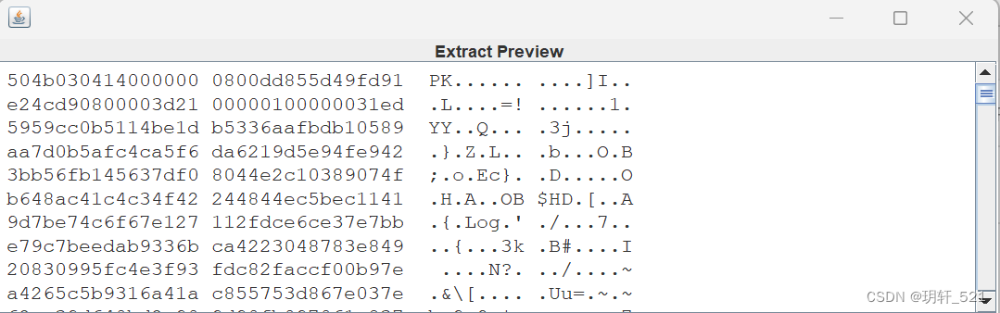
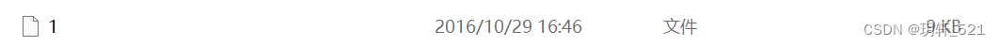
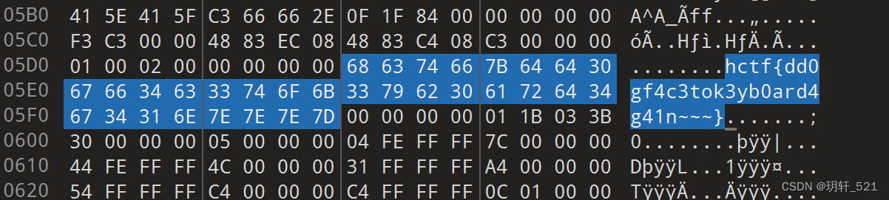
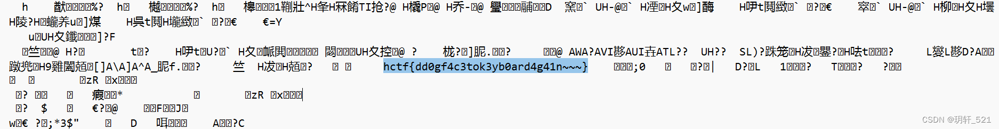

**BUUCTF: [https://buuoj.cn/challenges](https://buuoj.cn/challenges)** 

---

相关阅读

- [CTF Wiki](https://ctf-wiki.org/)




### 题目描述：

注意：请将 hctf 替换为 flag 提交，格式 flag{}

### 密文：

下载附件，得到一张.png图片。



---

### 解题思路：

1、因为附件是一张图片，先放到StegSolve中，在Analyse（分析）选项卡，使用Data Extract（数据提取），可以看到有zip文件的标志。（通过）
[跟这道题有异曲同工之妙](https://blog.csdn.net/YueXuan_521/article/details/133822506?spm=1001.2014.3001.5502) 



2、由pk文件头可以看出隐写内容为zip文件，按save Bin键保存为zip文件。解压获得一个名为1的文件，可以通过添加.txt后缀或在010 Editor中查看文件。仔细找，找到flag。







### flag：

```bash
flag{dd0gf4c3tok3yb0ard4g41n~~~}
```