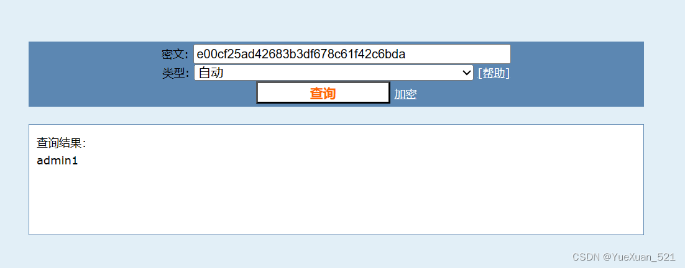

密文：

```cobol
e00cf25ad42683b3df678c61f42c6bda
```

**简述：** 

一般MD5值是32位由数字“0-9”和字母“a-f”所组成的字符串，字母大小写统一；如果出现这个范围以外的字符说明这可能是个错误的md5值，就没必要再拿去解密了。

**特征：** 

 有固定长度，一般是32位或者16位

 由数字“0-9”和字母“a-f”组成

直接进行在线解密

<div style="text-align:center;"></div>

在线解密工具： [https://www.cmd5.com/](https://www.cmd5.com/) 