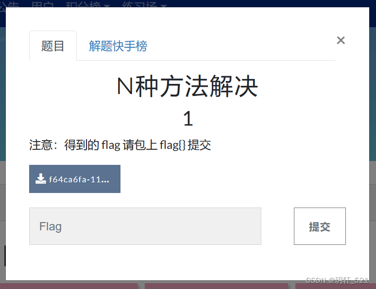
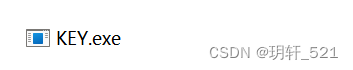
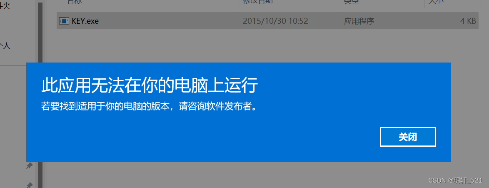
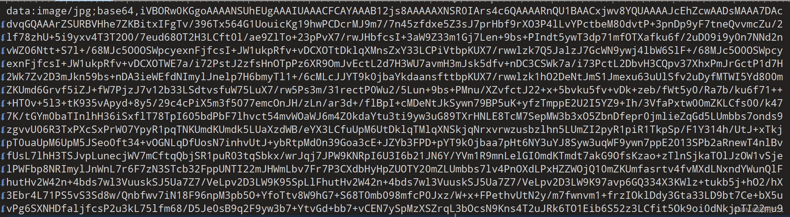
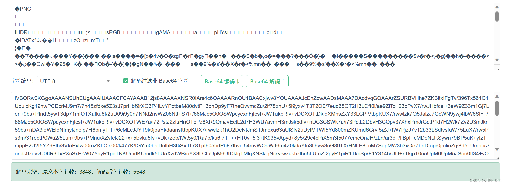
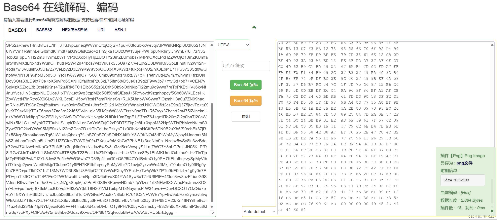
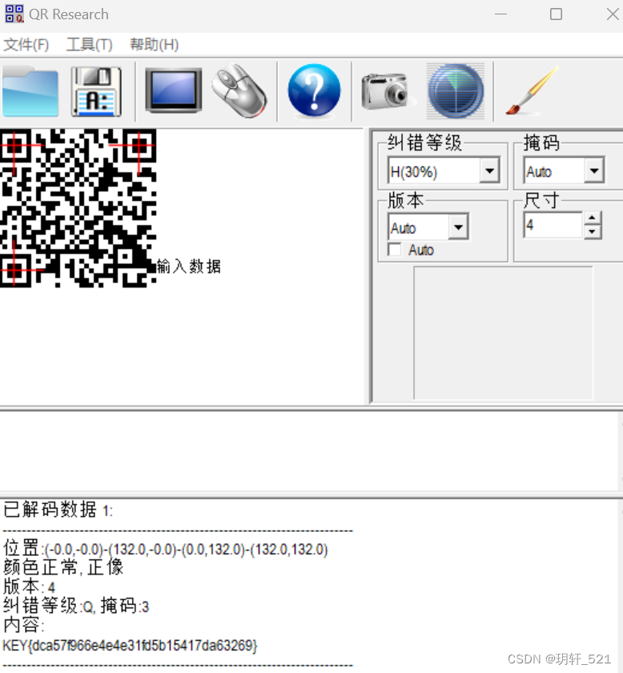

**BUUCTF: [https://buuoj.cn/challenges](https://buuoj.cn/challenges)** 

---

相关阅读

- [CTF Wiki](https://ctf-wiki.org/)




### 题目描述：

下载附件，解压得到一个.exe文件

### 密文：



### 解题思路：

1、双击.exe文件，出现一个错误，切换其他的方法。



2、将KEY.exe文件放到010Editor，分析这个文件。



3、观察到jpg、base64等关键词，将base64后的字符串解码，点击另存为png文件。
在对base64的初次解码中，发现文件可能为png文件的线索。



[https://the-x.cn/encodings/Base64.aspx](https://the-x.cn/encodings/Base64.aspx) 



4、打开下载的png文件，发现是一张二维码，使用QR Research扫描，得到flag。（通过手机扫码也可以得到flag，为扫码跳转网页的网址）



### flag：

```bash
flag{dca57f966e4e4e31fd5b15417da63269}
```