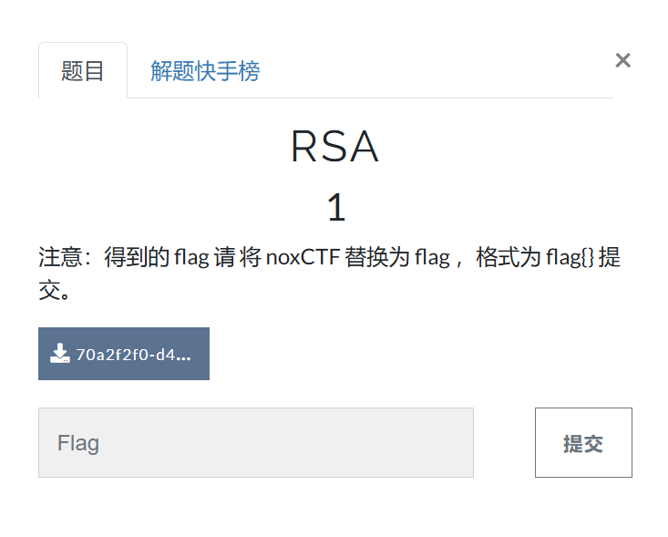

**BUUCTF: [https://buuoj.cn/challenges](https://buuoj.cn/challenges)** 

---

相关阅读

- [CTF Wiki](https://ctf-wiki.org/)


 

### 题目描述：

注意：得到的 flag 请 将 noxCTF 替换为 flag ，格式为 flag{} 提交。

### 密文：

```python
在一次RSA密钥对生成中，假设p=473398607161，q=4511491，e=17
求解出d作为flga提交
```

---

### 解题思路：

Python代码求解。或用工具求解，参考这篇文章 [https://blog.csdn.net/MikeCoke/article/details/105967809](https://blog.csdn.net/MikeCoke/article/details/105967809) 

```python
import gmpy2
p = 473398607161
q = 4511491
e = 17
d = int(gmpy2.invert(e, (p-1)*(q-1)))
print(d)

```

### flag：

```python
125631357777427553
```