**BUUCTF: [https://buuoj.cn/challenges](https://buuoj.cn/challenges)** 

---

相关阅读

- [CTF Wiki](https://ctf-wiki.org/)
- [CTF解题技能之压缩包分析基础篇](https://www.freebuf.com/column/199854.html)
- [BUUCTF：USB](https://blog.csdn.net/mochu7777777/article/details/109632626)
- [(usb键盘隐写)buuctf:USB](https://www.cnblogs.com/Dreamerwd/p/15159027.html#:~:text=%E5%85%88%E6%8A%8A%E5%8E%8B%E7%BC%A9%E5%8C%85%E6%8F%90)


 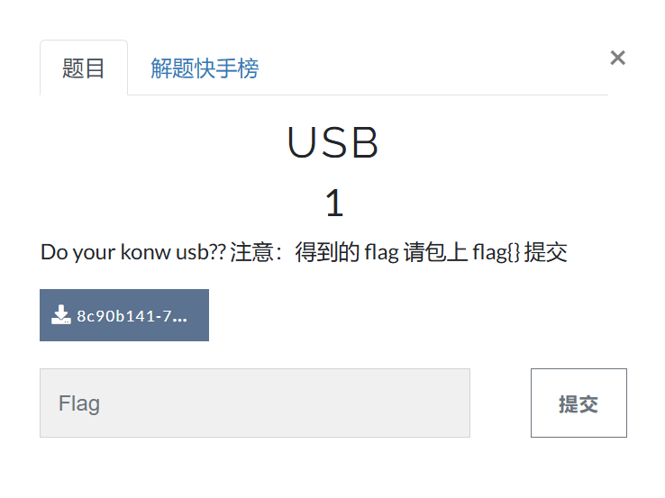

### 题目描述：

Do your konw usb?? 注意：得到的 flag 请包上 flag{} 提交

### 密文：

下载附件解压，得到233.rar和key.ftm文件

 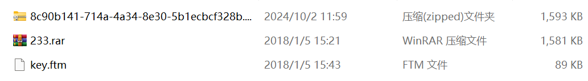

---

### 解题思路：

1、解压233.rar，发现文件损坏，233.png没有解压出来，flag.txt文件中没有flag。

 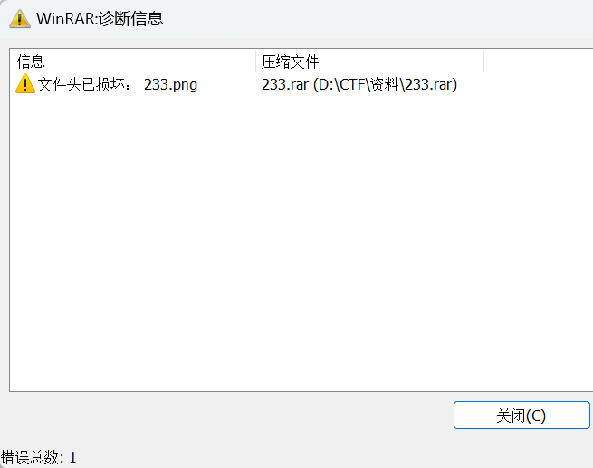

 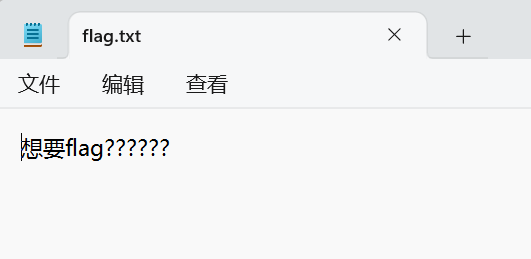

用010Editor打开，提示文件的第三个块CRC报错，也就是233.rar的文件块。

> RAR是有四个文件块组成的，分别是分别是 `标记块` 、 `归档头部块` 、 `文件块` 、 `结束块` 。

 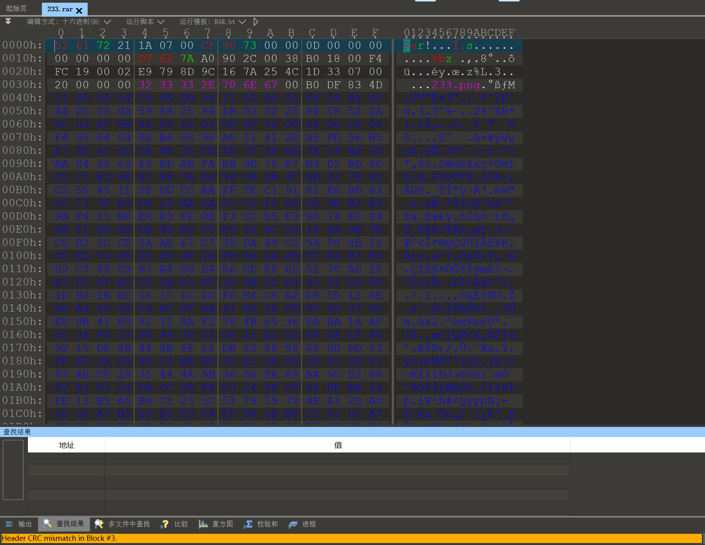

检查发现是文件块的HEAD_TYPE出错，原数值应为0x74，而非0x7A。修改后即可成功解压。

 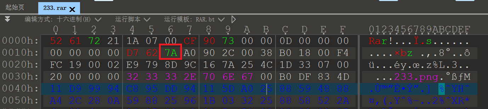

 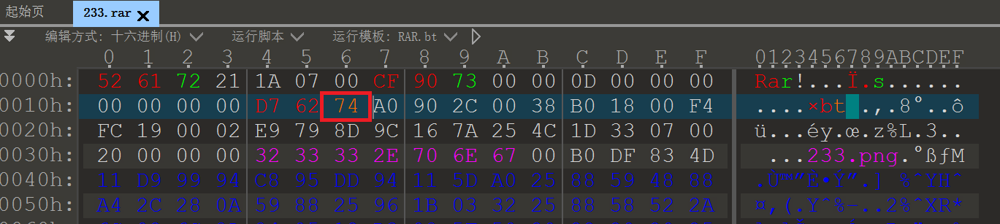

2、解压已修改后的文件，得到233.png

 

使用StegSolve打开图片，在Blue plane 0通道发现一个二维码

 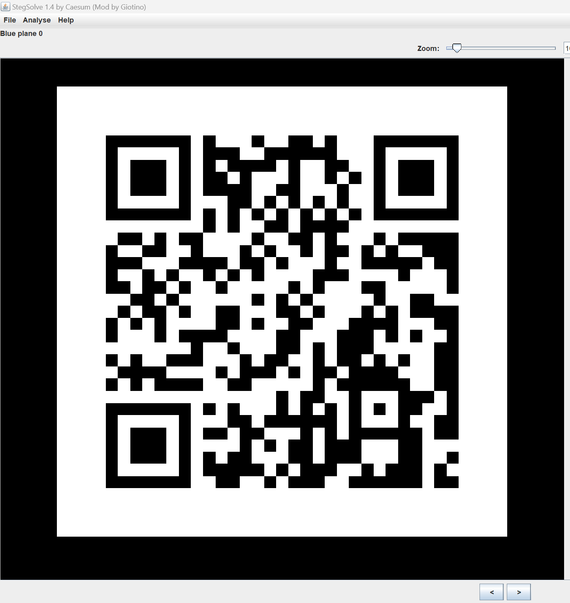

扫描二维码得到疑似flag的密文： `ci{v3erf_0tygidv2_fc0}` ，猜测为维吉尼亚密码。但缺少key值（密钥），暂时无法解密

 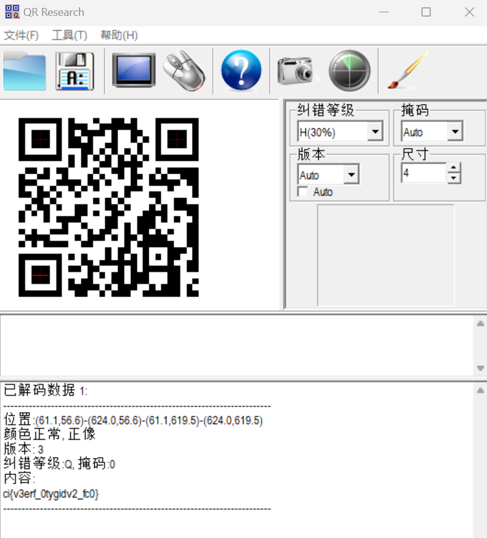

3、回过头，key.ftm中应该就有我们要的key值

> **FTM** 是FamiTracker，用于生产任天堂（NES）系统的音乐的音频节目创建的音频跟踪器模块。 它包括短的音频样本和一系列包含旋律音符。

在010 Editor中搜索“key”关键字，发现隐藏zip压缩包，内部有key.pcap

 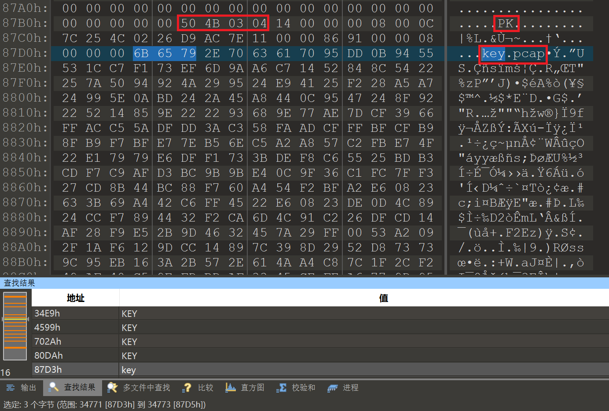

将zip的数据另存为一个单独的zip文件，解压得到key.pcap。（或者使用WinRAR直接打开key.ftm）

 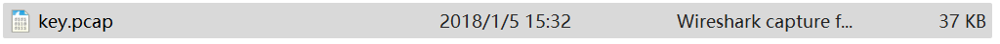

打开发现全部为USB的流量

 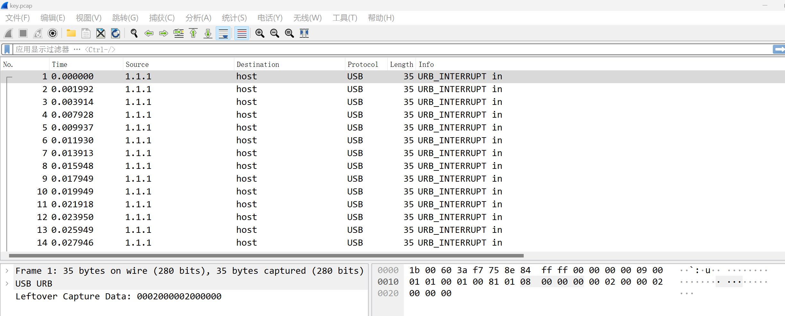

使用隐写脚本USBUsbKeyboardDataHacker.py，得到内容 `aababacbbdbdccccdcdcdbbcccbcbbcbbaababaaaaaaaaaaaaaaaaaakey{xinan}` ，key值为 `xinan` 

[https://github.com/WangYihang/UsbKeyboardDataHacker
](https://github.com/WangYihang/UsbKeyboardDataHacker) 

```shell
python UsbKeyboardDataHacker.py /root/key.pcap
```

 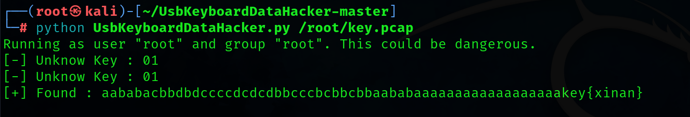

4、使用得到的key值，解密维吉尼亚密码，得到 `fa{i3eei_0llgvgn2_sc0}` 
[维吉尼亚密码加密解密](https://www.qqxiuzi.cn/bianma/weijiniyamima.php) 

 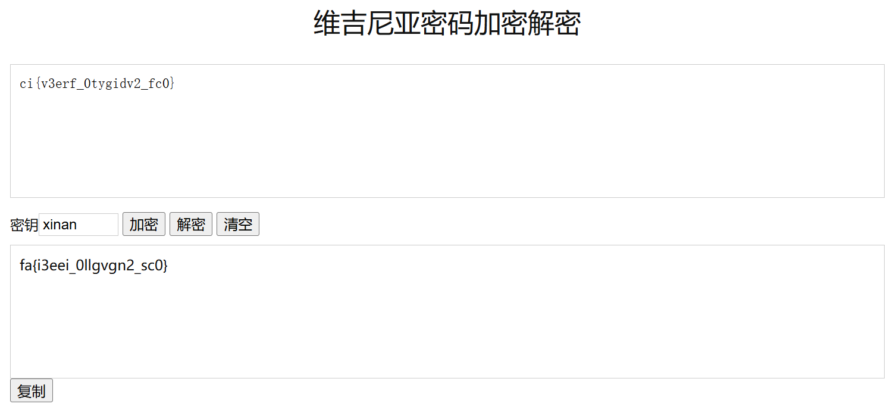

猜测明文又经过栅栏加密，解密得到 `flag{vig3ne2e_is_c00l}` 
[栅栏密码加密解密](https://www.qqxiuzi.cn/bianma/zhalanmima.php) 

 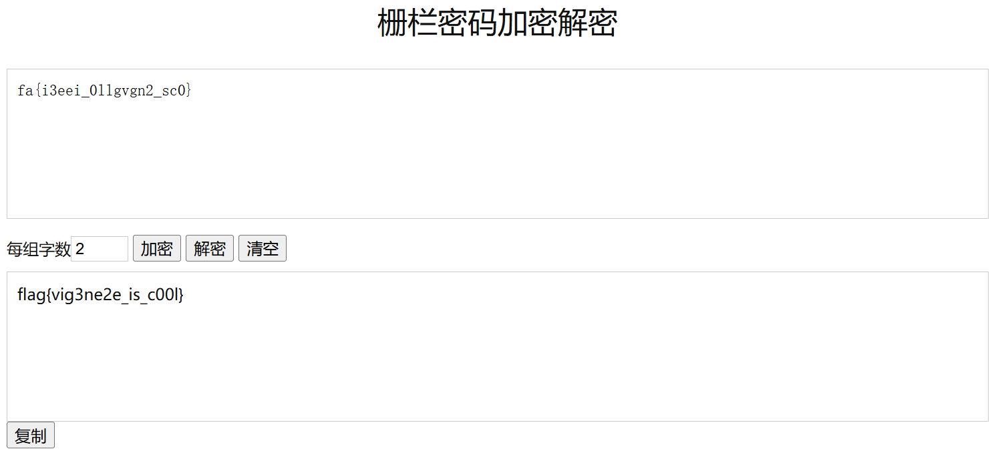

### flag：

```bash
flag{vig3ne2e_is_c00l}
```