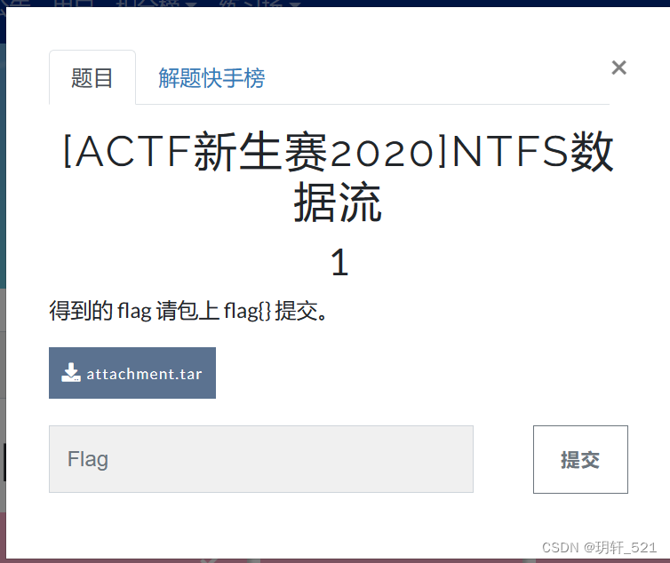
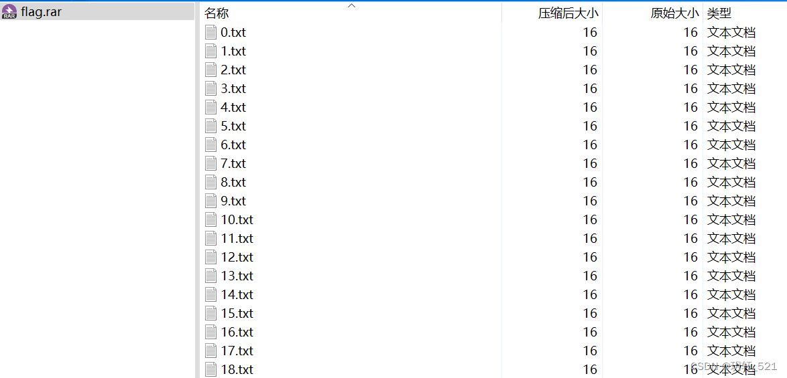
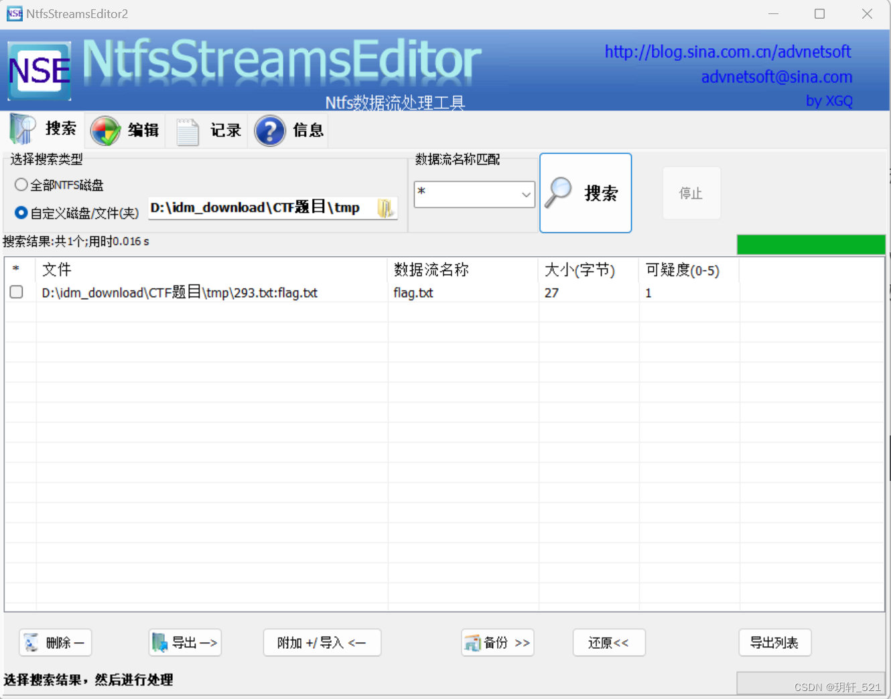
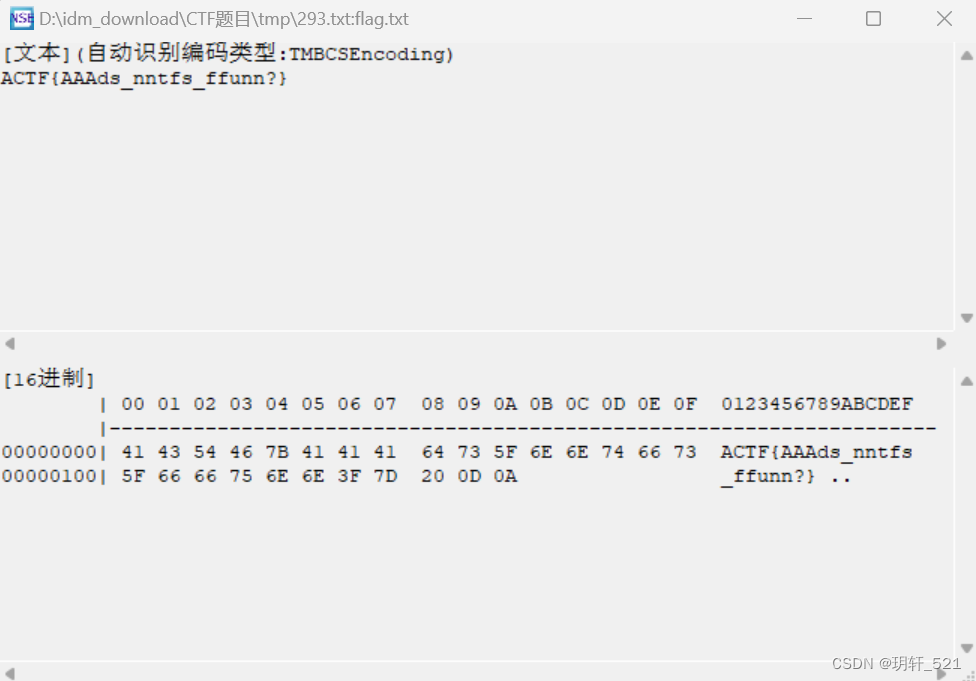

**BUUCTF: [https://buuoj.cn/challenges](https://buuoj.cn/challenges)** 

---

相关阅读

- [CTF Wiki](https://ctf-wiki.org/)


 

### 题目描述：

得到的 flag 请包上 flag{} 提交。

### 密文：

下载附件，得到一个.tar文件。
 

---

### 解题思路：

1、解压.tar文件，再解压tmp文件夹下的flag.rar文件，得到500个.txt文件。随便看一个.txt文件，内容如下。

 

 

2、结合题目提示，这是一道关于NTFS交换数据流的题目。
[NTFS 交换数据流 实现隐藏文件](https://zhuanlan.zhihu.com/p/654643812) 

使用工具NtfsStreamsEditor或AlternateStreamView打开存放tmp文件夹，扫描出现NTFS交换数据流文件，导出后打开，得到flag（或双击查看）。

[AlternateStreamView(跳转页面后，向下滑动，下载对应的32或64位软件)](https://www.nirsoft.net/utils/alternate_data_streams.html) 

这里使用NtfsStreamsEditor
 

双击查看，得到flag。

 

### flag：

```bash
flag{AAAds_nntfs_ffunn?} 
```