**BUUCTF: [https://buuoj.cn/challenges](https://buuoj.cn/challenges)** 

---

相关阅读

- [CTF Wiki](https://ctf-wiki.org/)


 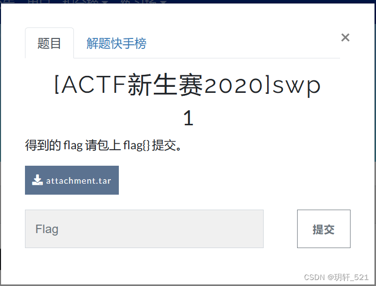

### 题目描述：

得到的 flag 请包上 flag{} 提交。

### 密文：

下载附件，得到一个.tar文件。
 

---

### 解题思路：

1、使用WinRAR解压.tar文件，得到两个.zip文件。

 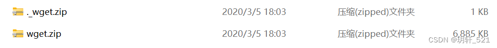

解压wget.zip文件，得到.pcapng文件。

 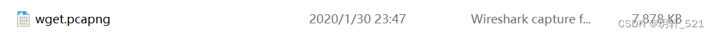

双击在Wireshark中打开，内容如下。

 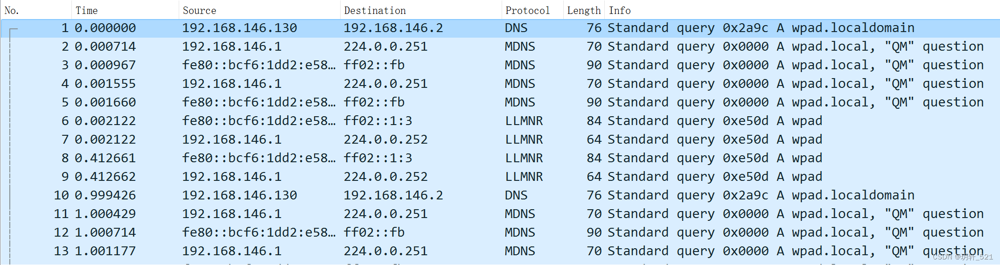

根据wget.zip和wget.pcapng的文件名“wget”，上网搜一下，是一个在网络上下载文件的软件。既然如此，将http的流量过滤出来，导出文件看一下有什么文件。

 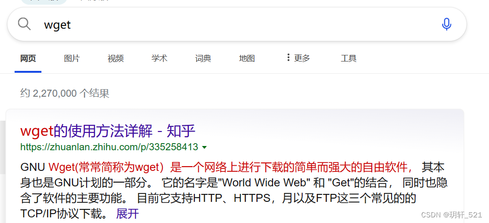

 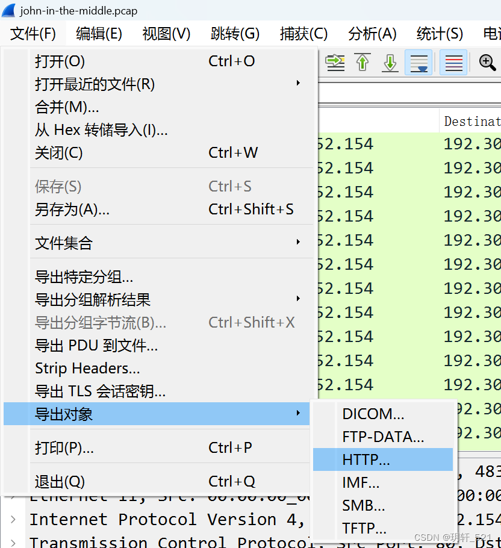

导出得到的文件如下。

 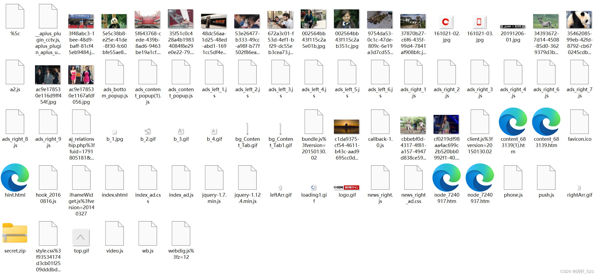

2、找到一个secret.zip文件，尝试解压，需要密码。

 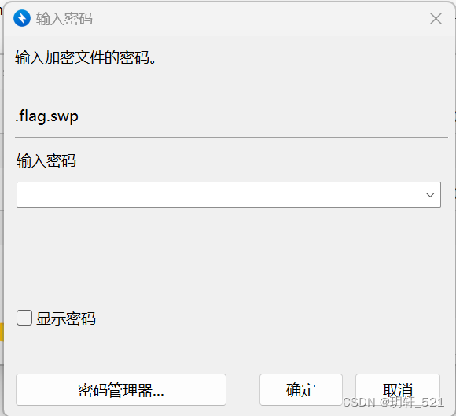

使用Ziperello打开.zip压缩包，提示错误，猜测为ZIP伪加密。

 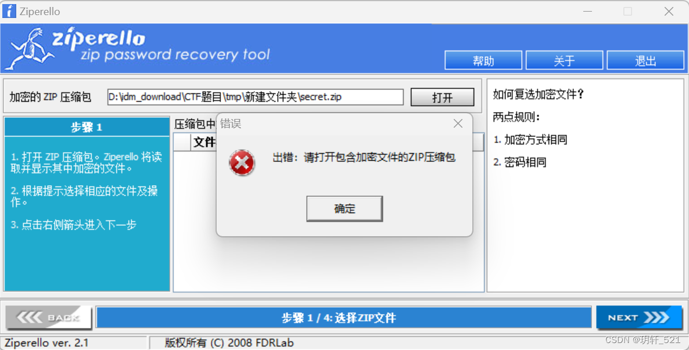

[zip伪加密原理](https://blog.csdn.net/qq_26187985/article/details/83654197) 
通过010 Editor修改压缩源文件数据区和目录区的全局方式位标记（下图红色标识），将伪压缩文件恢复到未加密的状态。

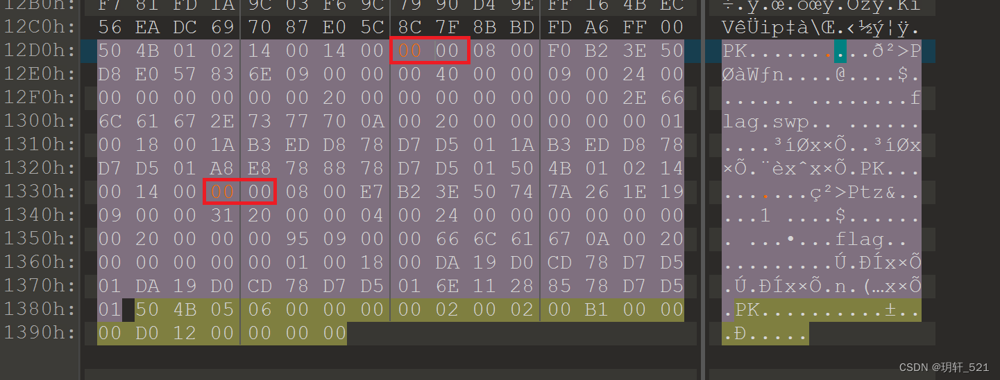

```bash
未加密：

文件头中的全局方式位标记为00 00

目录中源文件的全局方式位标记为00 00

伪加密：

文件头中的全局方式位标记为00 00

目录中源文件的全局方式位标记为09 00

真加密：

文件头中的全局方式位标记为09 00

目录中源文件的全局方式位标记为09 00

ps:也不一定要09 00或00 00，只要是奇数都视为加密，而偶数则视为未加密
```

修改后，解压压缩包不需要密码，解压成功，得到两个文件。

 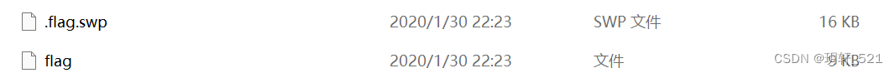

3、使用Notepad++打开任意一个文件，都可以发现flag。

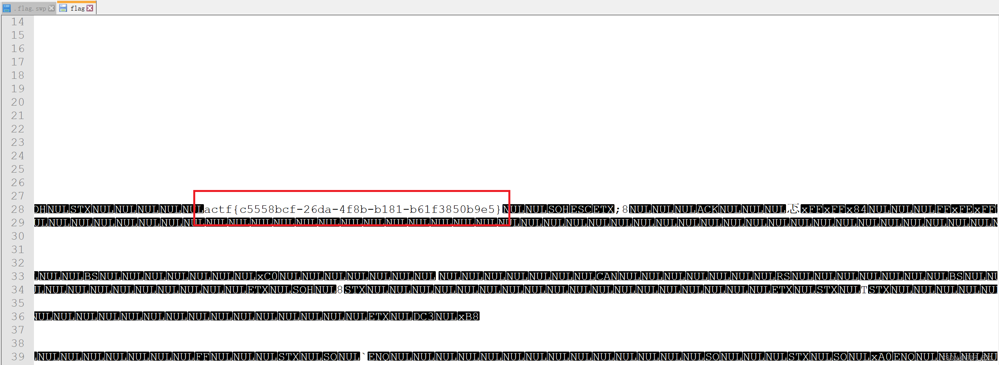

 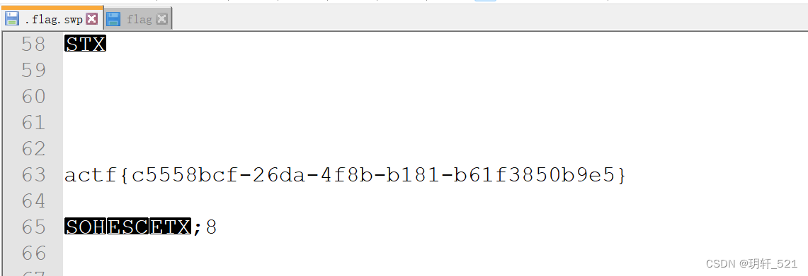

### flag：

```bash
flag{c5558bcf-26da-4f8b-b181-b61f3850b9e5}
```