**BUUCTF: [https://buuoj.cn/challenges](https://buuoj.cn/challenges)** 

---

相关阅读

- [CTF Wiki](https://ctf-wiki.org/)
- [明文攻击](https://peiqi.wgpsec.org/ctf/misc/%E5%8E%8B%E7%BC%A9%E5%8C%85%E7%A0%B4%E8%A7%A3/%E6%98%8E%E6%96%87%E6%94%BB%E5%87%BB.html)
- [BUUCTF：［ACTF新生赛2020］明文攻击](https://blog.csdn.net/qq_46230755/article/details/112108707#:~:text=%5BACTF%E6%96%B0)
- [Zip明文攻击细节问题及解决方案](https://blog.csdn.net/qq_52974719/article/details/117084427)


 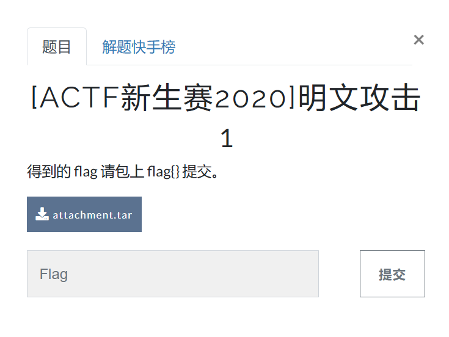

### 题目描述：

得到的 flag 请包上 flag{} 提交。

### 密文：

下载附件解压，得到tmp文件夹，下有none.zip，最后得到

 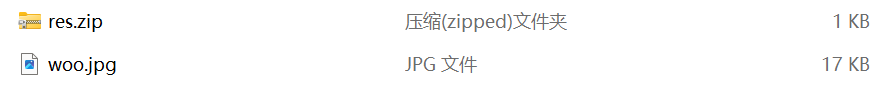

 

---

### 解题思路：

1、尝试解压res.zip，需要解压密码。看一下woo.jpg图片，发现数据中存在zip压缩包数据。（zip文件头：50 4B 03 04）

 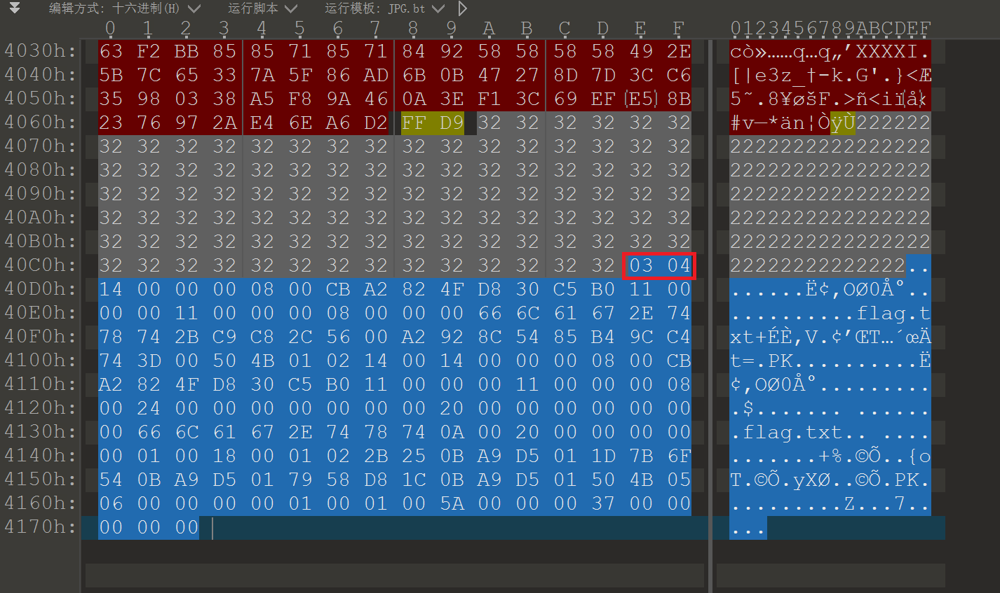

文件头存在缺失，补全文件头，另存为zip文件。

 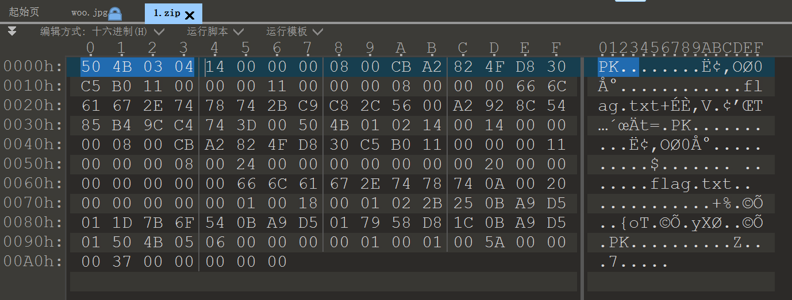

解压1.zip压缩包，得到flag.txt文件。（不是flag）

 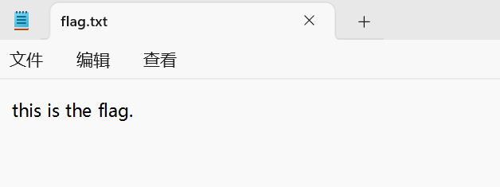

2、两个压缩包的CRC值相同，结合题目“明文攻击”，可以使用包含flag.txt的1.zip压缩包，对res.zip进行明文攻击。

> **明文攻击** 是一种存在特定场景下爆破手段，大致原理是当你不知道一个zip的密码，但是你有zip中的一个已知文件（文件大小要大于12Byte）或者已经通过其他手段知道zip加密文件中的某些内容时，因为同一个zip压缩包里的所有文件都是使用同一个加密密钥来加密的，所以可以用已知文件来找加密密钥，利用密钥来解锁其他加密文件。

 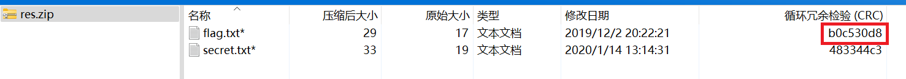

 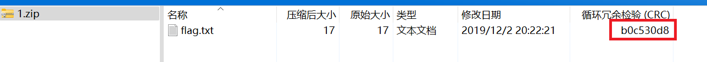

使用ARCHPR进行明文攻击，5、6分钟后点击“停止”

> 需要注意的是，明文攻击并不需要你太多时间，最多也就5,6分钟（师傅们的总结），一旦超过这个时间或感觉可以了点停止即可。

 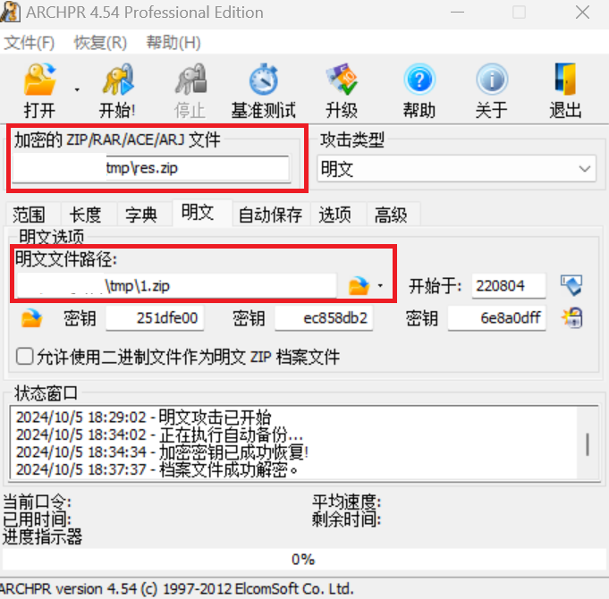

会弹出“加密密钥已成功恢复”提示框

 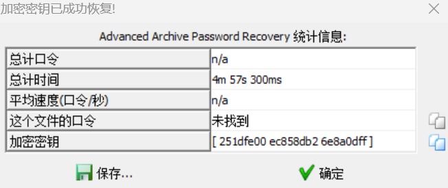

点击取消，将无密码的文件另存下来

 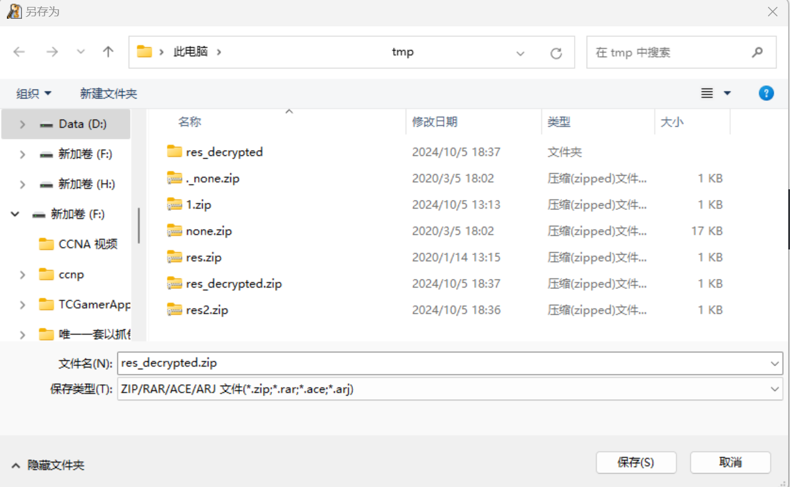

解压得到secret.txt文件，打开就是flag

 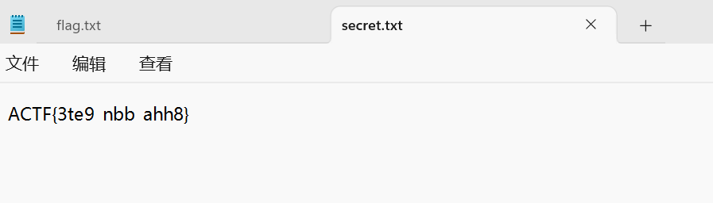

### flag：

```bash
ACTF{3te9_nbb_ahh8}
flag{3te9_nbb_ahh8}
```