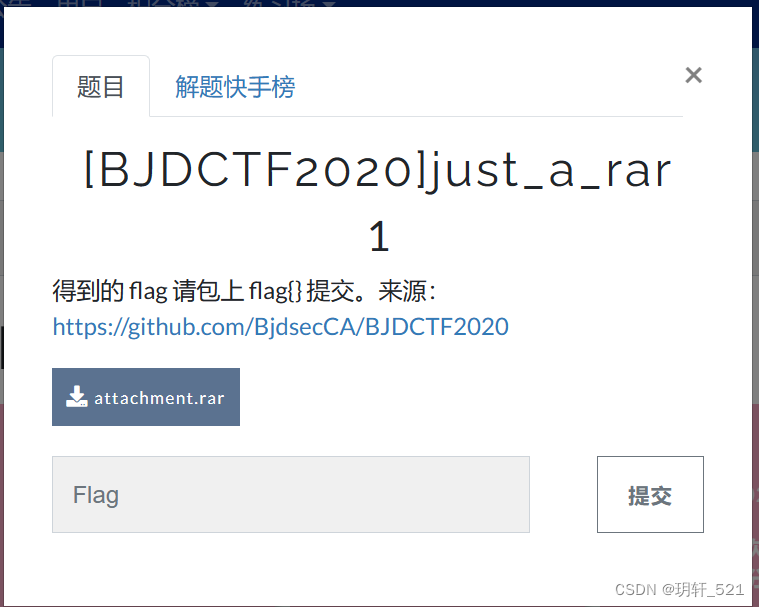
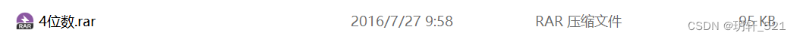
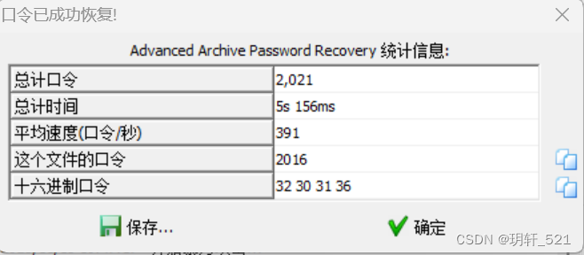
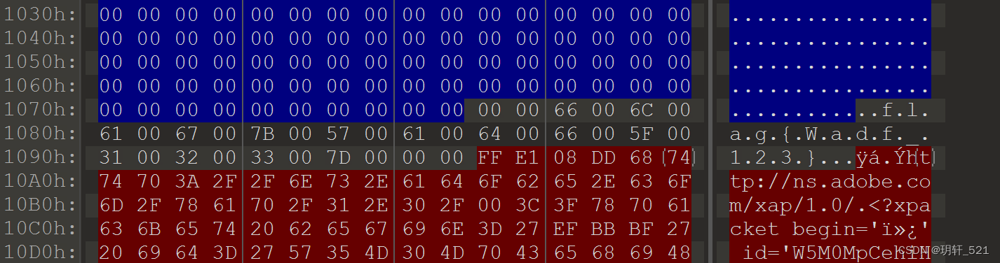

**BUUCTF: [https://buuoj.cn/challenges](https://buuoj.cn/challenges)** 

---

相关阅读

- [CTF Wiki](https://ctf-wiki.org/)

 

### 题目描述：

来源： [https://github.com/BjdsecCA/BJDCTF2020](https://github.com/BjdsecCA/BJDCTF2020) 

### 密文：

下载附件，解压得到一个.rar压缩包。
 

---

### 解题思路：

1、根据压缩包的名字提示我们使用4位纯数字进行破解。使用ARCHPR工具，选定参数，破解得到密码为5790。
 

用密码解压rar压缩包，得到一张名为flag的jpg图片。


2、使用010Editor打开图片，查阅数据时，发现flag。（flag中的“W”要注意大写！）

 

### flag：

```bash
flag{Wadf_123}
```