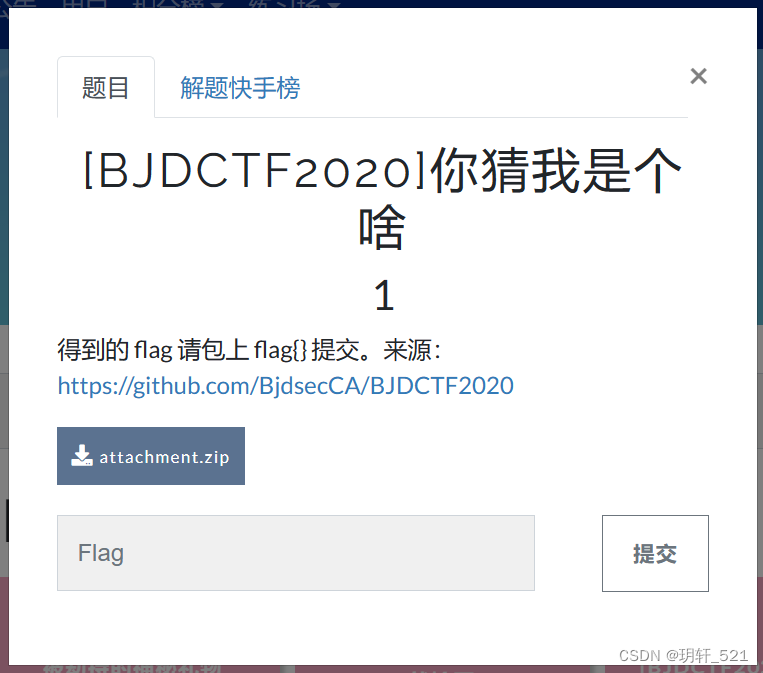
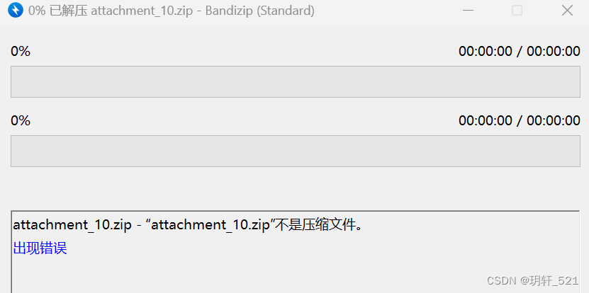
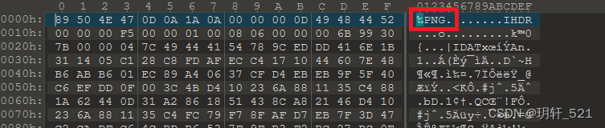
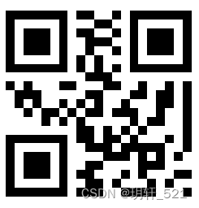
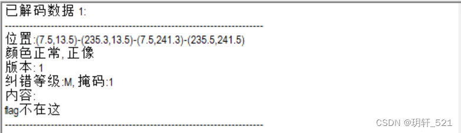
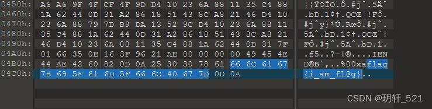

**BUUCTF: [https://buuoj.cn/challenges](https://buuoj.cn/challenges)** 

---

相关阅读

- [CTF Wiki](https://ctf-wiki.org/)

 

### 题目描述：

来源： [https://github.com/BjdsecCA/BJDCTF2020](https://github.com/BjdsecCA/BJDCTF2020) 

### 密文：

下载附件，得到一个zip压缩包。


---

### 解题思路：

1、尝试解压压缩包，提示“attachment_10.zip”不是压缩文件。结合题目，猜测更改了文件格式，放到010 Editor看一下，发现是png文件。
 



2、将文件后缀修改为.png，再次打开文件，得到一张二维码图片。



使用QR research扫描二维码，得到提示“flag不在这”。
 

3、我们返回010Editor中，在文件的最后找到了flag。（一开始得到的压缩包在010 Editor中也可以找到这个flag。）

 

### flag：

```bash
flag{i_am_fl@g}
```