**BUUCTF: [https://buuoj.cn/challenges](https://buuoj.cn/challenges)** 

---

相关阅读

- [CTF Wiki](https://ctf-wiki.org/)


 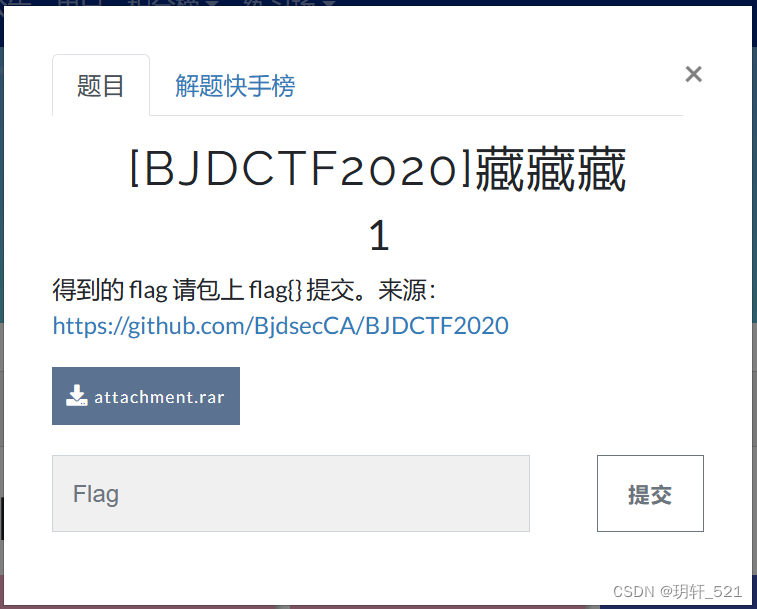

### 题目描述：

来源：https://github.com/BjdsecCA/BJDCTF2020

### 密文：

下载附件，解压得到一张.jpg图片和一个.txt文件。
 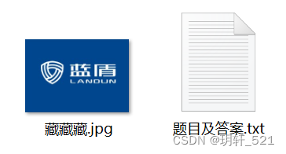

---

### 解题思路：

1、一张图片，典型的图片隐写。在010Editor中找到PK文件头，确认隐藏zip压缩包。放到Kali中，使用binwalk检测，也确认图片中有zip压缩包。（第一个“藏”）
 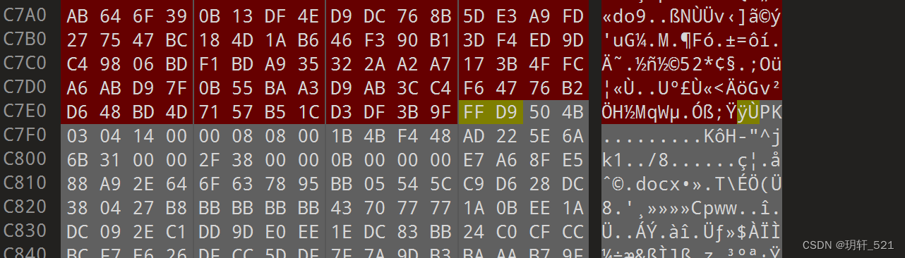

 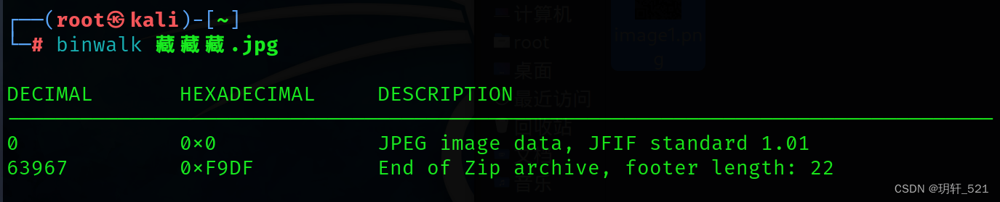

使用foremost分离图片中的压缩包，在output目录中找到隐藏的zip压缩包。
 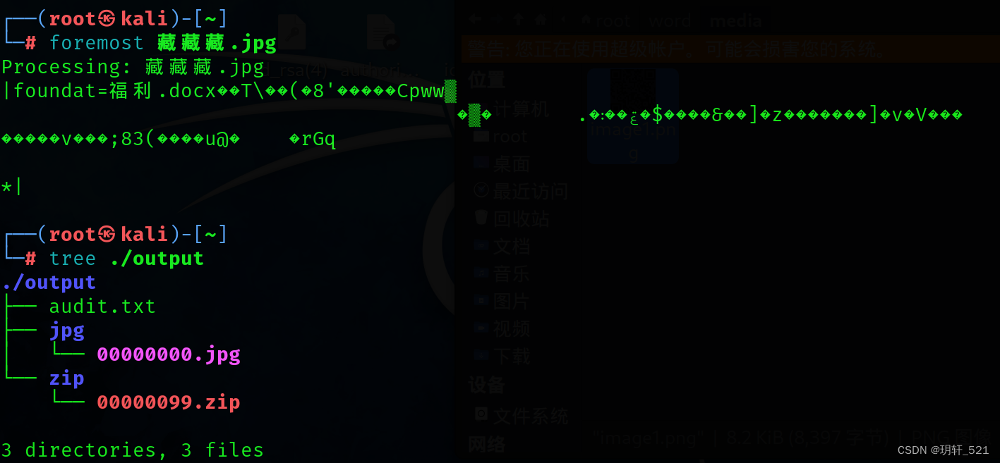

尝试解压压缩包，得到一个.docx文件。
 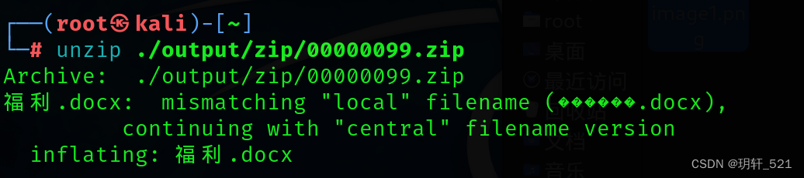

查看.docx文件，再次发现PK文件头。
 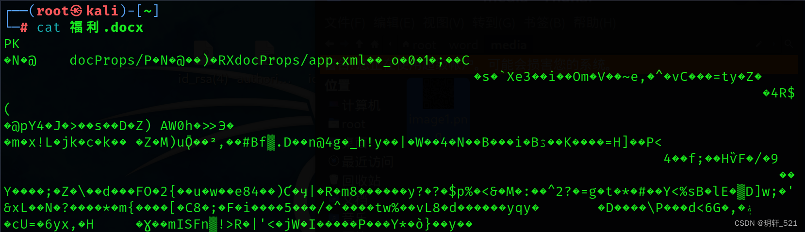

2、使用binwalk检测，发现有很多zip压缩包。（第二个“藏”）
 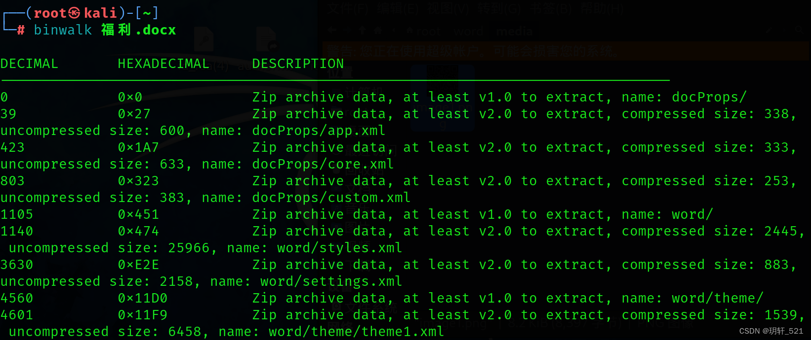

使用foremost分离压缩包，在output目录中找到zip压缩包并解压，得到很多文件。
 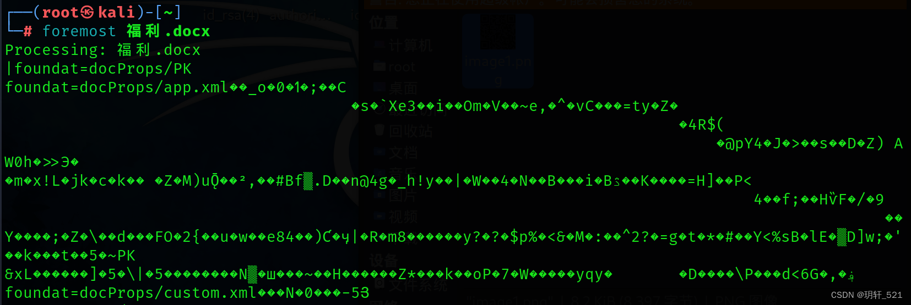

 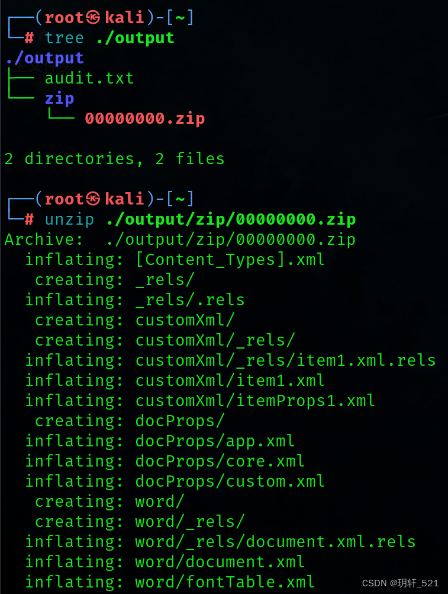

3、在很多文件中发现一个.png图片，查看一下，发现是一张二维码。（第三个“藏”）
 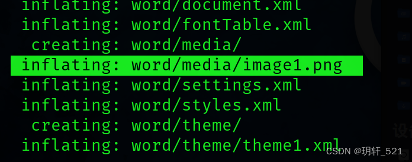

 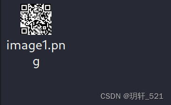

使用QR research扫描二维码，得到flag。（也可以使用手机扫码）
 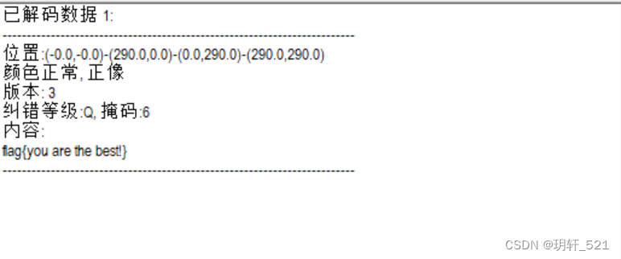

### flag：

```bash
flag{you are the best!}
```