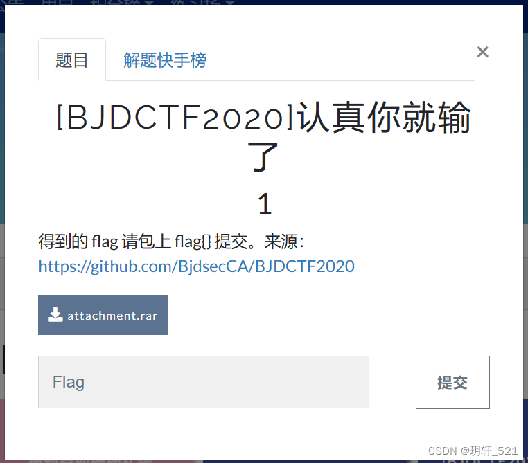
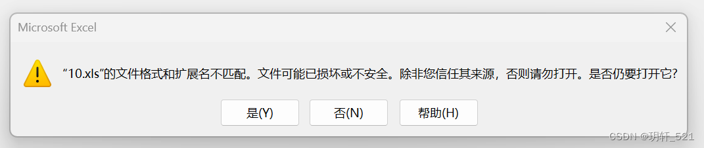
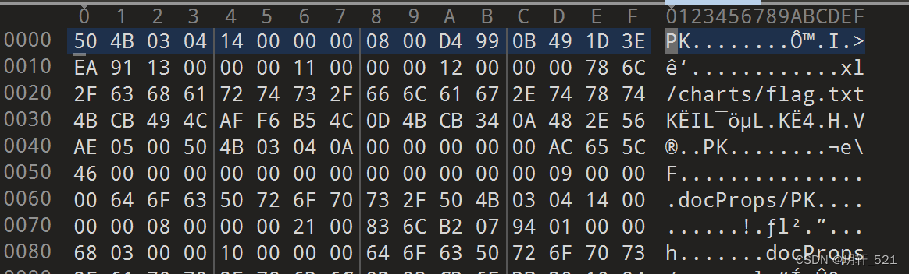
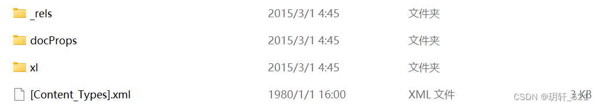
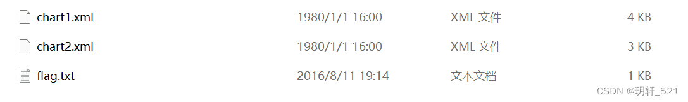
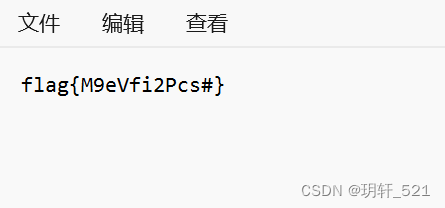

**BUUCTF: [https://buuoj.cn/challenges](https://buuoj.cn/challenges)** 

---

相关阅读

- [CTF Wiki](https://ctf-wiki.org/)


 

### 题目描述：

来源：https://github.com/BjdsecCA/BJDCTF2020

### 密文：

下载附件，解压得到一个.xls文件。
 

---

### 解题思路：

1、双击文件，提示“10.xls”的文件格式和扩展名不匹配。
 

在010Editor中打开10.xls文件，发现PK文件头，猜测为zip压缩包。
 

2、将10.xls文件的后缀名改为.zip，修改后解压，得到很多文件夹。
 

这一步之后不知道该如何分析本题，看了别人的题解，才知道原来flag就在xl文件夹下，只需要进入xl文件夹，在进入charts文件夹，就可以看到flag.txt文件。果然是“认真你就输了”！
 

打开flag.txt文件，得到flag。
 

### flag：

```bash
flag{M9eVfi2Pcs#}
```