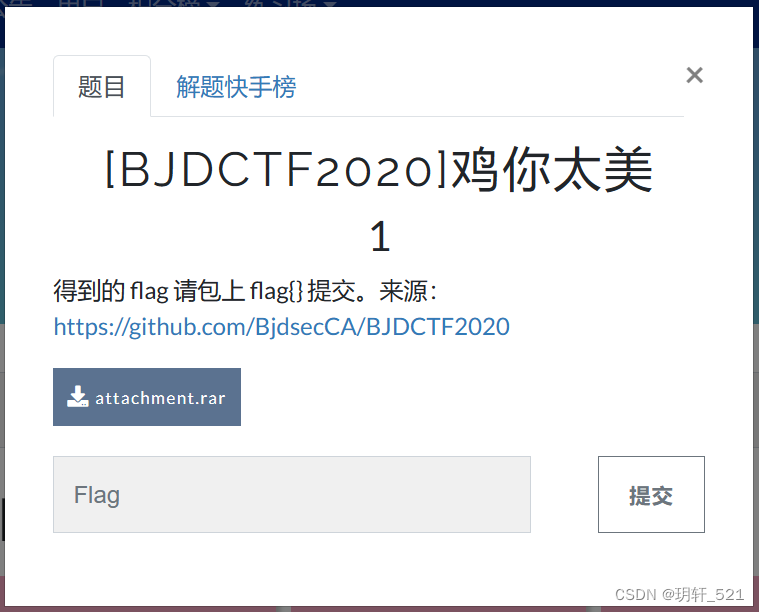
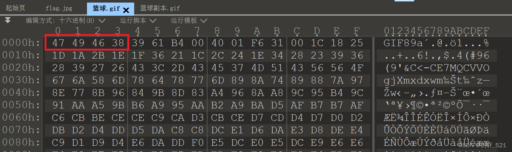
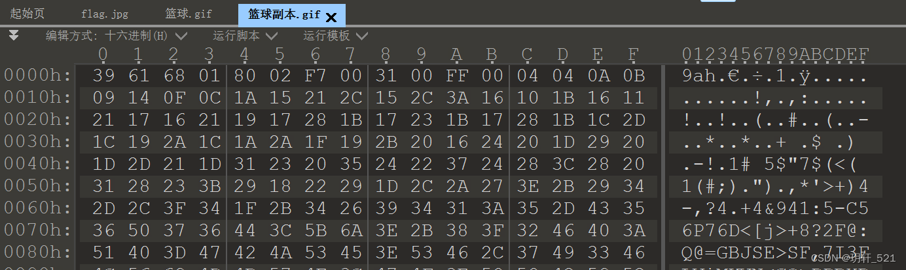
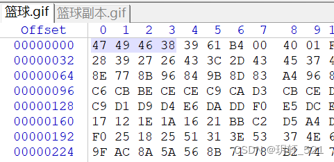
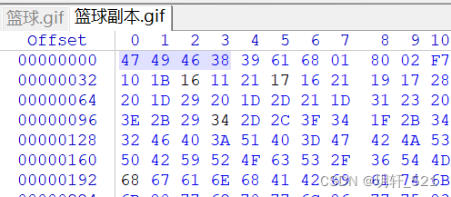

**BUUCTF: [https://buuoj.cn/challenges](https://buuoj.cn/challenges)** 

---

相关阅读

- [CTF Wiki](https://ctf-wiki.org/)

 

### 题目描述：

得到的 flag 请包上 flag{} 提交。来源： [
https://github.com/BjdsecCA/BJDCTF2020](https://github.com/BjdsecCA/BJDCTF2020) 

### 密文：

下载附件，解压得到两个.gif图片。
第一个gif图片：


第二个gif图片无法打开。

---

### 解题思路：

1、使用010 Editor或WinHex打开，可以发现第二个gif文件缺少相应的gif文件头。

```bash
gif的文件头：47 49 46 38
```



 

2、我们给第二个gif文件加上gif的文件头，插入文件头的工具我使用WinHex，没有找到在010 Editor中插入的方法。

复制前一个文件的文件头
 

在第二个文件的开头粘贴
 

3、保存文件，查看图片发现flag。
文件太大了，无法上传，放张图片吧。


 

### flag：

```bash
flag{zhi_yin_you_are_beautiful}
```