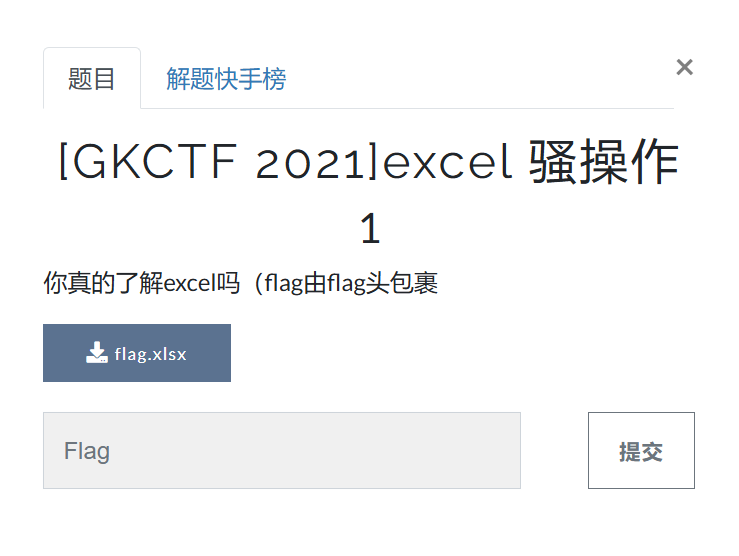
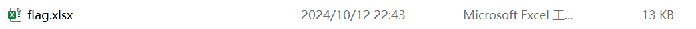
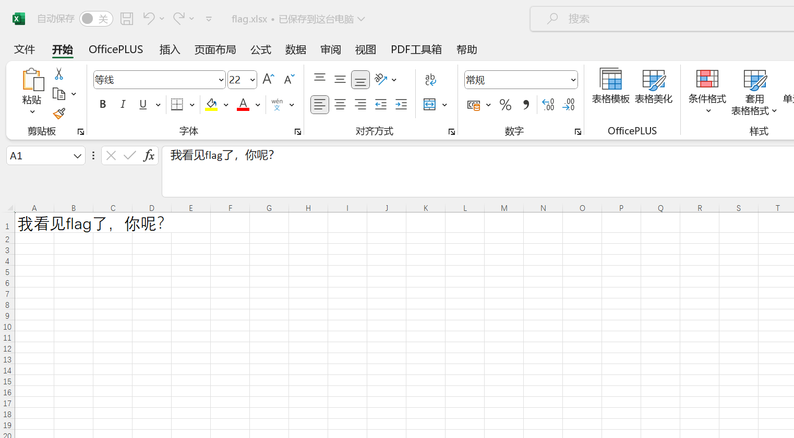
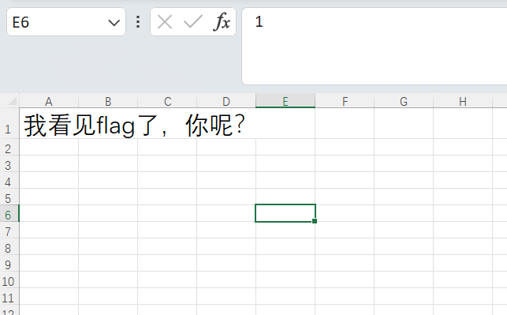
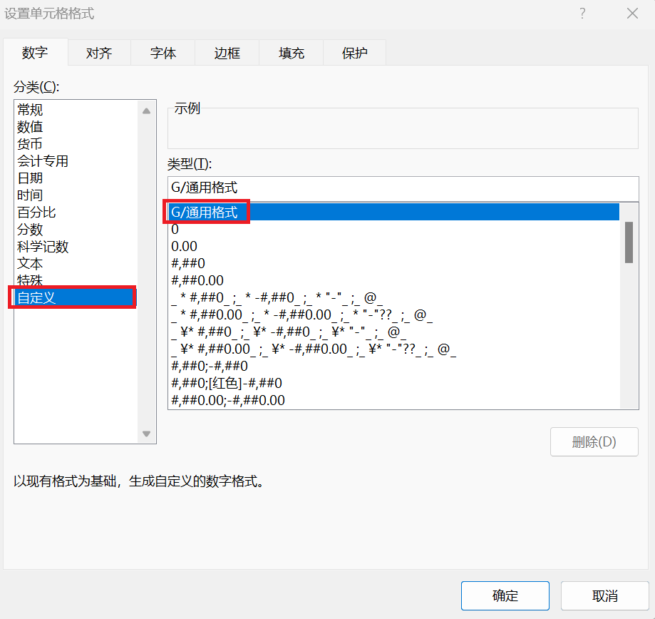
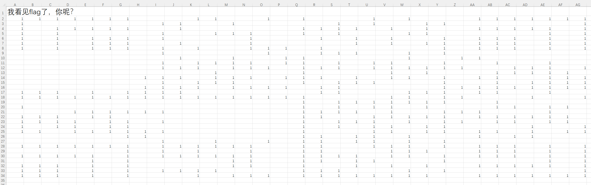
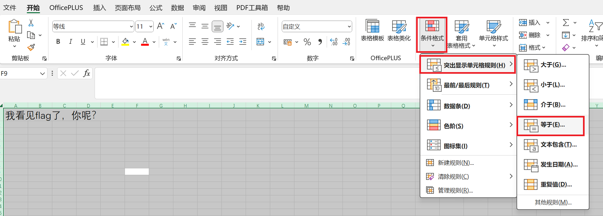
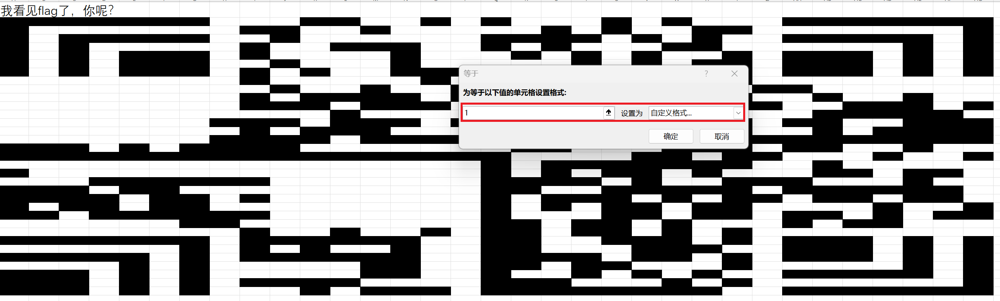
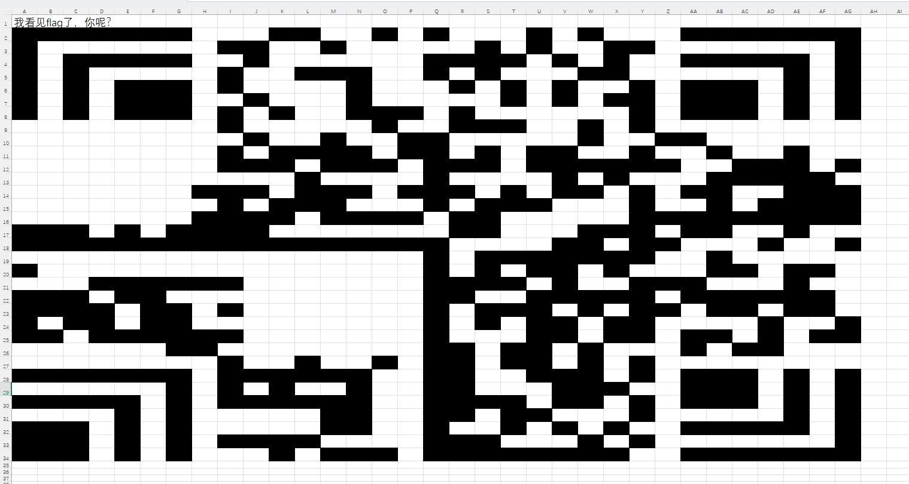
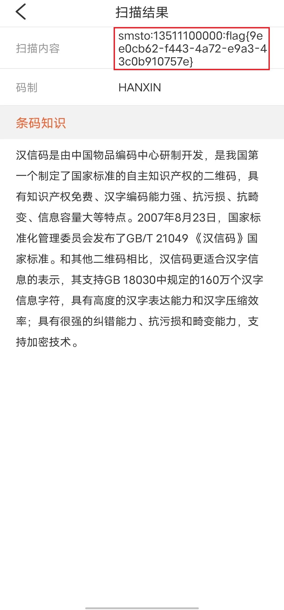

**BUUCTF: [https://buuoj.cn/challenges](https://buuoj.cn/challenges)** 

---

相关阅读

- [CTF Wiki](https://ctf-wiki.org/)
- [2021GKCTF Misc excel骚操作–详解](https://blog.csdn.net/qq_43871179/article/details/118310357)
- [中国编码APP下载](http://appserver.gs1cn.org/ancc2020h/)


 

### 题目描述：

你真的了解excel吗（flag由flag头包裹

### 密文：

下载附件，得到flag.xlsx文件

 

---

### 解题思路：

1、打开文件，hint： `我看见flag了，你呢？` 

 

随便点击几个地方，发现有的单元格有数字 `1` ，而且不是均匀分布的。

 

在这里，可以全选单元格，设置单元格格式中的数字类型为 `G/通用格式` ，就可以直观看到所有含数字 `1` 的单元格。

 

 

再通过单元格 `条件格式` ，将单元格中所有数字等于 `1` 的单元格标黑，看它的图案。

 

 

最后调整单元格行高为27，可以发现这是个“码”。

 

2、这其实是一个叫 **汉信码** 的二维码，需要使用中国编码网的中国编码APP，扫码得到flag。

下载地址： [http://appserver.gs1cn.org/ancc2020h/](http://appserver.gs1cn.org/ancc2020h/) 

 

要想实现文中的隐藏效果，可以采取以下步骤：
1、单元格输入数字
2、单元格格式，数字选择自定义
3、类型中输入；；；

### flag：

```bash
flag{9ee0cb62-f443-4a72-e9a3-43c0b910757e}
```