**BUUCTF: [https://buuoj.cn/challenges](https://buuoj.cn/challenges)** 

---

相关阅读

- [CTF Wiki](https://ctf-wiki.org/)
- [Hello CTF](https://hello-ctf.com/HC_Start/)
- [NewStar CTF](https://ns.openctf.net/learn/)
- [buuctf ［GKCTF 2021］你知道apng吗 ＜apng图片格式的考察＞](https://blog.csdn.net/weixin_45556441/article/details/119801433)
- [buuctf-misc-［GKCTF 2021］你知道apng吗1](https://blog.csdn.net/qq_29977871/article/details/128507643)
- [你知道apng吗](https://blog.csdn.net/wangjin7356/article/details/123402038)


 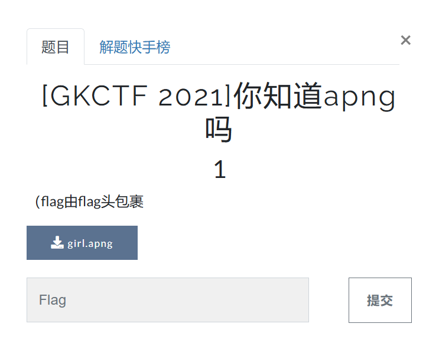

### 题目描述：

（flag由flag头包裹

### 密文：

下载附件，解压得到girl.apng文件。

 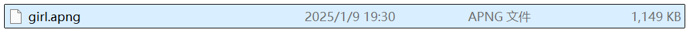

---

### 解题思路：

1、根据题目 `你知道apng吗` ，搜索得到这是一种类似于GIF的动图文件。

[科普（APNG）](https://www.bilibili.com/opus/301546385385594815) 

> APNG：我出身于PNG（便携式网络图形），我的使命就是淘汰GIF。我的全称是Animated Portable Network Graphics，我的本质是PNG的位图动画扩展，但未获PNG组织官方认可。我仍对原版PNG保持向下兼容，我的第1帧为标准PNG图像，剩余的动画和帧速等数据放在PNG扩展数据块，因此只支持原版PNG的软件会正确显示第1帧。Firefox与Chrome浏览器（59版本及以上）均可以直接打开我。

[APNG百度](https://baike.baidu.com/item/APNG/3582613) 

> APNG（Animated Portable Network Graphics）是一个基于PNG（Portable Network Graphics）的位图动画格式，扩展方法类似主要用于网页的GIF 89a，仍对传统PNG保留向下兼容。第1帧是标准的单幅PNG图像，因此只支持原版PNG的软件能正常显示第1帧。剩余的动画帧和帧速数据储存在符合原版PNG标准的扩展数据块里。 APNG与Mozilla社区关系密切，格式标准文档就放在Mozilla网站。

使用Firefox可以打开girl.apng，可以看到有多个二维码一闪而过。

找到一个APNG在线查看工具： [https://ezgif.com/split?err=expired](https://ezgif.com/split?err=expired) ，上传图片后，点击 `Split` ，得到每帧的图片。

 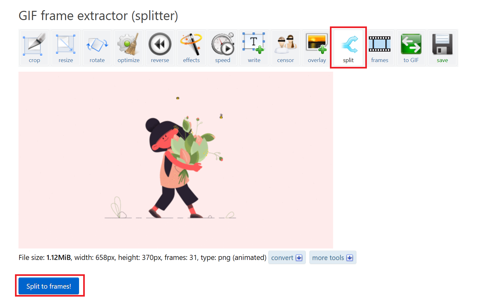

---

`1、` 
 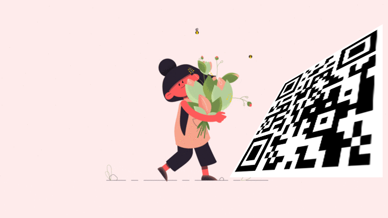

`2、` 
 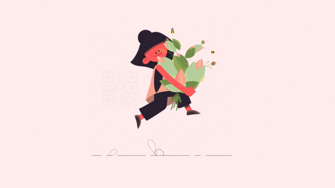

`3、` 
 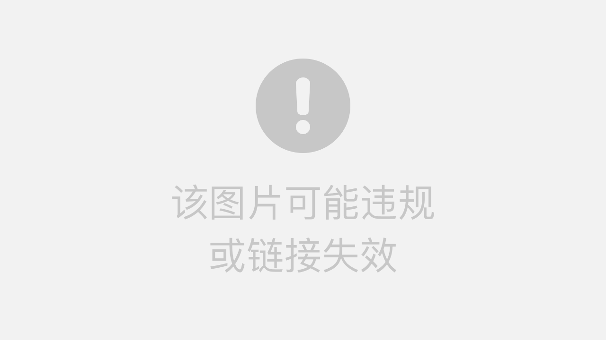

`4、` 
 

---

2、使用PS（或在线PS）处理第一张图片，选择 `编辑` –> `变换` –> `扭曲` ，此时扫码得到四分之一的flag。

 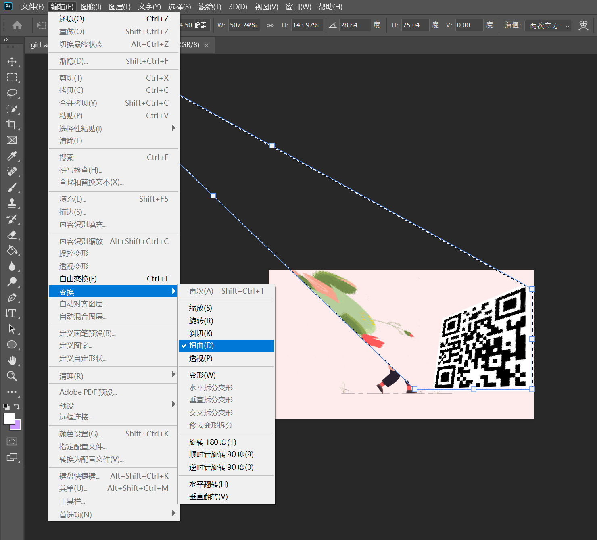

 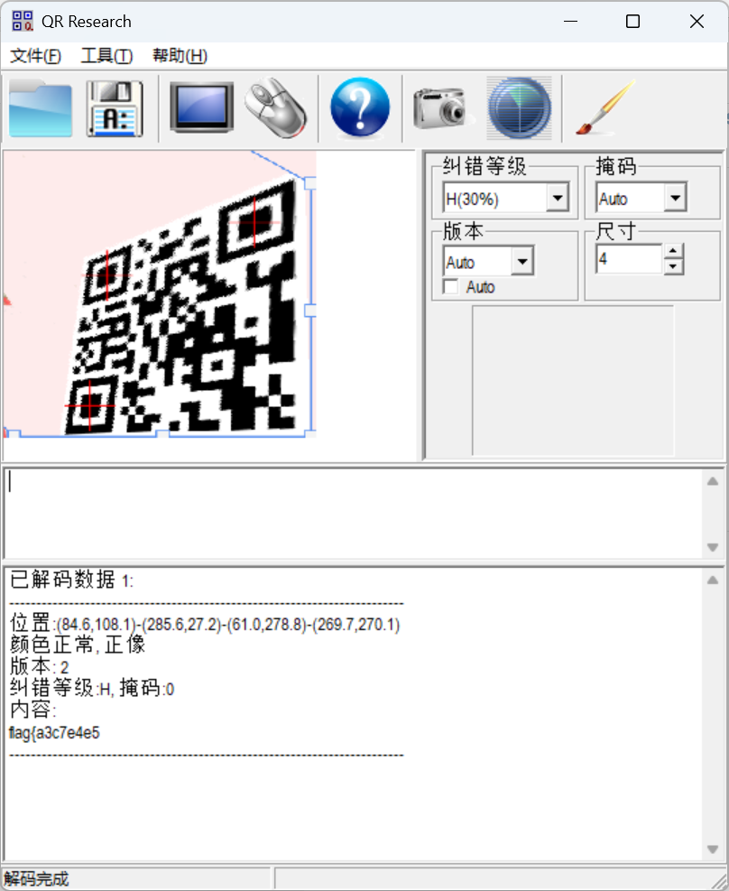

第二张图片使用StegSolve，查看其它的通道，找到可以识别的二维码。

 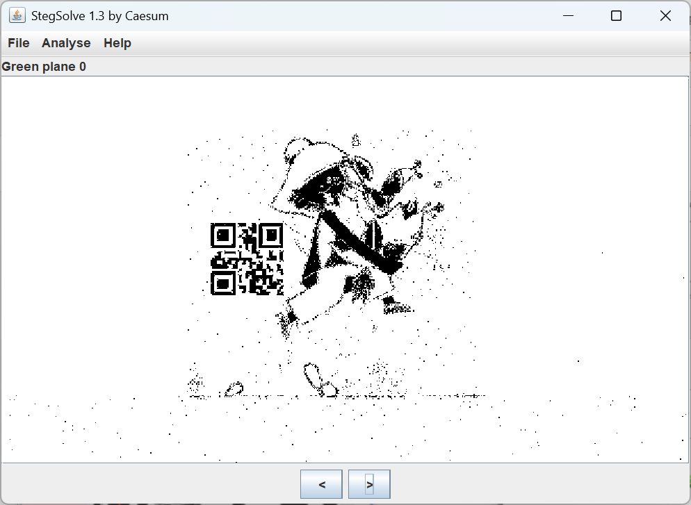

 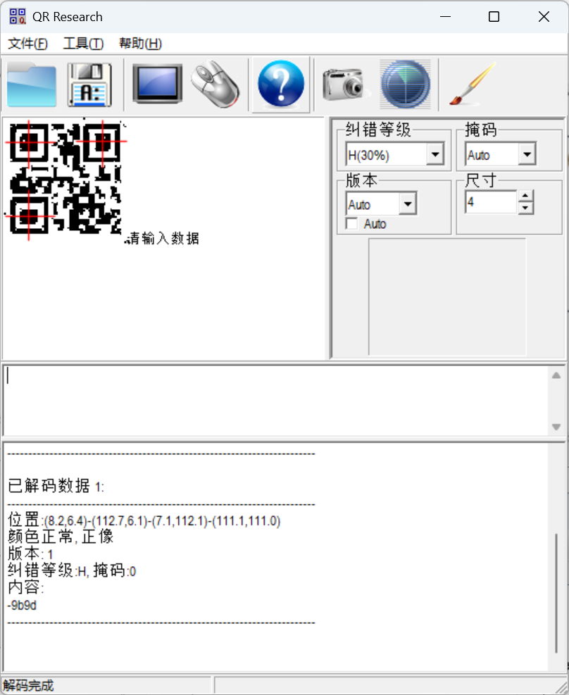

剩下两张可以直接扫码得到四分之一flag，最后得到完整flag。

 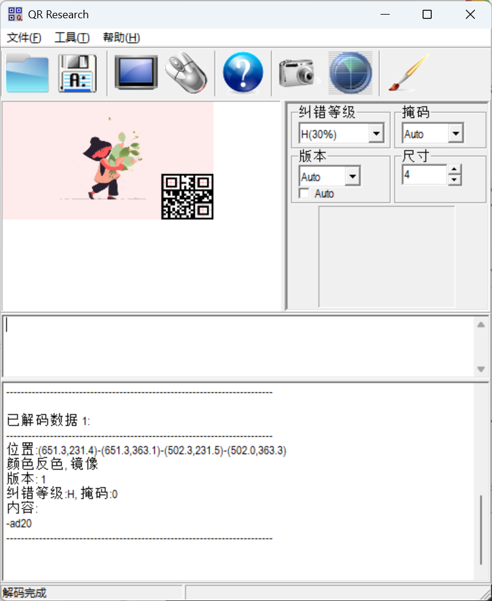

 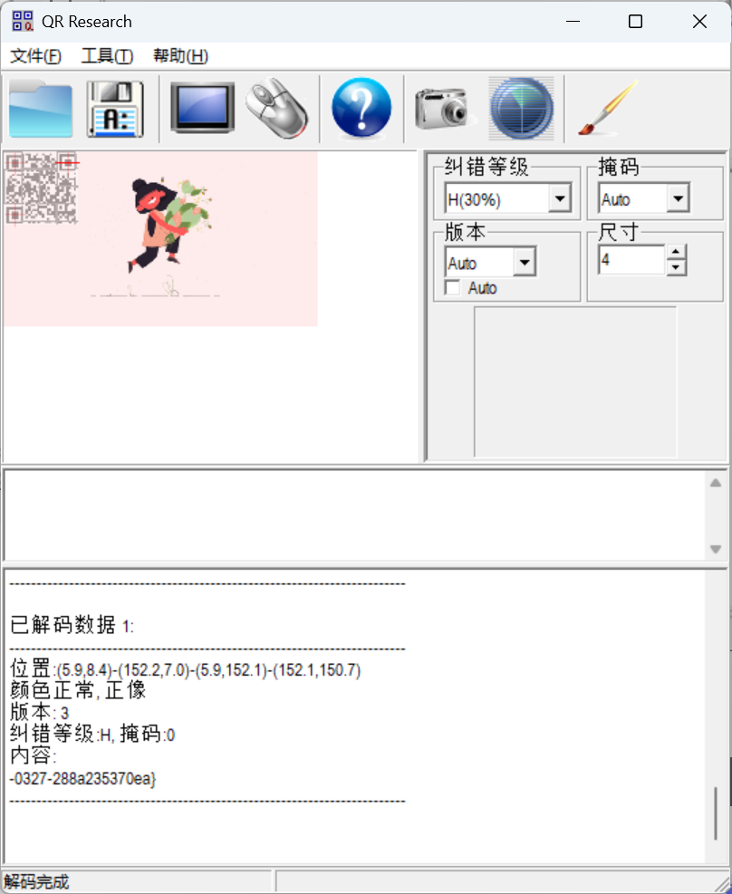

### flag：

```bash
flag{a3c7e4e5-9b9d-ad20-0327-288a235370ea}
```