**BUUCTF: [https://buuoj.cn/challenges](https://buuoj.cn/challenges)** 

---

相关阅读

- [CTF Wiki](https://ctf-wiki.org/)
- [BUUCTF zip伪加密 1](https://blog.csdn.net/YueXuan_521/article/details/134055375)
- [RSA加密原理详解，以及RSA中的数论基础](https://blog.csdn.net/Demonslzh/article/details/130738368)
- [BUUCTF：［GUET-CTF2019］虚假的压缩包](https://blog.csdn.net/mochu7777777/article/details/105367979#:~:text=%5BGUET-)
- [BUUCTF:［GUET-CTF2019］虚假的压缩包](https://www.cnblogs.com/vuclw/p/15848284.html#:~:text=%E5%85%B6%E4%B8%AD%E7%9C%9F%E5%AE%9E%E7%9A%84%E5%8E%8B)
- [Misc | 相当于签到 第二届“奇安信”杯网络安全技能竞赛](https://blog.csdn.net/YueXuan_521/article/details/134352467?spm=1001.2014.3001.5502)


 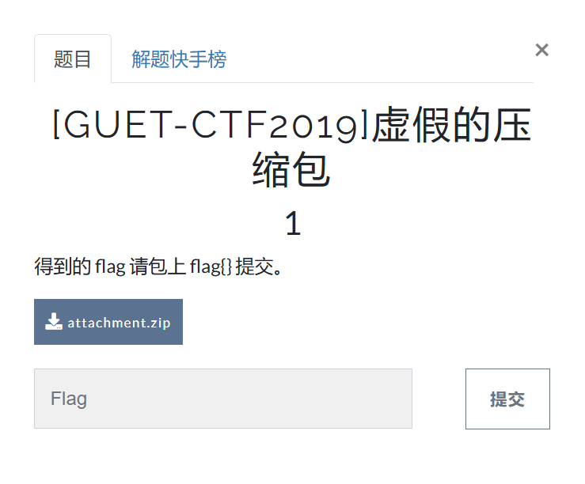

### 题目描述：

得到的 flag 请包上 flag{} 提交。

### 密文：

下载附件解压，得到两个压缩包：虚假的压缩包.zip和真实的压缩包.zip

 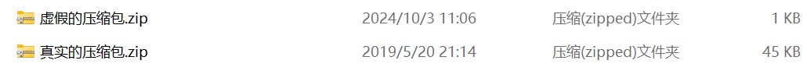

---

### 解题思路：

1、先处理虚假的压缩包.zip，因为真实的压缩包.zip需要密码。虚假的压缩包.zip使用了伪加密，搜索 `50 4B 01 02` ，将文件头的第9位和第10位改为0。

 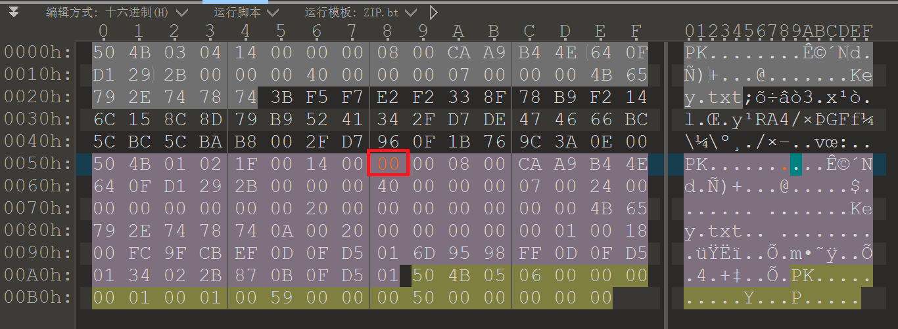

解压得到Key.txt文件，内容如下：

 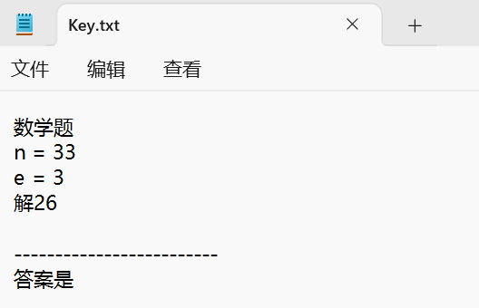

2、猜测为RSA加密，解密脚本如下：

```python
import gmpy2
"""
gmpy2.mpz(n)#初始化一个大整数
gmpy2.mpfr(x)# 初始化一个高精度浮点数x
d = gmpy2.invert(e,n) # 求逆元，de = 1 mod n
C = gmpy2.powmod(M,e,n)# 幂取模，结果是 C = (M^e) mod n
gmpy2.is_prime(n) #素性检测
gmpy2.gcd(a,b)  #欧几里得算法，最大公约数
gmpy2.gcdext(a,b)  #扩展欧几里得算法
gmpy2.iroot(x,n) #x开n次根
"""
p = gmpy2.mpz(3)
q = gmpy2.mpz(11)
e = gmpy2.mpz(3)
l = (p-1) * (q-1)
d = gmpy2.invert(e,l)
c = gmpy2.mpz(26)
n = p * q
ans = pow(c,d,n)
print(ans)

来源:https://blog.csdn.net/qq_24033605/article/details/117158714
```

运行脚本，得到答案是 `5` 。

 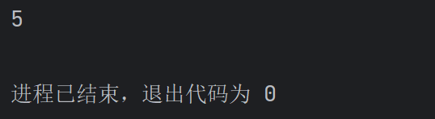

3、解压真实的压缩包.zip，得到一张没卵用且会浪费你时间的图片.jpg和亦真亦假。

解压密码： `答案是5` 

 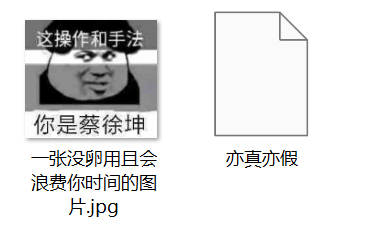

使用TweakPNG打开jpg图片，发现提示jpg图片CRC不对，应该是被修改宽高啦。（另外该图片应为png文件，png文件头89 50 4E 47）

 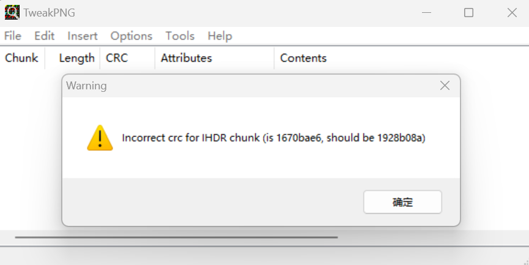

 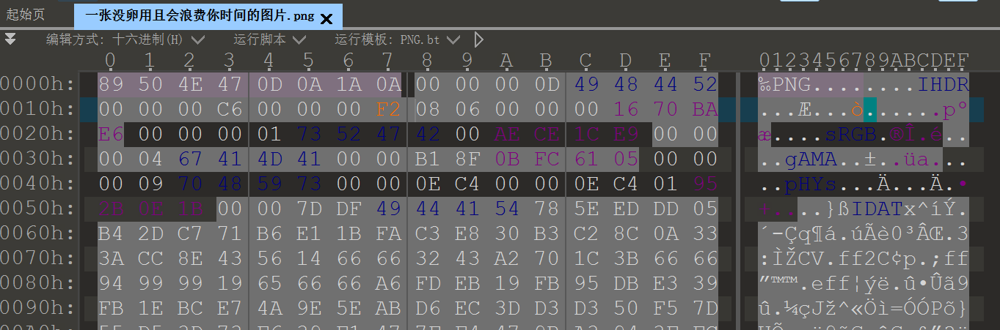

使用如下脚本，计算原文件宽高。

```python
import os
import binascii
import struct

crcbp = open("1.png", "rb").read()    #打开图片!!!
for i in range(2000):
    for j in range(2000):
        data = crcbp[12:16] + \
            struct.pack('>i', i)+struct.pack('>i', j)+crcbp[24:29]
        crc32 = binascii.crc32(data) & 0xffffffff
        if(crc32 == 0x1670BAE6):    #修改为图片当前CRC!!!
            print(i, j)
            print('hex:', hex(i), hex(j))
```

得到图片的高应为 `242` ， `0xF2` 。

 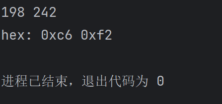

修改图片高度如下

 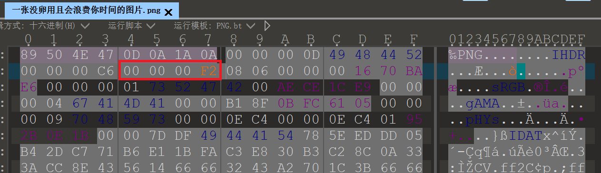

得到图片
 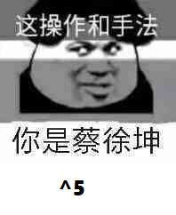

4、根据上面图片的提示，我们将亦真亦假文件的数据 `异或5` ，python脚本如下：

```python
import binascii

# 打开文件进行读取
with open('file', 'r') as f1:
    data = f1.read()

# 初始化变量存储解密后的数据
flag_data = ""

# 对每个字符进行异或操作
for i in data:
    tmp = int(i, 16) ^ 5
    flag_data += hex(tmp)[2:]

# 将解密后的数据写入新文件
with open('./flag.doc', 'wb') as f2:
    # 使用 binascii.unhexlify 替代 decode('hex')
    f2.write(binascii.unhexlify(flag_data))

print("Decryption complete.")
```

得到flag.doc文件，打开没有发现flag，全选改变字体颜色，得到flag。（word隐藏文字）

 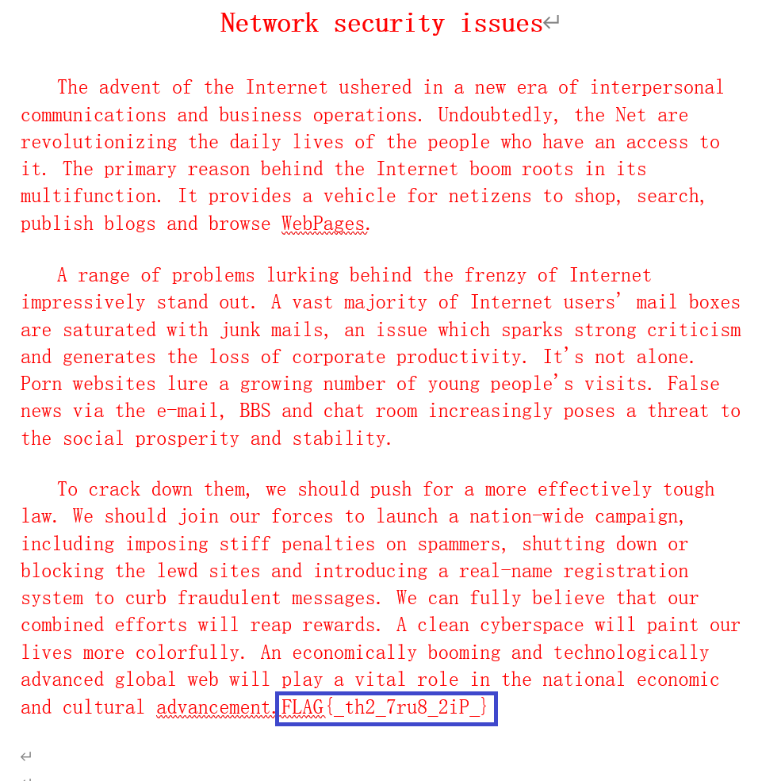

### flag：

```bash
FLAG{_th2_7ru8_2iP_}   
flag{_th2_7ru8_2iP_}   
```