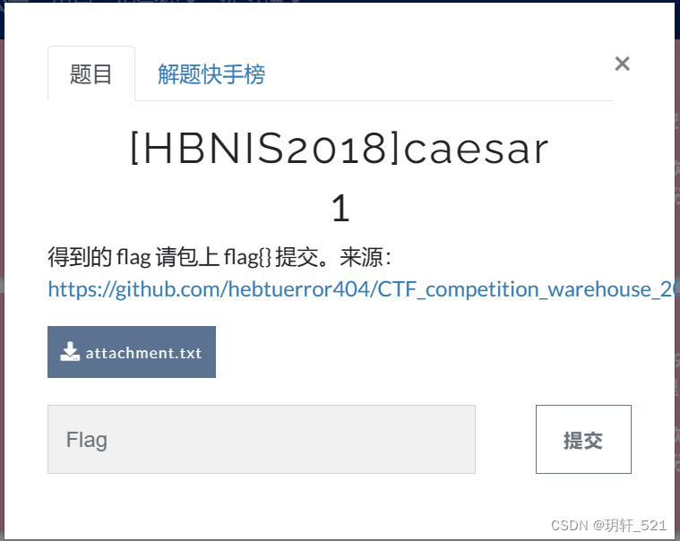
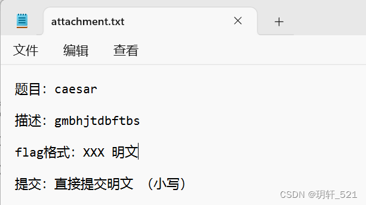
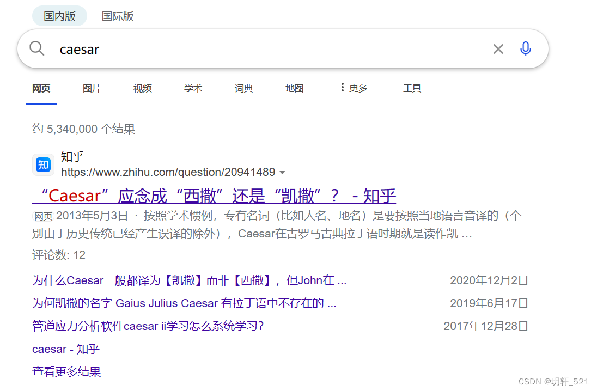
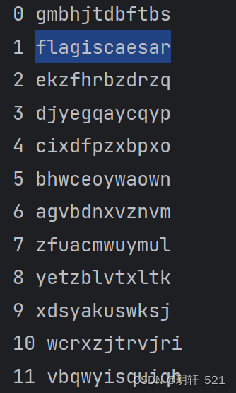

**BUUCTF: [https://buuoj.cn/challenges](https://buuoj.cn/challenges)** 

---

相关阅读

- [CTF Wiki](https://ctf-wiki.org/)


 

### 题目描述：

得到的 flag 请包上 flag{} 提交。来源： [https://github.com/hebtuerror404/CTF_competition_warehouse_2018](https://github.com/hebtuerror404/CTF_competition_warehouse_2018) 

### 密文：

下载附件，得到一个.txt文件。

 

---

### 解题思路：

1、用浏览器搜索“caesar”，发现是“凯撒”的意思，再看题目描述，感觉是凯撒加密。

 

2、使用Python脚本或者工具，对题目描述进行解密，下面提供一个Python脚本。

```bash
描述：gmbhjtdbftbs
```

```python
def decrypt(ciphertext, shift):
    """移位解密函数"""
    plaintext = ''
    for char in ciphertext:
        if char.isalpha(): # 如果是字母，进行移位解密
            if char.isupper():
                plaintext += chr((ord(char) - shift - 65) % 26 + 65) # 大写字母移位解密
            else:
                plaintext += chr((ord(char) - shift - 97) % 26 + 97) # 小写字母移位解密
        else: # 如果不是字母，直接输出
            plaintext += char
    return plaintext

# 加密密文和移位数
ciphertext = 'gmbhjtdbftbs'
shift = 3
ciphertext = ciphertext.lower()
# 小写易于观察
# 枚举所有可能的移位数，输出所有解密结果
for i in range(26):
    plaintext = decrypt(ciphertext, i)
    print("%d %s"% (i, plaintext))
```

运行脚本，找到有意义的文本，就是flag值。

 

### flag：

```bash
flag{flagiscaesar}
```