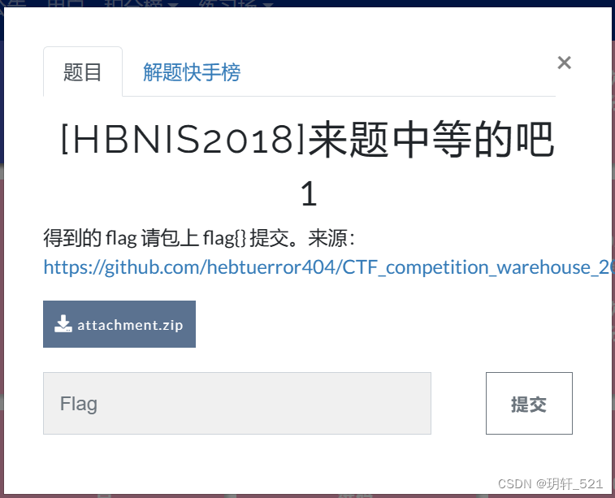
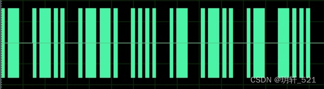
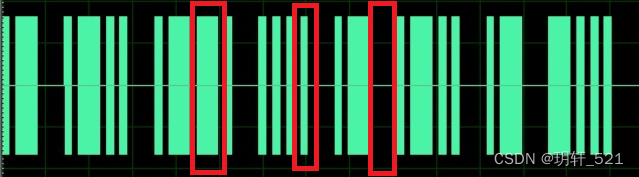
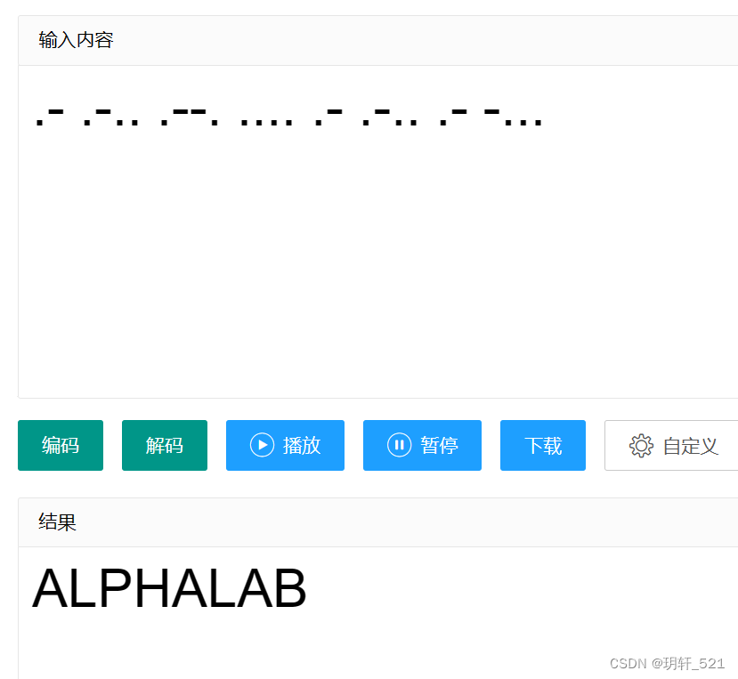
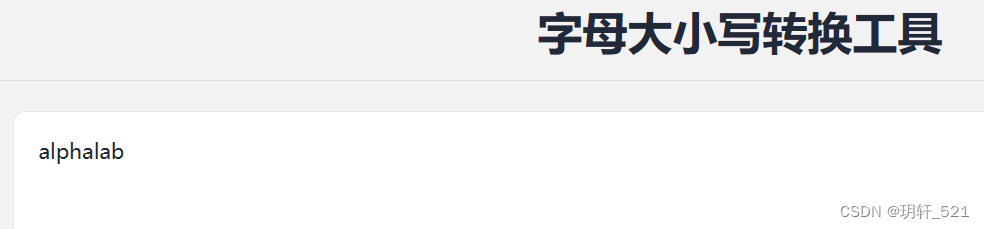

**BUUCTF: [https://buuoj.cn/challenges](https://buuoj.cn/challenges)** 

---

相关阅读

- [CTF Wiki](https://ctf-wiki.org/)


 

### 题目描述：

得到的 flag 请包上 flag{} 提交。来源： [https://github.com/hebtuerror404/CTF_competition_warehouse_2018](https://github.com/hebtuerror404/CTF_competition_warehouse_2018) 

### 密文：

下载附件，解压得到一个.png图片。



---

### 解题思路：

我以为这道题不会那么简单的，所以一直再找额外的提示信息。然而，尝试提交flag后，居然就是这么简单，跟题目完全不相符。

1、这个图片类似一段音频，有很多分组，分组内由粗的音块和细的音块组成，类似莫尔斯电码的“-”和“.”。
举例如下图。按照这样的对应将音轨上的分组全部转译为莫尔斯电码，转换为“.- .-… .–. … .- .-… .- -…”。



```bash
第一个红框代表“-”，第二个红框代表“.”，第三个红框代表“ ”（空格）。
.- .-.. .--. .... .- .-.. .- -...
```

2、使用在线网站，将莫尔斯电码转换为明文字符，转换为小写字母得到flag值。
[在线摩斯密码翻译器](https://rumkin.com/tools/cipher/morse-code/) 
[字母大小写转换工具
](https://charactercalculator.com/zh-cn/case-converter/) 

 

 

### flag：

```bash
flag{alphalab}
```