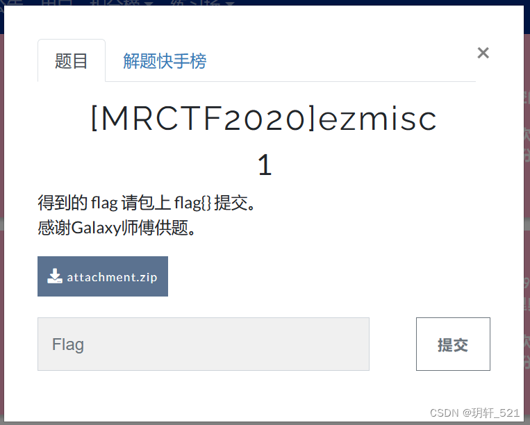
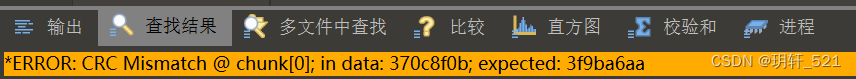
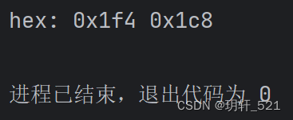
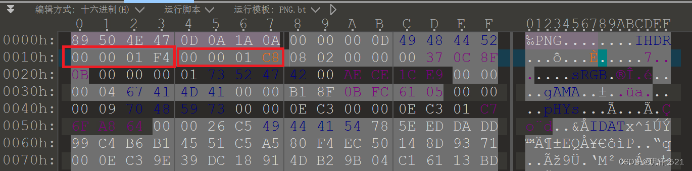
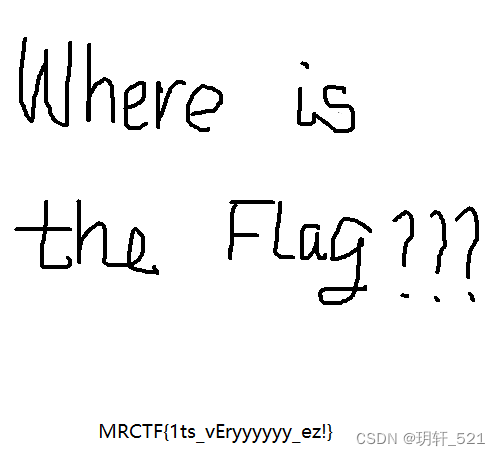

**BUUCTF: [https://buuoj.cn/challenges](https://buuoj.cn/challenges)** 

---

相关阅读

- [CTF Wiki](https://ctf-wiki.org/)


 

### 题目描述：

得到的 flag 请包上 flag{} 提交。
感谢Galaxy师傅供题。

### 密文：

下载附件，解压得到.png图片。


从这里也可以看出图片经过修改，无法正常显示。

---

### 解题思路：

1、在010Editor中打开，提示CRC校验错误，认为图片被修改了宽高，不符合CRC校验。

 

通过爆破宽高，得到正确的宽高，然后修改图片的宽高数据，得到正确的图片。爆破所用代码如下。

```python
import os
import binascii
import struct

crcbp = open("repair.png", "rb").read()    #打开图片（修改图片路径）
for i in range(2000):
    for j in range(2000):
        data = crcbp[12:16] + \
            struct.pack('>i', i)+struct.pack('>i', j)+crcbp[24:29]
        crc32 = binascii.crc32(data) & 0xffffffff
        if(crc32 == 0x9BF1293B):    #图片当前CRC（修改CRC）
            print(i, j)
            print('hex:', hex(i), hex(j))
```

得到正确的宽高值。

 

2、修改图片中的宽高参数，然后保存图片查看。



查看图片，得到flag。



### flag：

```bash
flag{1ts_vEryyyyyy_ez!}
```