**BUUCTF: [https://buuoj.cn/challenges](https://buuoj.cn/challenges)** 

---

相关阅读

- [CTF Wiki](https://ctf-wiki.org/)


 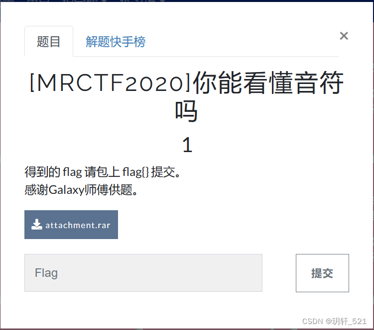

### 题目描述：

得到的 flag 请包上 flag{} 提交。
感谢Galaxy师傅供题。

### 密文：

下载附件，得到一个rar压缩包。

 

---

### 解题思路：

1、尝试解压rar压缩包，出现错误无法解压。

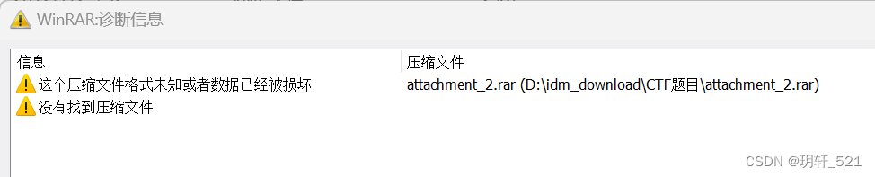

使用010Editor打开rar压缩包，发现该文件的rar文件头格式错误，修改为“52 61 72 21”，也可以使用WinHex修改。
（RARArchive(rar)， 文件头：52 61 72 21）

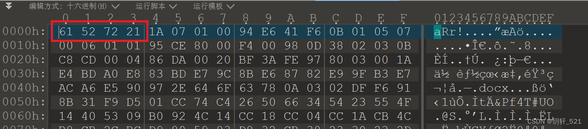

修改为

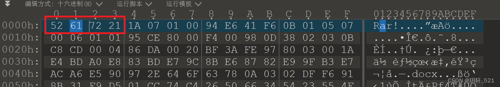

保存文件，再次解压得到.docx文件。

 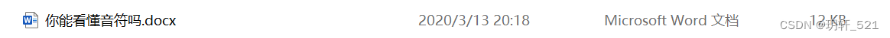

2、查看.docx文件，内容如下。

 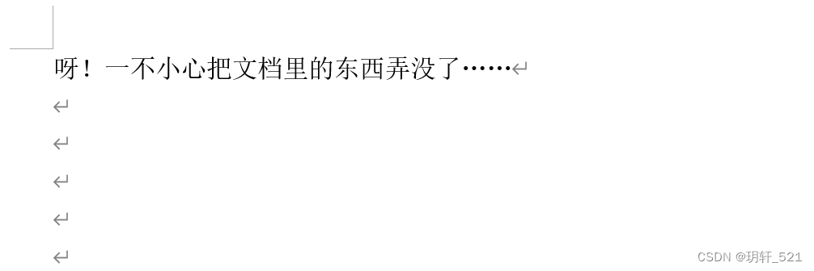

使用010 Editor打开.docx文件，发现存在PK文件的文件头，确认为zip文件。
（ZIP Archive (zip)，文件头：50 4B 03 04）

 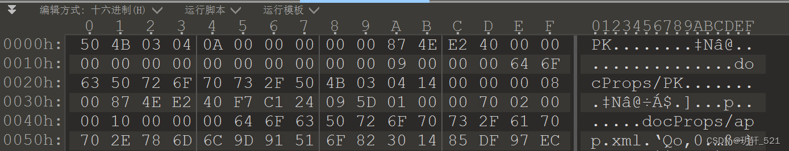

将文件另存为zip文件或修改后缀为.zip，解压成功。得到的文件如下图：

 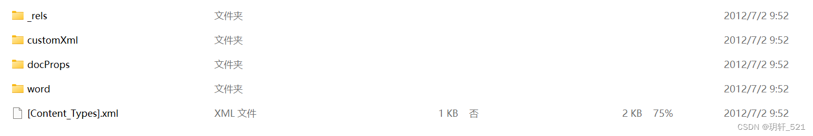

3、选择word文件夹的docunment.xml文件，右键在浏览器打开，找到与题目相符合的音符。

 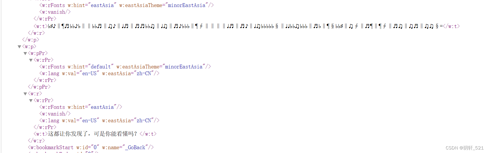

复制下来，使用在线工具将音符转换为明文，得到flag。
[文本加密为音乐符号](https://www.qqxiuzi.cn/bianma/wenbenjiami.php?s=yinyue) 

 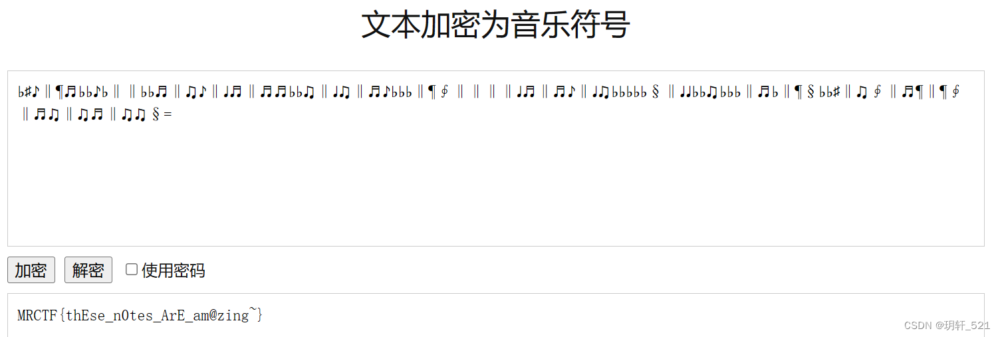

---

另一种方法，可以查看到word中的隐藏文字。

选择文件

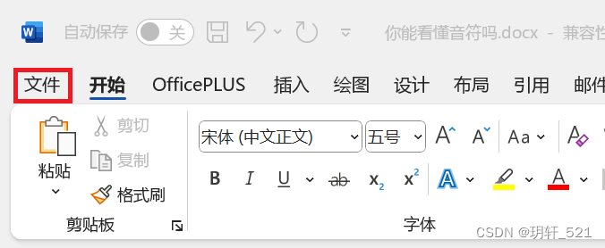

选择选项

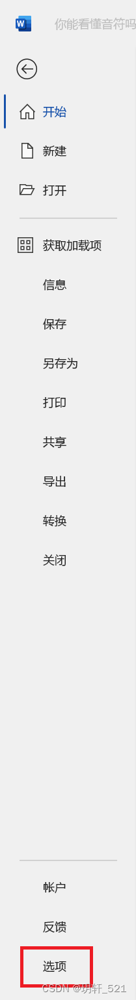

选择显示，勾选“隐藏文字”，文档中就显示出了音符。

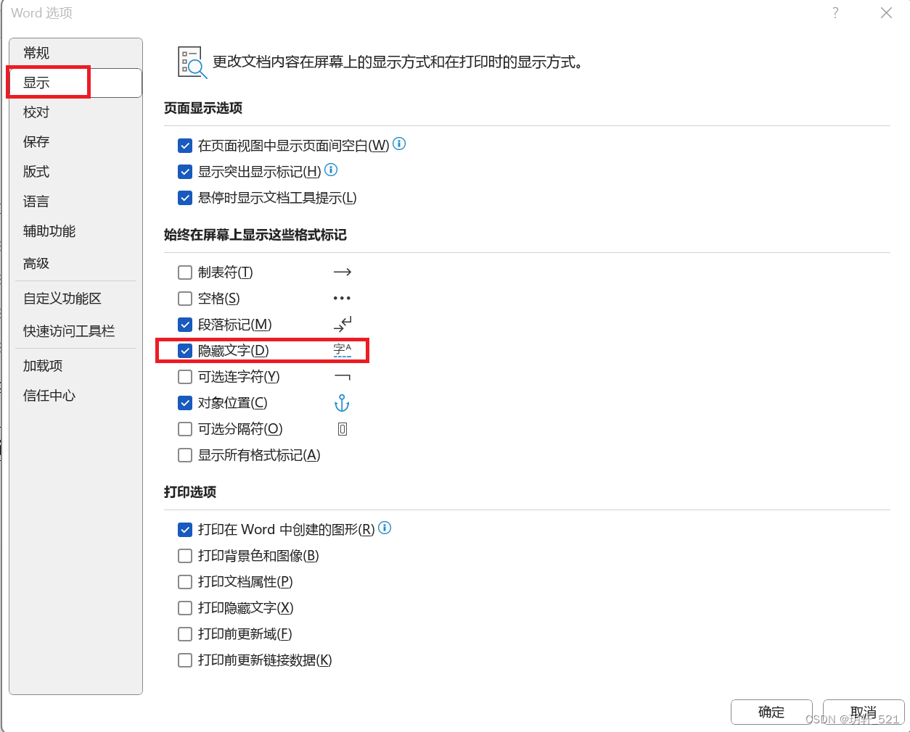

 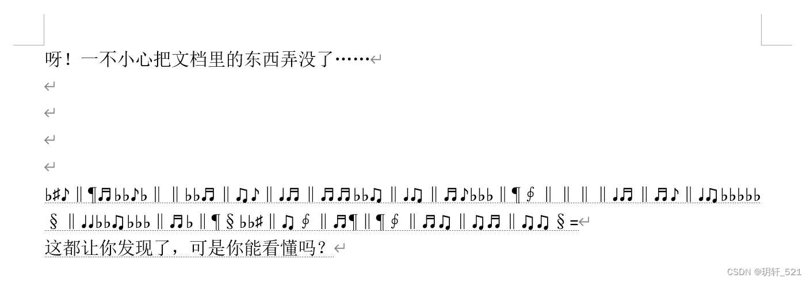

如果有的同学复制出现问题，可以尝试将全部文字选中，右键选择字体，把“隐藏”选项取消选中，就可以复制下啦。

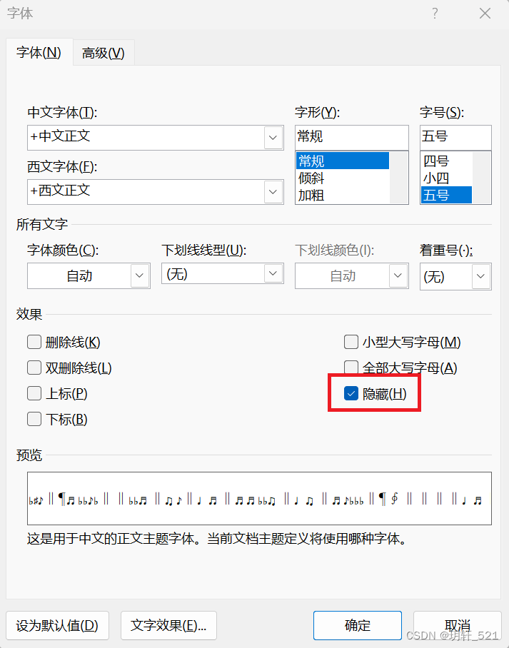

### flag：

```bash
flag{thEse_n0tes_ArE_am@zing~}
```