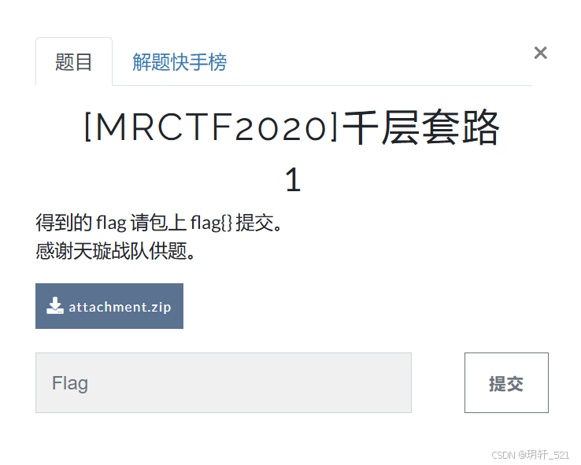
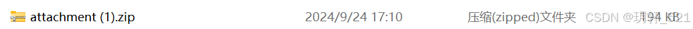
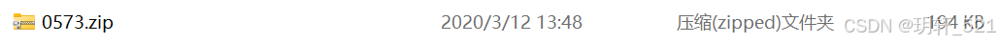
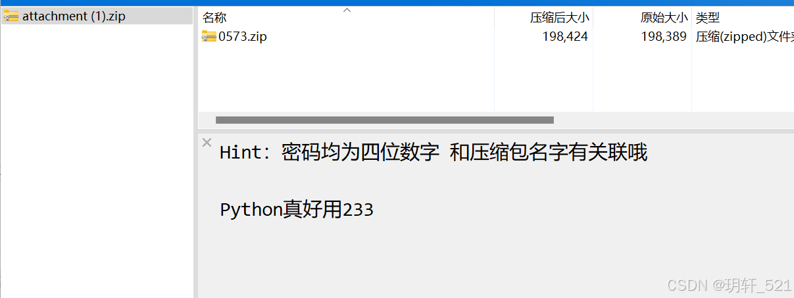
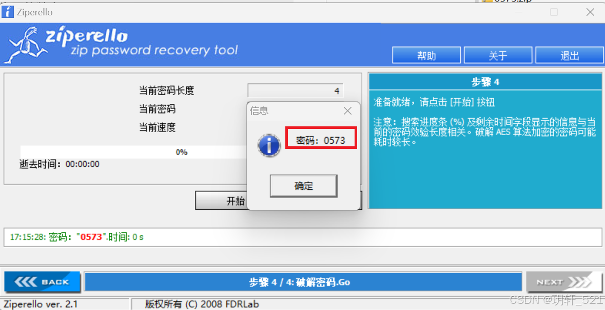
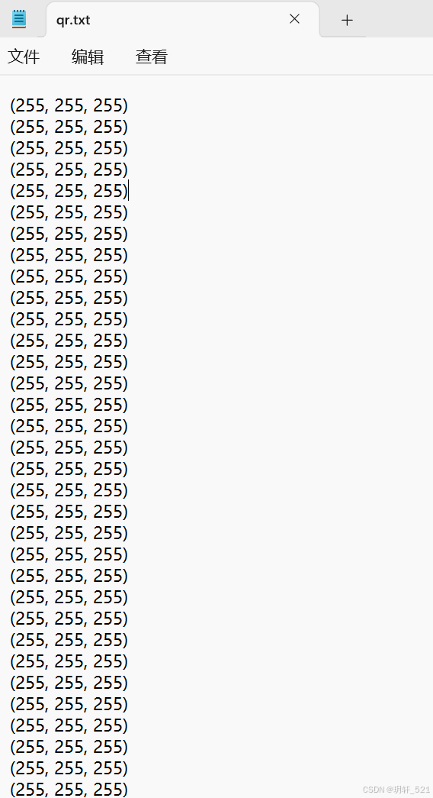
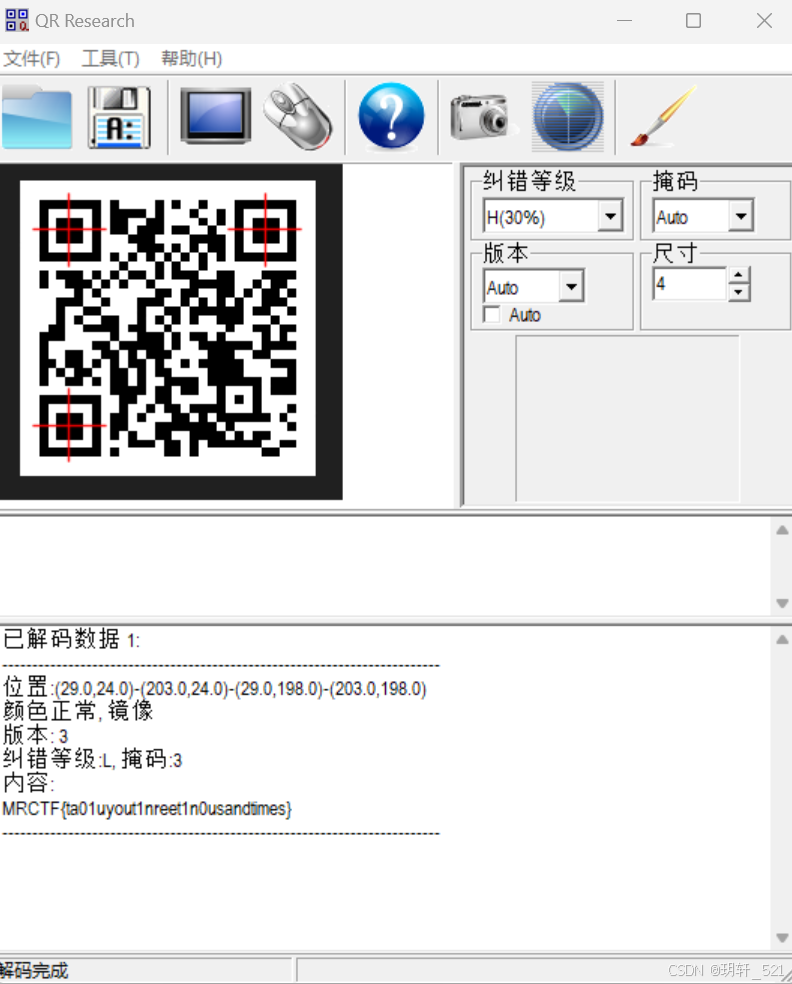

**BUUCTF: [https://buuoj.cn/challenges](https://buuoj.cn/challenges)** 

---

相关阅读

- [CTF Wiki](https://ctf-wiki.org/)
- [Hello CTF](https://hello-ctf.com/HC_Start/)
- [NewStar CTF](https://ns.openctf.net/learn/)


 

### 题目描述：

得到的 flag 请包上 flag{} 提交。
感谢天璇战队供题。

### 密文：

下载附件，得到attachment.zip文件

 

---

### 解题思路：

1、解压attachment.zip文件，得到0573.zip文件，向下解压需要密码。

 

用Bandizip打开attachment.zip文件，看到压缩包备注，密码均为四位数字

 

我开始使用Ziperello爆破0573.zip，得到密码0573。

 

使用密码向下解压压缩包，得到0114.zip。至此，我明白每个压缩包的解压密码就是它的文件名，并且向下可能有1000层压缩。（从题目千层套路推测出）

2、编写python脚本，进行自动解压（使用该脚本你可能需要删掉一批解压出的文件，再继续解压）

```python
# @Author：YueXuan
# @Date  ：2024/9/24 17:19

import zipfile
import os

def extract_zip_with_filename_as_password(zip_path):
    # 检查文件是否存在
    if not os.path.exists(zip_path):
        print(f"File {zip_path} does not exist.")
        return

    # 获取ZIP文件名（不包含路径）
    zip_filename = os.path.basename(zip_path)

    # 获取不带扩展名的文件名
    base_name = os.path.splitext(zip_filename)[0]

    # 尝试使用文件名作为密码解压ZIP文件
    try:
        with zipfile.ZipFile(zip_path, 'r') as zip_ref:
            zip_ref.extractall(pwd=base_name.encode())
            print(f"Successfully extracted {zip_path} with password: {base_name}")

            # 检查解压后的文件是否还是ZIP文件
            for file in zip_ref.namelist():
                new_zip_path = os.path.join(os.getcwd(), file)
                if zipfile.is_zipfile(new_zip_path):
                    # 如果是ZIP文件，则递归调用函数继续解压
                    extract_zip_with_filename_as_password(new_zip_path)
                else:
                    print(f"Extracted file {file} is not a ZIP file.")

    except RuntimeError as e:
        print(f"Failed to extract {zip_path}: {e}")

# 使用示例
# 假设你的ZIP文件位于当前目录下，名称为0573.zip
zip_path = "0573.zip"
extract_zip_with_filename_as_password(zip_path)
```

最后得到qr.txt文件，打开如下所示

 

3、猜测为一系列的RGB颜色值，比如 (255, 255, 255)，这表示白色。编写脚本，绘制出这些数据所要表现的图像。脚本如下：

```python
# @Author：YueXuan
# @Date  ：2024/9/24 17:29
from PIL import Image

def parse_rgb(rgb_str):
    # 去除括号并将字符串分割为列表
    rgb_values = [int(value.strip()) for value in rgb_str.strip().replace('(', '').replace(')', '').split(',')]
    return tuple(rgb_values)

def create_image_from_txt(file_path, output_path):
    # 打开文件并读取所有行
    with open(file_path, 'r') as file:
        lines = file.readlines()

    # 解析每一行的RGB值
    pixels = [parse_rgb(line) for line in lines]

    # 计算图像的宽度和高度
    width = int(len(pixels) ** 0.5)
    height = width

    # 创建一个新图像
    image = Image.new('RGB', (width, height))

    # 将像素放入图像中
    for row in range(height):
        for col in range(width):
            index = row * width + col
            if index < len(pixels):
                image.putpixel((col, row), pixels[index])

    # 保存图像
    image.save(output_path)
    print(f"Image saved to {output_path}")

if __name__ == "__main__":
    input_file = "qr.txt"
    output_file = "output_image.png"
    create_image_from_txt(input_file, output_file)
```

得到一个二维码图像，使用QR Research扫码，得到flag

 

 

### flag：

```bash
flag{ta01uyout1nreet1n0usandtimes}
```