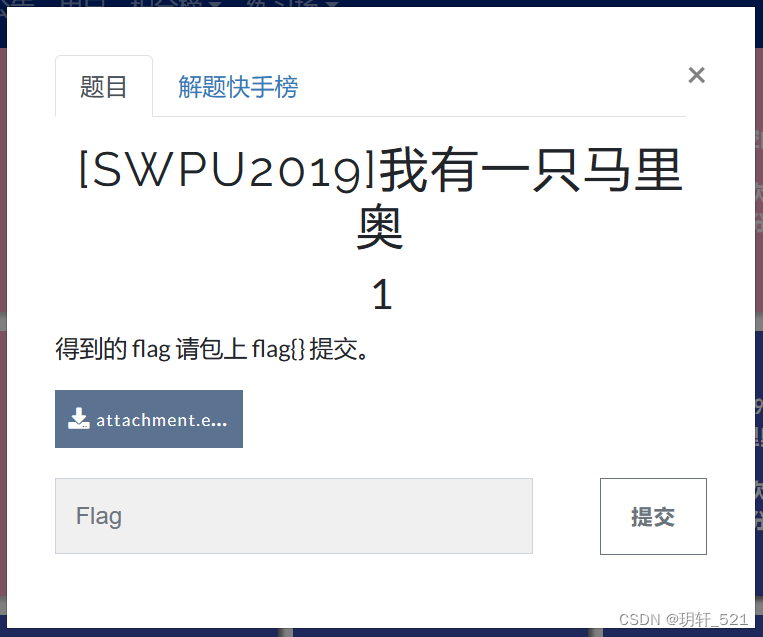
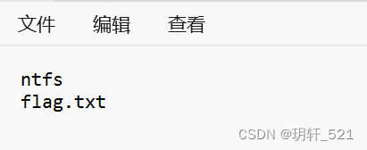
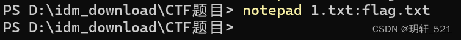
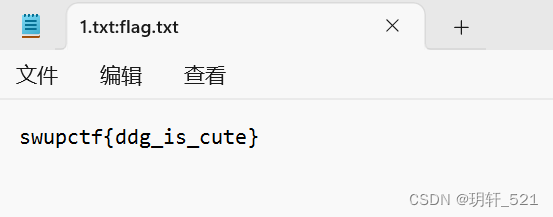
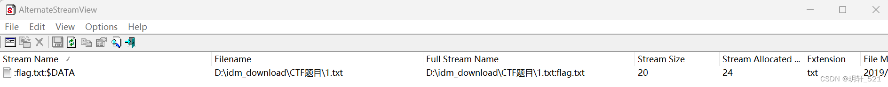
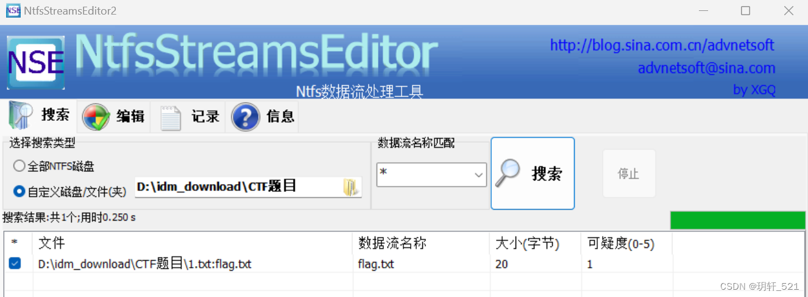
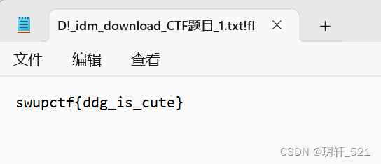

**BUUCTF: [https://buuoj.cn/challenges](https://buuoj.cn/challenges)** 

---

相关阅读

- [CTF Wiki](https://ctf-wiki.org/)


 

### 题目描述：

得到的 flag 请包上 flag{} 提交。

### 密文：

下载附件，得到一个.exe文件。
 

---

### 解题思路：

1、双击.exe文件运行，得到一个1.txt文本。打开，如下图。

 

2、提示我们这是一个NTFS交换数据流的宿主文件，内部可能隐藏一个flag.txt文件。有两个方法可以得到flag.txt文件的内容。
[NTFS 交换数据流 实现隐藏文件](https://zhuanlan.zhihu.com/p/654643812) 

方法一：
在1.txt文件所在的文件夹，右键选择“在终端中打开”，打开命令行输入以下命令，回车打开flag.txt文件。

```bash
notepad 1.txt:flag.txt
```





方法二：
使用工具NtfsStreamsEditor或AlternateStreamView打开存放1.txt文件的文件夹，扫描出现隐藏文件文件，导出后打开，得到flag。

[AlternateStreamView(跳转页面后，向下滑动，下载对应的32或64位软件)](https://www.nirsoft.net/utils/alternate_data_streams.html) 

 

[NtfsStreamsEditor下载](http://soft.onlinedown.net/soft/47981.htm) 

 

 

### flag：

```bash
flag{ddg_is_cute}
```