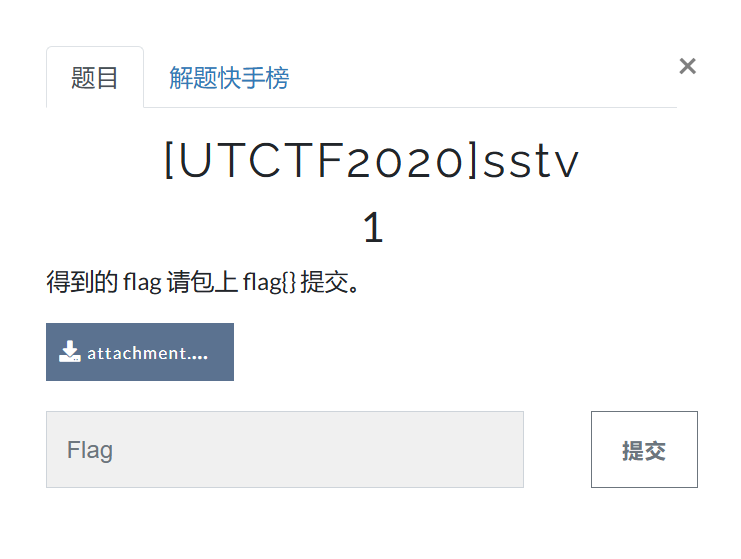
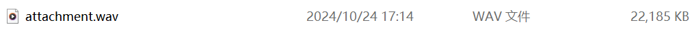
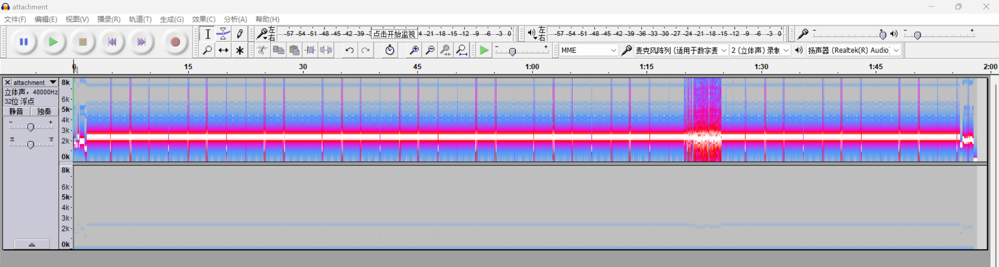
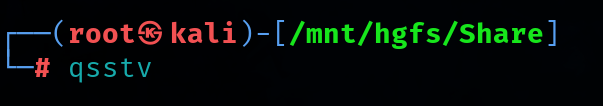
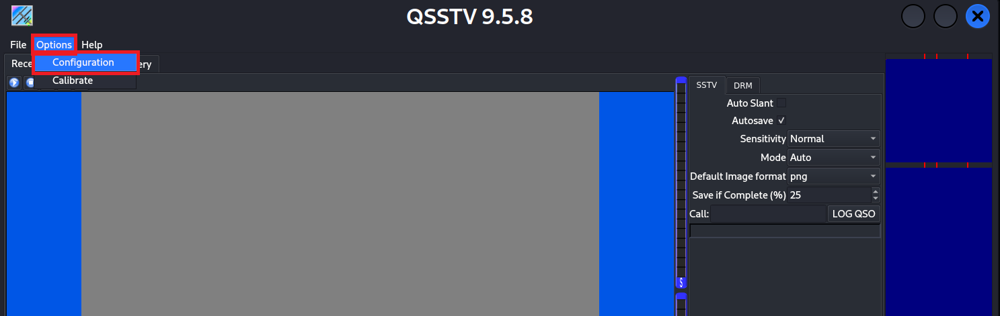
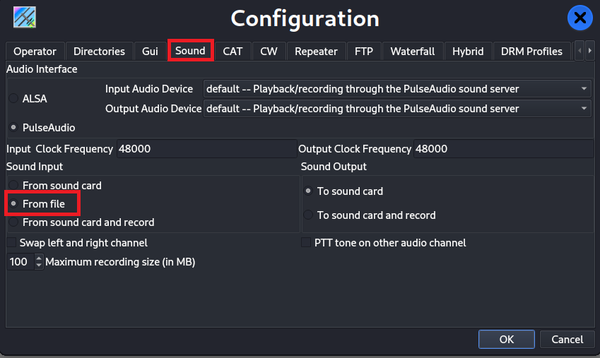
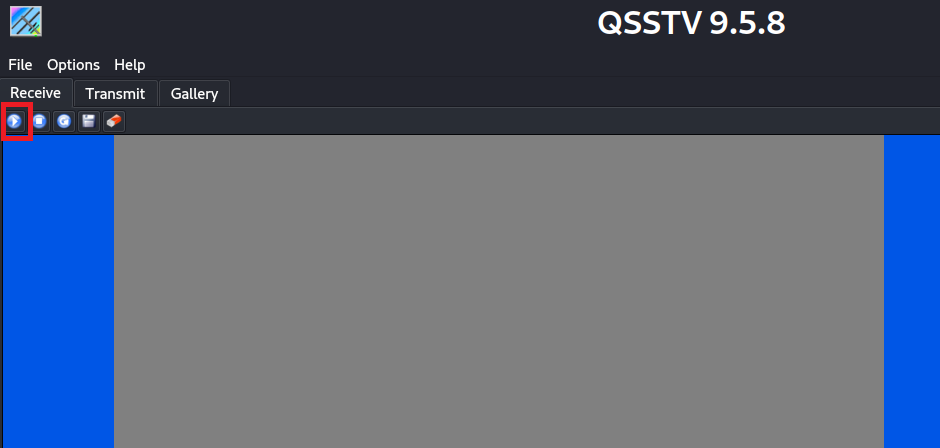
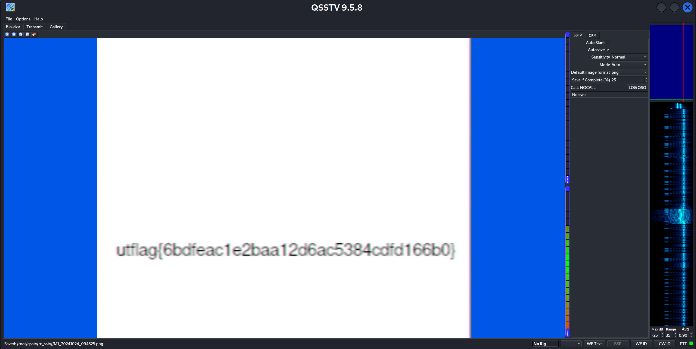

**BUUCTF: [https://buuoj.cn/challenges](https://buuoj.cn/challenges)** 

---

相关阅读

- [CTF Wiki](https://ctf-wiki.org/)


 

### 题目描述：

得到的 flag 请包上 flag{} 提交。

### 密文：

下载附件，得到attachment.wav文件。

 

---

### 解题思路：

1、Audacity打开看了一下，结合题目“ `sstv` ”，推测 **慢扫描电视** 技术。

 

> **慢扫描电视（Slow-scan television）** 是业余无线电爱好者的一种主要图片传输方法，慢扫描电视通过无线电传输和接收单色或彩色静态图片。
> 慢扫描电视的一个术语名称是窄带电视。广播电视需要6MHz的带宽，因为帧速为25到30fps。慢扫描电视的带宽只有3kHz，因此慢扫描电视是一种慢得多的静态图像传输方法，通常每帧需要持续8秒或若干分钟。
> 业余无线电操作员通常在短波（或高频）、甚高频、超高频波段使用慢扫描电视。

2、在Kali中安装SSTV解码软件 `QSSTV` 

```shell
apt-get install qsstv
```

输入 `qsstv` ，运行QSSTV

 

`Options -> Configuration` ，在 `Sound` 勾选 `From file` 

 

 

点击这个按钮，选择 `attachment.wav` 开始解码。

 

最后，图像慢慢从上到下打印出来，太cool了，得到flag： `utflag{6bdfeac1e2baa12d6ac5384cdfd166b0}` 。

 

### flag：

```bash
flag{6bdfeac1e2baa12d6ac5384cdfd166b0}
```