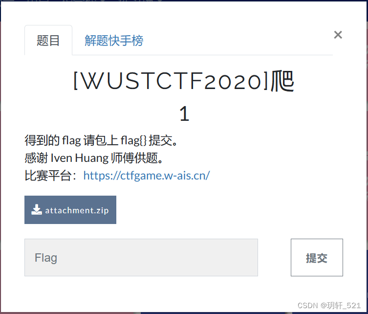
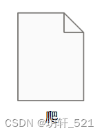
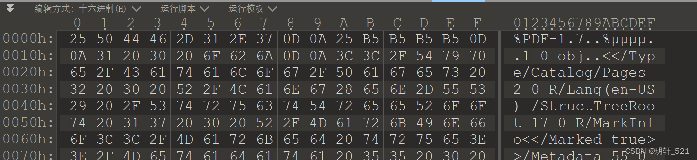
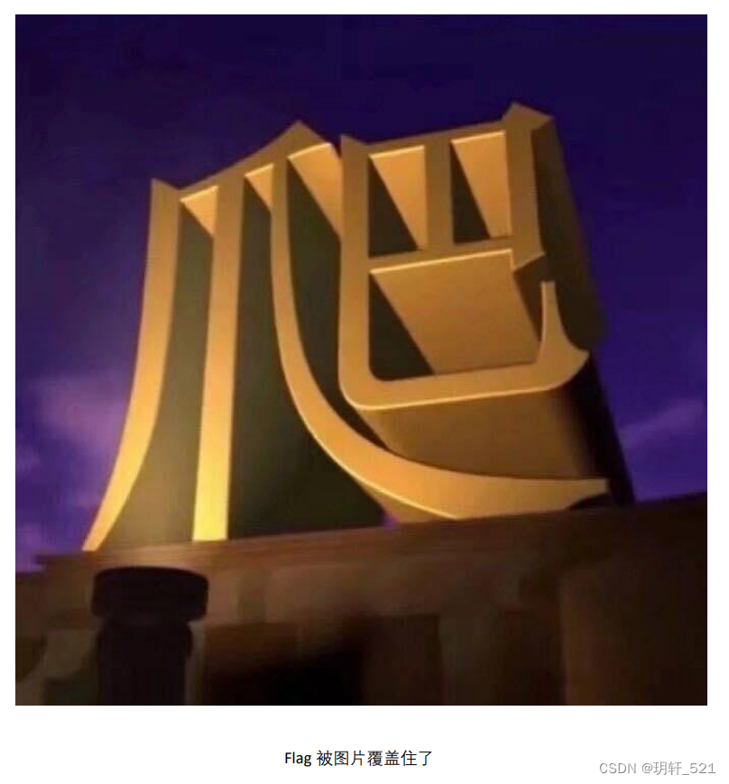
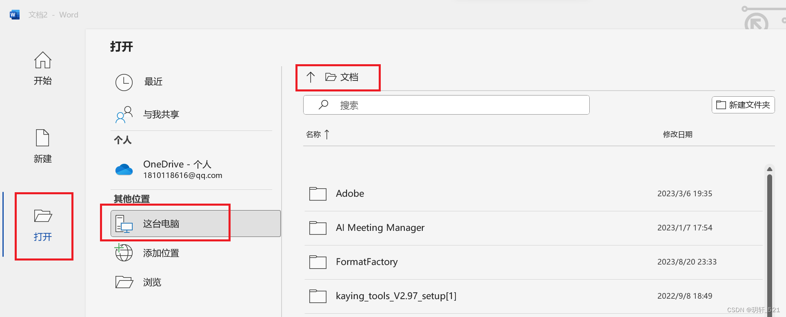
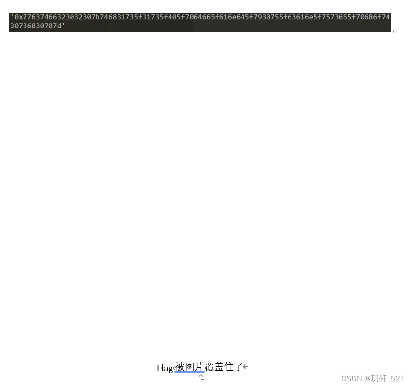
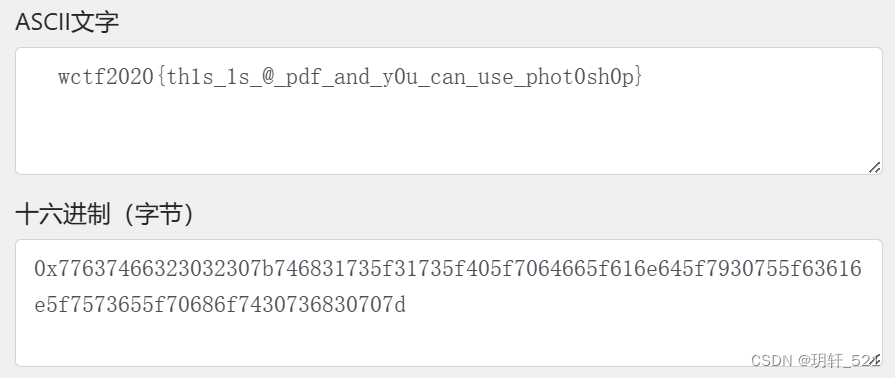

**BUUCTF: [https://buuoj.cn/challenges](https://buuoj.cn/challenges)** 

---

相关阅读

- [CTF Wiki](https://ctf-wiki.org/)
- [Hello CTF](https://hello-ctf.com/HC_Start/)
- [NewStar CTF](https://ns.openctf.net/learn/)


 

### 题目描述：

得到的 flag 请包上 flag{} 提交。

### 密文：

下载附件，得到一个没有后缀的文件。
 

---

### 解题思路：

1、文件没有后缀，用010Editor看一下文件类型，是PDF文件。

```bash
Adobe Acrobat (pdf)， 文件头：25 50 44 46 2D 31 2E
```

 

修改文件后缀为.pdf，打开如下图所示。

 

2、提示flag在图片的后面，但PDF文件是无法修改的。使用电脑上的Word打开PDF文件，转换为word文件进行编辑。

 

删除图片，得到一串十六进制的数据图片。

```bash
0x77637466323032307b746831735f31735f405f7064665f616e645f7930755f63616e5f7573655f70686f7430736830707d
```

 

3、将这串十六进制数据转换为ASCII字符串，得到flag。

 

### flag：

```bash
flag{th1s_1s_@_pdf_and_y0u_can_use_phot0sh0p}
```