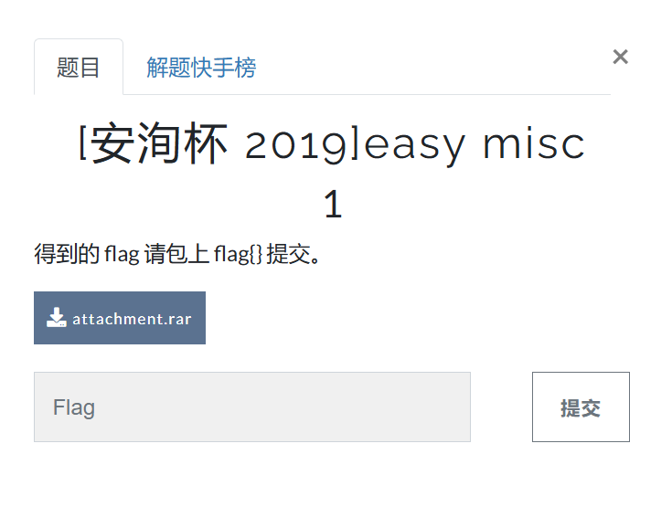
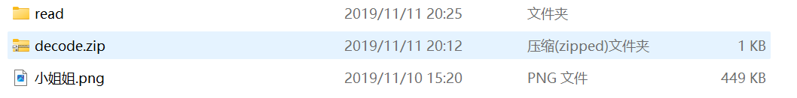
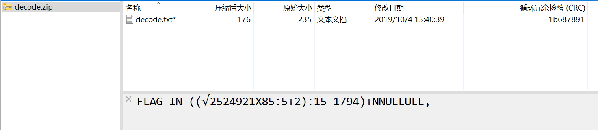
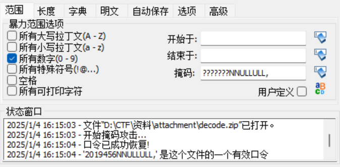
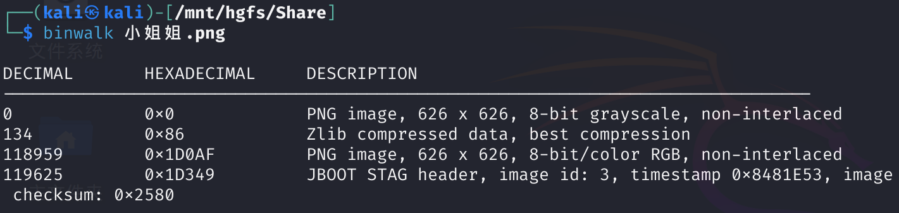
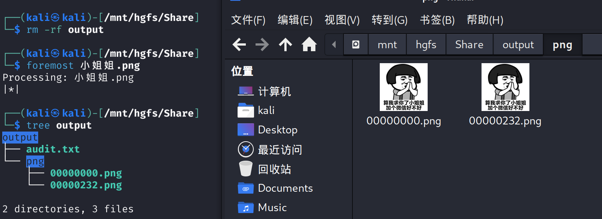
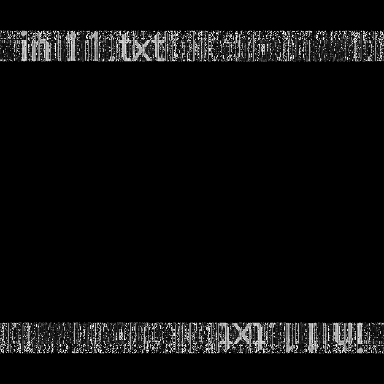
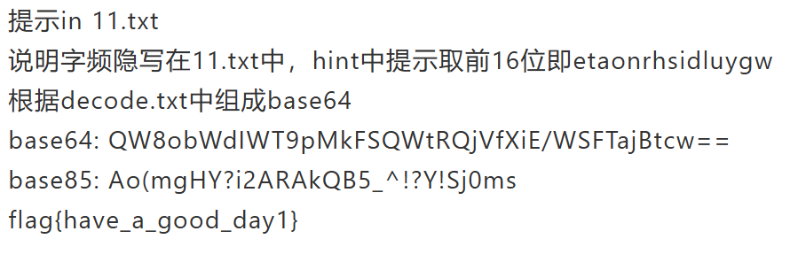

**BUUCTF: [https://buuoj.cn/challenges](https://buuoj.cn/challenges)** 

---

相关阅读

- [CTF Wiki](https://ctf-wiki.org/)
- [Hello CTF](https://hello-ctf.com/HC_Start/)
- [NewStar CTF](https://ns.openctf.net/learn/)
- [安洵杯 2019/BUUCTF-easy misc](https://shawroot.hatenablog.com/entry/2020/01/02/%E5%AE%89%E6%B4%B5%E6%9D%AF_2019/BUUCTF-easy_misc)
- [BUUCTF：［安洵杯 2019］easy misc](https://blog.csdn.net/mochu7777777/article/details/109669638)


 

### 题目描述：

得到的 flag 请包上 flag{} 提交。

### 密文：

下载附件，解压得到

 

---

### 解题思路：

1、使用Bandzip打开decode.zip文件，得到关于密码的提示。（当时我真没想到这跟压缩包密码有关系）

 

#### 计算步骤

##### 计算根号内的值

$$
\sqrt{2524921} = 1589
$$

##### 进行乘法和除法

$$
1589 \times 85 = 135065
$$

$$
135065 \div 5 = 27013
$$

##### 加法

$$
27013 + 2 = 27015
$$

##### 再次进行除法

$$
27015 \div 15 = 1801
$$

##### 减法

$$
1801 - 1794 = 7
$$

##### 字符串拼接

$$
7 + "NNULLULL,"
$$

猜测7位数字加上字符串"NNULLULL," 构成密码，使用ARCHPR进行掩码爆破，得到密码如下：

```python
2019456NNULLULL,
```

 

解压decode.zip文件，得到如下内容

```python
a = dIW
b = sSD
c = adE 
d = jVf
e = QW8
f = SA=
g = jBt
h = 5RE
i = tRQ
j = SPA
k = 8DS
l = XiE
m = S8S
n = MkF
o = T9p
p = PS5
q = E/S
r = -sd
s = SQW
t = obW
u = /WS
v = SD9
w = cw=
x = ASD
y = FTa
z = AE7
```

2、使用binwalk查看小姐姐.png，发现还有一张图片。（我的binwalk为什么会出问题，然后一不小心恢复快照，只能再装一个Kali了）

 

 

用foremost提取图片，结果是两张一样的图片。

 

猜测为盲水印，使用BlindWaterMark工具，解密得到如下内容：

 

3、对11.txt进行字频统计，字符按照出现频率从大到小排列如下：

```python
大->小:
字符： etaonrhisdluygwmfc.　,bp"k'Hv-ITS?ADMRWPGN!FxBOYjCEzqLQUV;K:J)(134Z0792X5*~86	\
```

根据hint.txt的提示 `hint:取前16个字符` ，取其前16个字符： ` etaonrhisdluygw` 。（第一位是空格）

```python
# 定义映射规则
mapping = {
    'a': 'dIW',
    'b': 'sSD',
    'c': 'adE',
    'd': 'jVf',
    'e': 'QW8',
    'f': 'SA=',
    'g': 'jBt',
    'h': '5RE',
    'i': 'tRQ',
    'j': 'SPA',
    'k': '8DS',
    'l': 'XiE',
    'm': 'S8S',
    'n': 'MkF',
    'o': 'T9p',
    'p': 'PS5',
    'q': 'E/S',
    'r': '-sd',
    's': 'SQW',
    't': 'obW',
    'u': '/WS',
    'v': 'SD9',
    'w': 'cw=',
    'x': 'ASD',
    'y': 'FTa',
    'z': 'AE7'
}

# 需要映射的字符串
input_str = "etaonrhisdluygw"

# 进行映射
result = ''.join(mapping[char] for char in input_str)

# 打印结果
print(result)
```

根据先前得到的decode.txt中的映射规则，得到字符串 `QW8obWdIWT9pMkF-sd5REtRQSQQWjVfXiE/WSFTajBtcw=` ，在这一步出现与官方WP不同的地方。

 

最后没有问题会得到flag： `flag{have_a_good_day1}` 

### flag：

```bash
flag{have_a_good_day1}
```