**BUUCTF: [https://buuoj.cn/challenges](https://buuoj.cn/challenges)** 

---

相关阅读

- [CTF Wiki](https://ctf-wiki.org/)


 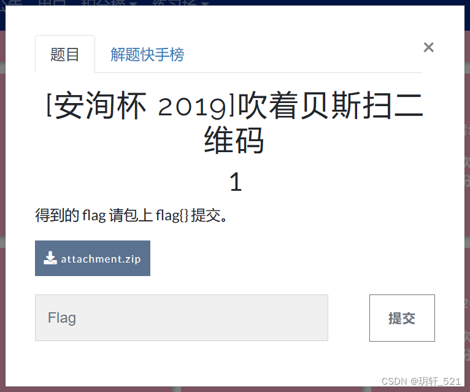

### 题目描述：

得到的 flag 请包上 flag{} 提交。

### 密文：

下载附件解压，得到很多没有后缀的文件和一个ZIP压缩包。

 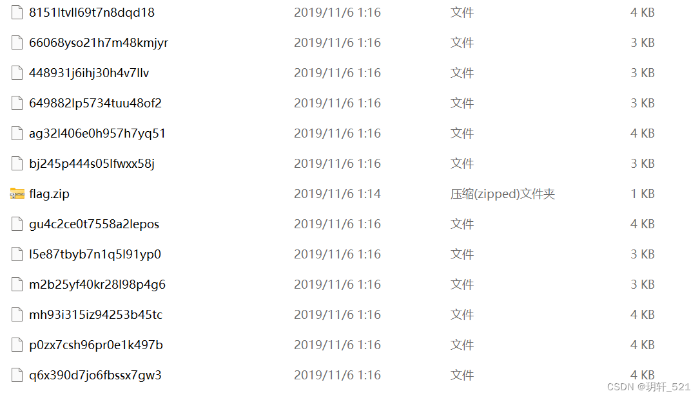

---

### 解题思路：

1、首先，查看ZIP压缩包，发现有密码，并且在压缩包的注释找到疑似被加密的压缩包密码，初步解密失败。

 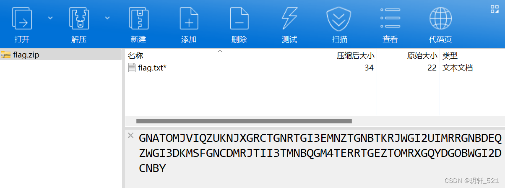

```bash
GNATOMJVIQZUKNJXGRCTGNRTGI3EMNZTGNBTKRJWGI2UIMRRGNBDEQZWGI3DKMSFGNCDMRJTII3TMNBQGM4TERRTGEZTOMRXGQYDGOBWGI2DCNBY
```

查看其他的无后缀文件，在010Editor中观察到jpg文件的文件头，猜测为jpg文件。

```bash
JPEG (jpg) 　　文件头：FF D8 FF　　 文件尾：FF D9
```

 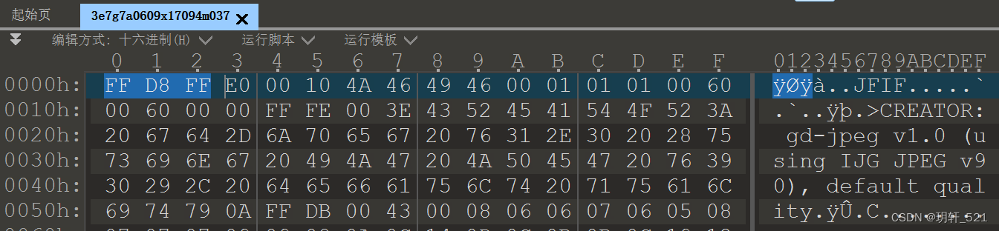

修改文件后缀为.jpg，发现是二维码的一部分，其他文件是一样的，共36个二维码碎片。

 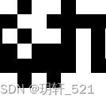

2、二维码应该存在解开压缩包的线索。先将所有的无后缀文件改为.jpg文件，可以手动添加，也可以使用python脚本完成。

```python
#coding=UTF-8
import os

path = 'D:\\CTF\\CTF_topic\\吹着贝斯扫二维码'   # 需要添加后缀的文件路径
for i in os.listdir('D:\\CTF\\CTF_topic\\吹着贝斯扫二维码'):
	if i == 'flag.zip':
		continue
	else:
		oldname = os.path.join(path, i)
		newname = os.path.join(path, i+'.jpg')
		os.rename(oldname, newname)
```

然后，使用Ps软件将所有二维码碎片组合起来，恢复原有的二维码，跟玩拼图一样。（但是真的很慢）

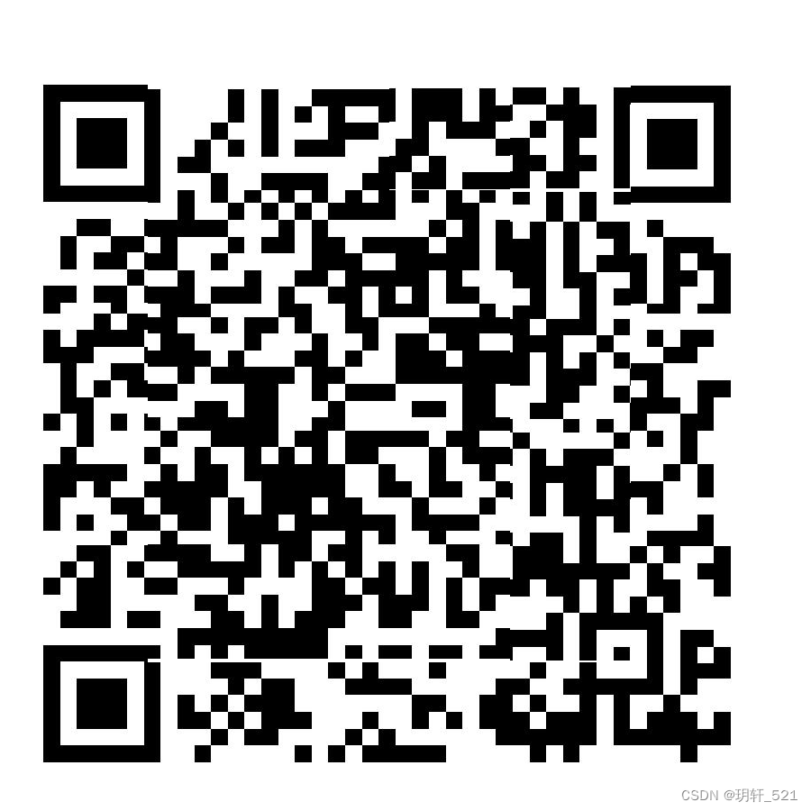

3、扫描二维码，得到加密字符串的加密顺序，如下：

 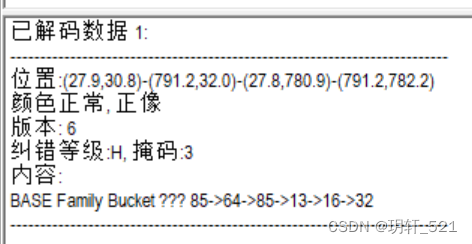

加密顺序：base85 >> base64 >> base85 >> rot13 >> base16 >> base32

解密只需要按照加密顺序反转进行解密就可以啦

解密顺序：base32 >> base16 >> rot13 >> base85 >> base64 >> base85

```bash
GNATOMJVIQZUKNJXGRCTGNRTGI3EMNZTGNBTKRJWGI2UIMRRGNBDEQZWGI3DKMSFGNCDMRJTII3TMNBQGM4TERRTGEZTOMRXGQYDGOBWGI2DCNBY
```

**base32** [https://the-x.cn/encodings/Base32.aspx](https://the-x.cn/encodings/Base32.aspx) 

```bash
3A715D3E574E36326F733C5E625D213B2C62652E3D6E3B7640392F3137274038624148
```

 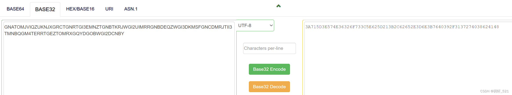

**base16** [https://www.qqxiuzi.cn/bianma/base.php?type=16](https://www.qqxiuzi.cn/bianma/base.php?type=16) 

```bash
:q]>WN62os<^b]!;,be.=n;v@9/17'@8bAH
```

 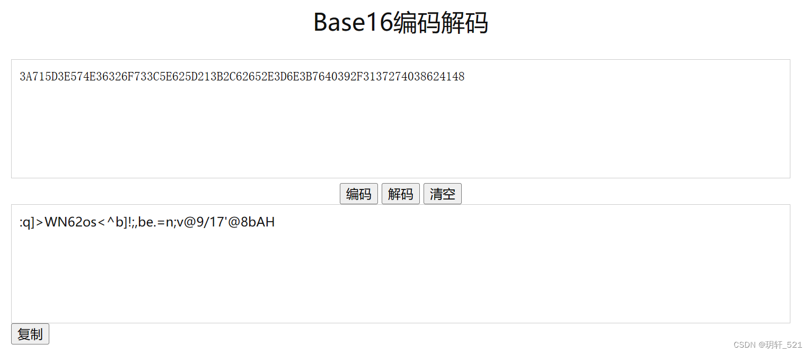

**rot13** [https://lzltool.cn/Tools/Rot13](https://lzltool.cn/Tools/Rot13) 

```bash
:d]>JA62bf<^o]!;,or.=a;i@9/17'@8oNU
```

 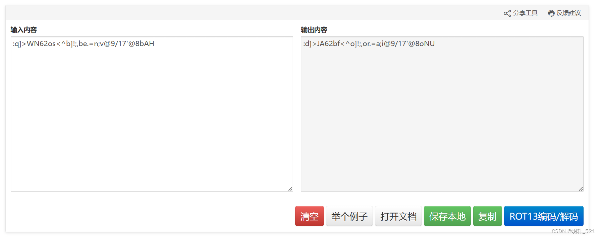

**base85** [http://www.atoolbox.net/Tool.php?Id=934](http://www.atoolbox.net/Tool.php?Id=934) 

```bash
PCtvdWU4VFJnQUByYy4mK1lraTA=
```

 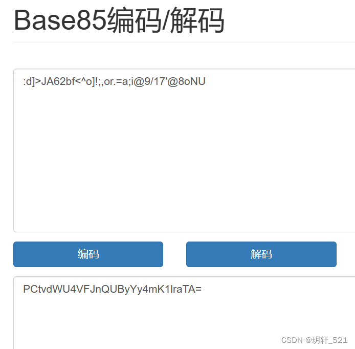

**base64** [https://base64.supfree.net/](https://base64.supfree.net/) 

```bash
<+oue8TRgA@rc.&+Yki0
```

 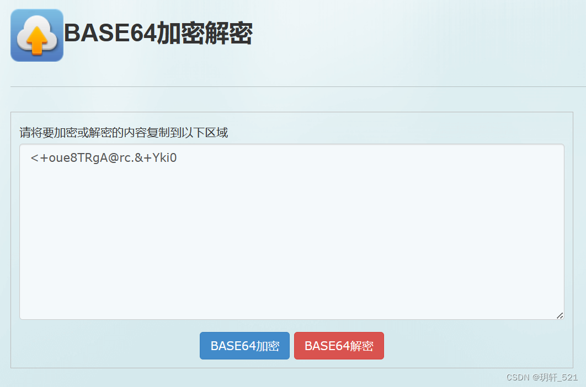

**base85** （解密需使用ASCII85编码标准） [http://www.hiencode.com/base85.html](http://www.hiencode.com/base85.html) 

```bash
ThisIsSecret!233
```

 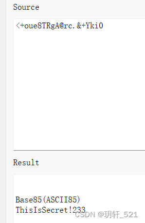

 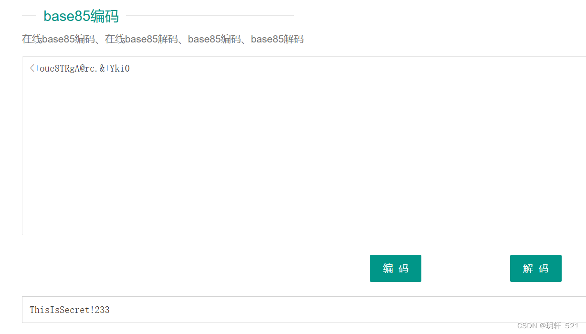

4、得到明文，使用它解压压缩包，得到flag.txt文件。

 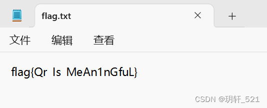

### flag：

```bash
flag{Qr_Is_MeAn1nGfuL}
```