**BUUCTF: [https://buuoj.cn/challenges](https://buuoj.cn/challenges)** 

---

相关阅读

- [CTF Wiki](https://ctf-wiki.org/)
- [Hello CTF](https://hello-ctf.com/HC_Start/)
- [NewStar CTF](https://ns.openctf.net/learn/)
- [BuuCTF难题详解| Misc | ［湖南省赛2019］Findme](https://blog.csdn.net/pone2233/article/details/107990787)
- [［湖南省赛2019］Findme](https://www.cnblogs.com/zhoujiaff/p/17071345.html)


 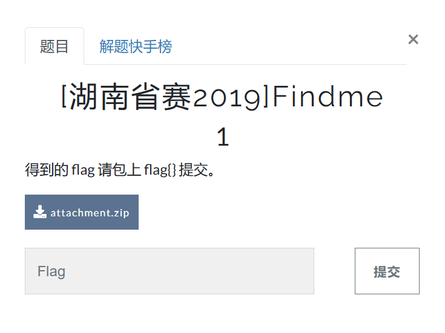

### 题目描述：

得到的 flag 请包上 flag{} 提交。

### 密文：

下载附件，解压得到1.png、2.png、3.png、4.png、5.png。

 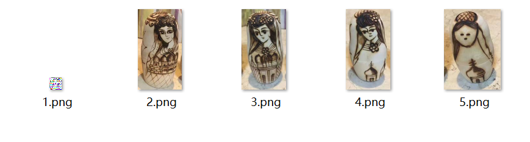

---

### 解题思路：

1、先看第一张图片1.png，显示出错，而且与其它四张图片不同，尝试修改宽高。

通过python脚本爆破宽高，得到正确的宽高，然后修改图片的宽高数据，得到正确的图片。爆破所用代码如下。

```python
import os
import binascii
import struct

crcbp = open("repair.png", "rb").read()    #打开图片（修改图片路径）
for i in range(2000):
    for j in range(2000):
        data = crcbp[12:16] + \
            struct.pack('>i', i)+struct.pack('>i', j)+crcbp[24:29]
        crc32 = binascii.crc32(data) & 0xffffffff
        if(crc32 == 0x9BF1293B):    #图片当前CRC（修改CRC）
            print(i, j)
            print('hex:', hex(i), hex(j))
```

> 宽为 227， 高为 453， 新CRC值为 806611， 宽为 e3， 高为 1c5

正确的图片显示如下，还是有问题。
 

用010Editor打开，发现struct PNG_CHUNK `chunk[2]` 、 `chunk[3]` 缺少 `IDAT` 标识。

 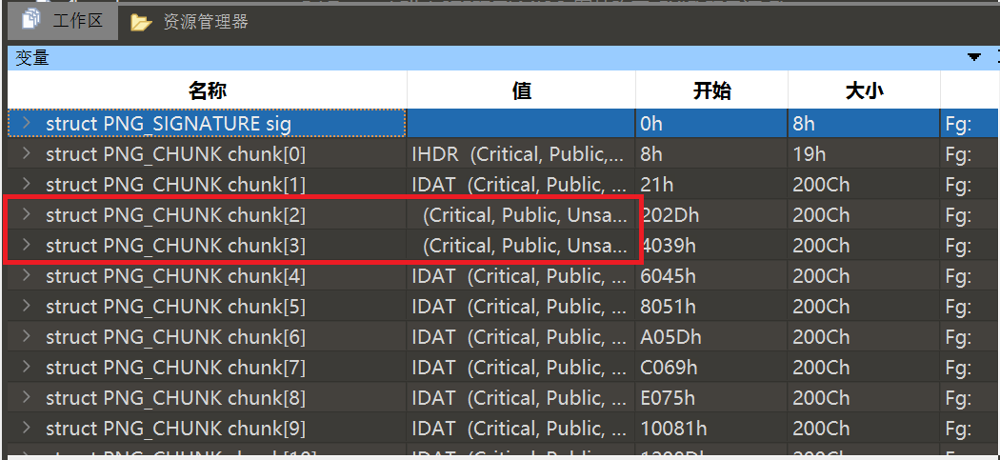

添加 `IDAT` 标识，在struct PNG_CHUNK `chunk[2]` 下的 `union CTYPE type` 中的 `uint32 crc` ，添加值 `49444154h` 

 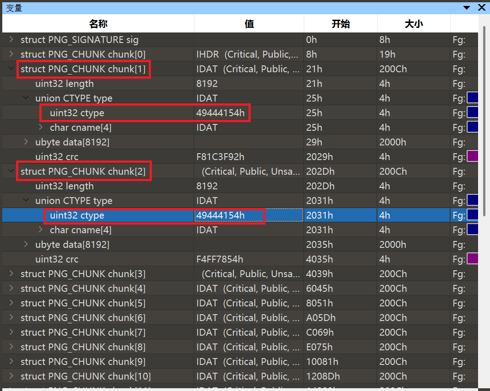

图片正常显示如下：

 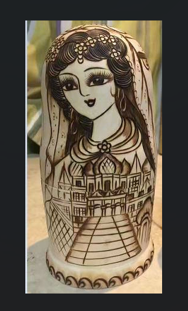

使用Stegsolve打开，在 `blue 2` 通道发现二维码。

 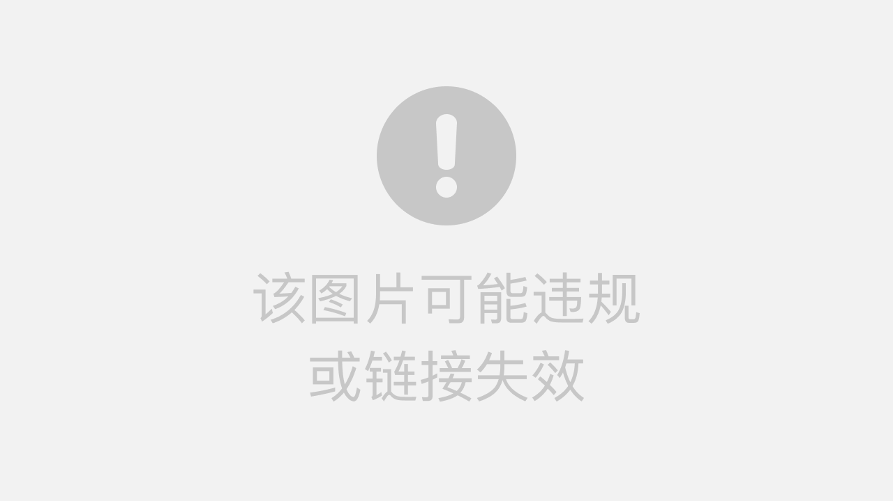

 

扫码二维码，得到 `ZmxhZ3s0X3` 。

2、第二张图片2.png，用010 Editor打开，在文件尾发现 `7z` 开头的数据，提取出来再处理。

 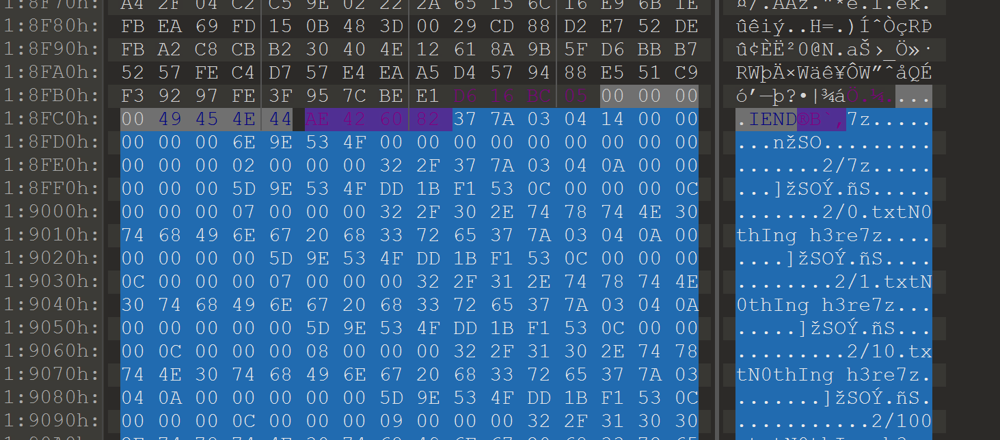

保存为7z文件后，无法正常解压。将文件数据中全部的 `7z` 替换为 `PK` ，保存为zip文件，可以正常解压。

> 7z文件头： `37 7A BC AF 27 1C` 
> zip文件头： `50 4B 03 04` 

 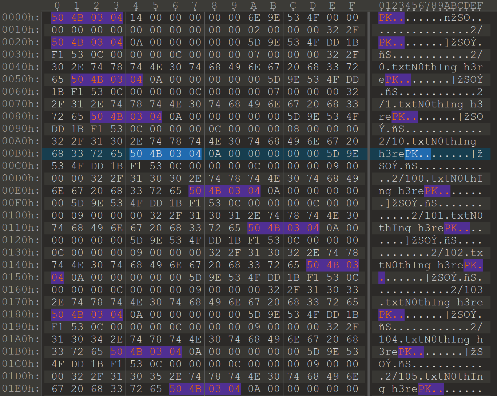

解压得到1000个文件。

 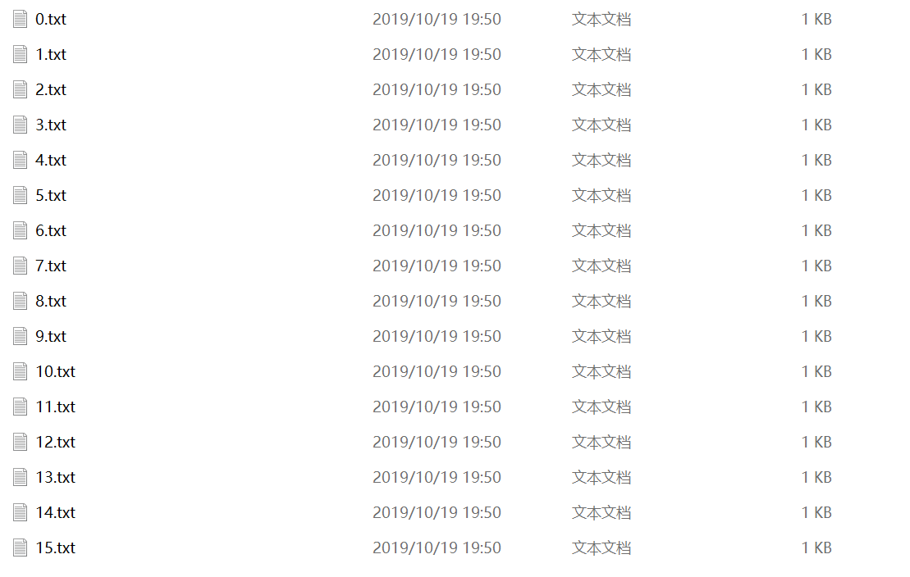

将文件按照文件大小，从大到小排列，发现618.txt

 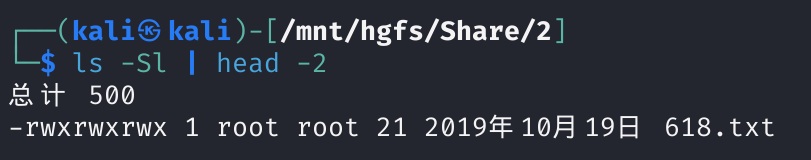

 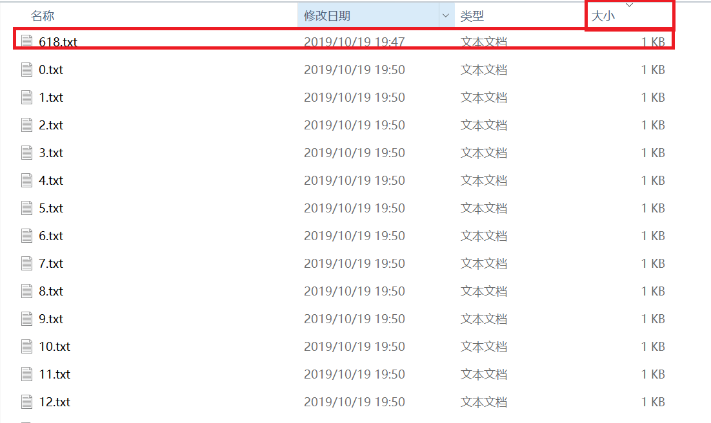

618.txt内容如下：

 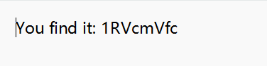

得到 `1RVcmVfc` 

3、第三张图片3.png，用010 Editor打开，在struct PNG_CHUNK chunk[0、1、2、3、4、5、6、7]下的 `uint32 crc` ，全部隐藏了十六进制数据。

 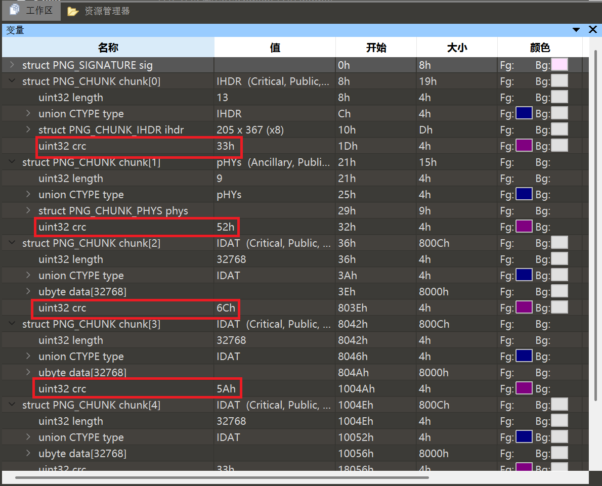

16进制转换文本： [https://www.sojson.com/hexadecimal.html](https://www.sojson.com/hexadecimal.html) 
 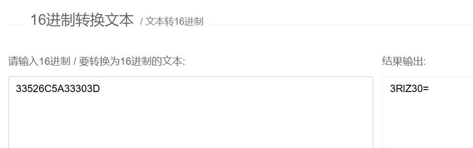

提取出来转换为ASCII字符，得到 `3RlZ30=` 

4、第四张图片4.png，使用Kali中的exiftool查看4.png的EXIF信息。

 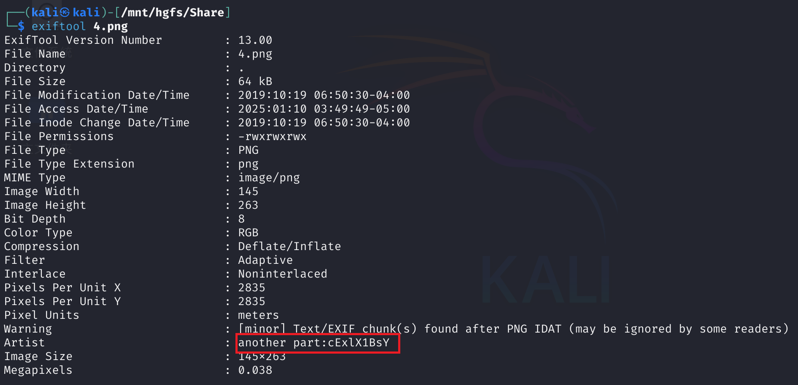

在Artist下发现another part： `cExlX1BsY` 

5、第五张图片5.png，用010 Editor打开，在最后发现 a gift。

 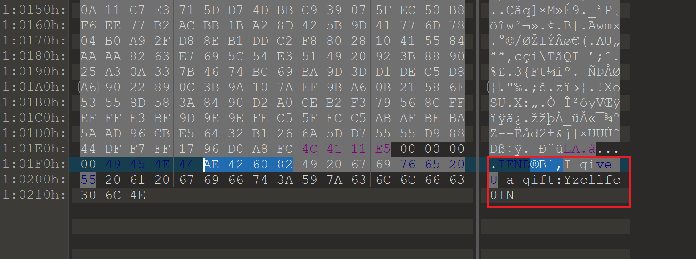

得到 `Yzcllfc0lN` 

6、按照1.png、5.png、4.png、2.png、3.png的顺序组合，得到可以解码的Base64字符串。

```python
ZmxhZ3s0X3Yzcllfc0lNcExlX1BsY1RVcmVfc3RlZ30=
```

解码得到flag： `flag{4_v3rY_sIMpLe_PlcTUre_steg}` 

 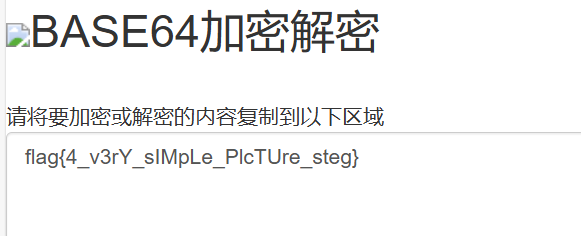

### flag：

```bash
flag{4_v3rY_sIMpLe_PlcTUre_steg}
```