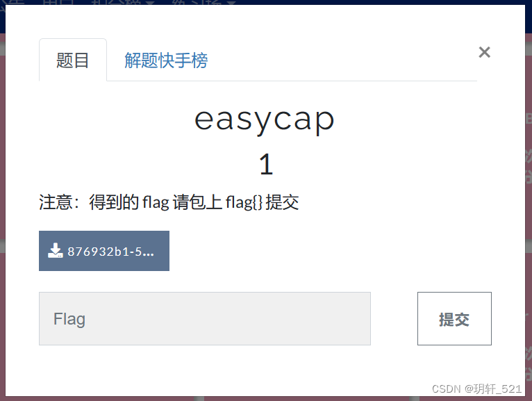
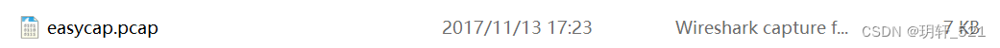
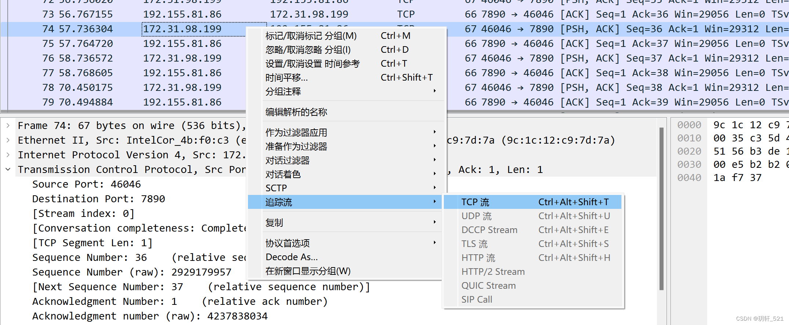
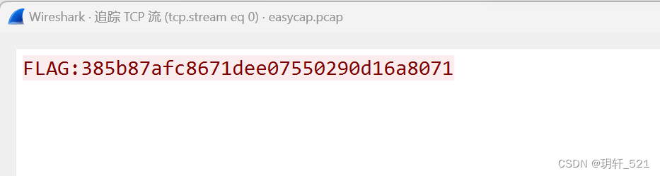

**BUUCTF: [https://buuoj.cn/challenges](https://buuoj.cn/challenges)** 

---

相关阅读

- [CTF Wiki](https://ctf-wiki.org/)




### 题目描述：

下载附件，解压得到一个.pcap文件。

### 密文：



---

### 解题思路：

1、这道题和它的名字一样，真的很easy。双击easycap.pcap文件，打开Wireshark。在Wireshark中，不管你追踪那个流量的TCP流，你都可以找到flag。





### flag：

```bash
flag{385b87afc8671dee07550290d16a8071}
```