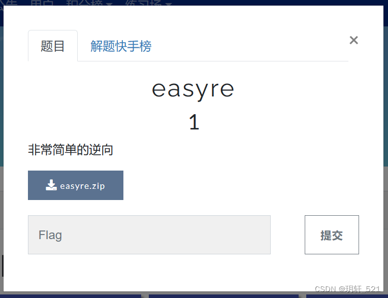
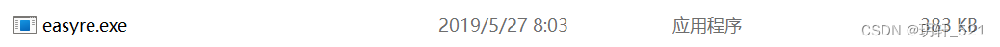
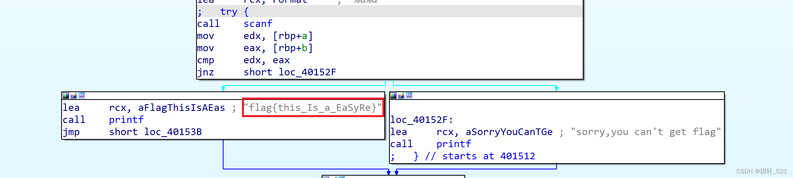
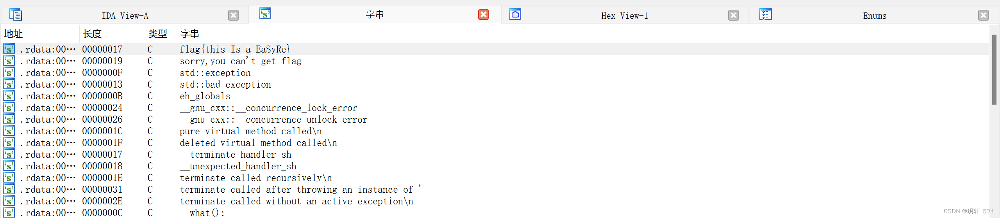

**BUUCTF: [https://buuoj.cn/challenges](https://buuoj.cn/challenges)** 


---

相关阅读

- [CTF Wiki](https://ctf-wiki.org/)




### 题目描述：

下载附件，解压得到一个.exe文件。

### 密文：



---

### 解题思路：

1、使用IDA pro打开exe文件，在反汇编窗口（IDA View-A），直接找到flag。



也可以通过使用快捷键shift+F12：自动分析出参考字符串，找到flag。



### flag：

```bash
flag{this_Is_a_EaSyRe}
```