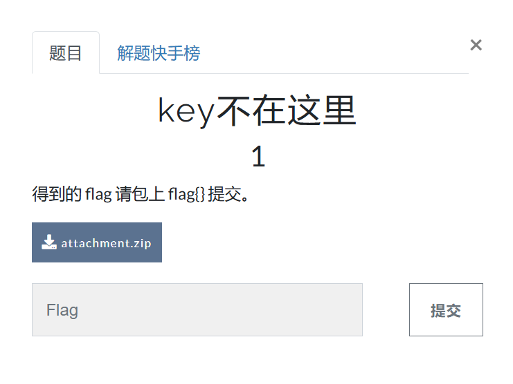
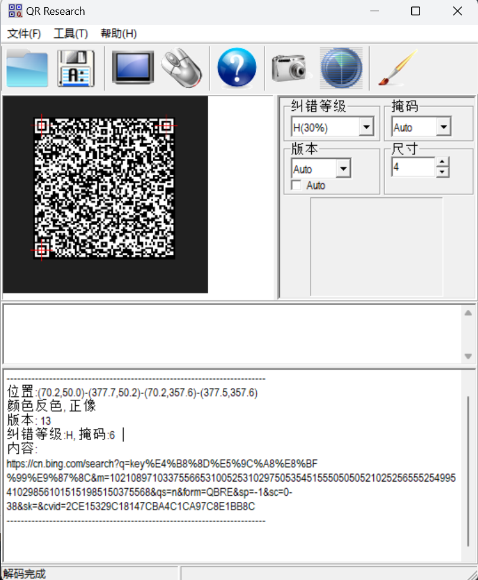
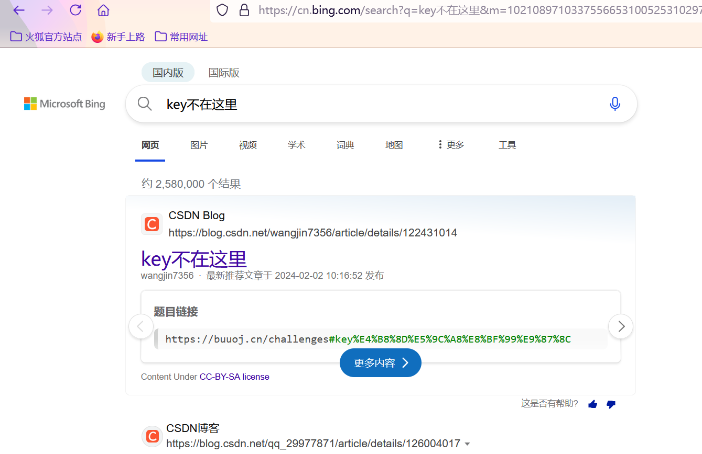
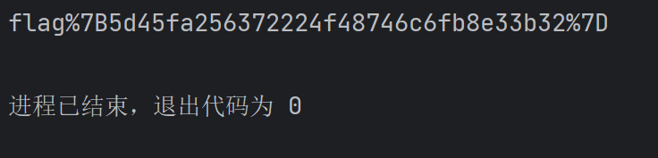
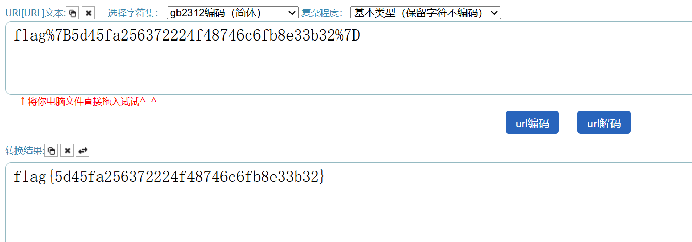

**BUUCTF: [https://buuoj.cn/challenges](https://buuoj.cn/challenges)** 

---

相关阅读

- [CTF Wiki](https://ctf-wiki.org/)
- [buuctf-misc-key不在这里1](https://blog.csdn.net/qq_29977871/article/details/126004017)


 

### 题目描述：

得到的 flag 请包上 flag{} 提交。

### 密文：

下载附件，解压得到1564386056.png

 

---

### 解题思路：

1、扫码得到如下链接：

```python
https://cn.bing.com/search?q=key%E4%B8%8D%E5%9C%A8%E8%BF%99%E9%87%8C&m=10210897103375566531005253102975053545155505050521025256555254995410298561015151985150375568&qs=n&form=QBRE&sp=-1&sc=0-38&sk=&cvid=2CE15329C18147CBA4C1CA97C8E1BB8C
```

 

访问链接，没有找到flag。

 

2、注意到URL中，有一长串十进制数字： `10210897103375566531005253102975053545155505050521025256555254995410298561015151985150375568` ，将其转为ASCII

```python
def decode_mixed(s):
    """
    解码混合长度的数字序列到ASCII字符。
    
    :param s: 密文字符串
    :return: 解码后的ASCII文本
    """
    temp = ''
    while s:
        if int(s[:3]) < 127:
            temp += chr(int(s[:3]))
            s = s[3:]
        else:
            temp += chr(int(s[:2]))
            s = s[2:]
    return temp

# 给定的密文
ciphertext = '10210897103375566531005253102975053545155505050521025256555254995410298561015151985150375568'

decoded_text = decode_mixed(ciphertext)
print(decoded_text)
```

得到ASCII字符串，如下

```python
flag%7B5d45fa256372224f48746c6fb8e33b32%7D
```

 

3、再进行一次URL解码，得到flag。

[在线urlencode编码、urldecode解码、url编码解码、百分号编码](http://web.chacuo.net/charseturlencode) 
 

### flag：

```bash
flag{5d45fa256372224f48746c6fb8e33b32}
```