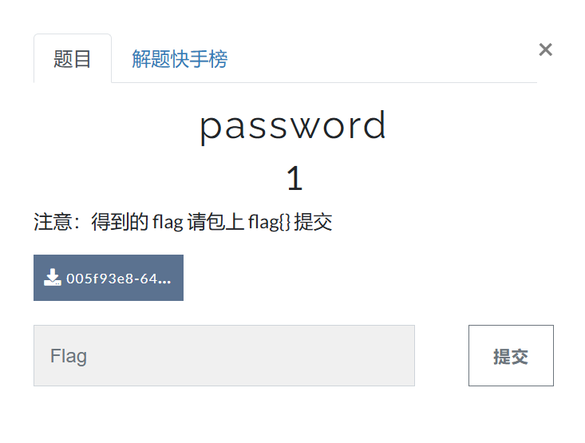

**BUUCTF: [https://buuoj.cn/challenges](https://buuoj.cn/challenges)** 

---

相关阅读

- [CTF Wiki](https://ctf-wiki.org/)


 

### 密文：

```python
姓名：张三 
生日：19900315

key格式为key{xxxxxxxxxx}
```

### 解题思路：

flag的长度为十位，猜测为姓名的缩写“zs”，加上生日“19900315”，构成flag。

### flag：

```python
flag{zs1990315}
```