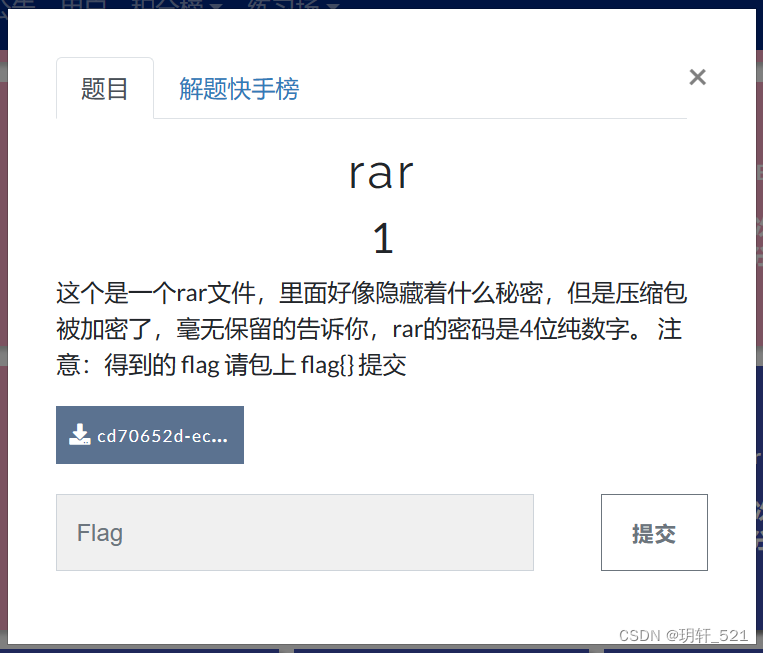
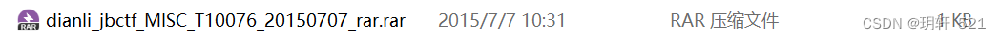
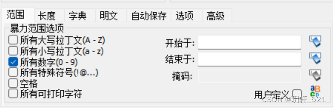
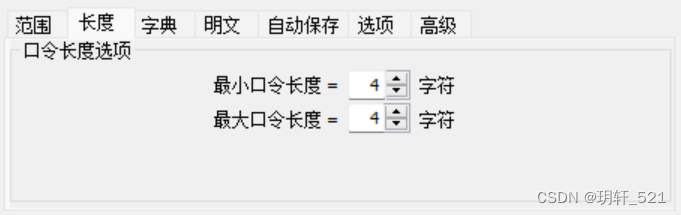
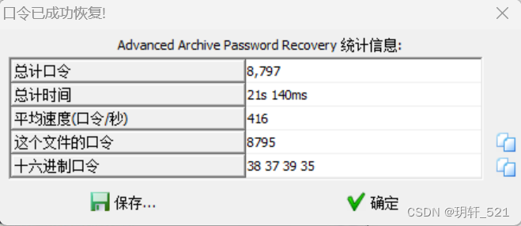
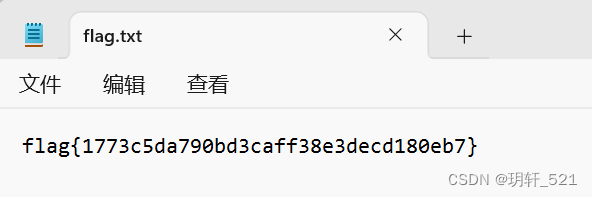

**BUUCTF: [https://buuoj.cn/challenges](https://buuoj.cn/challenges)** 

---

相关阅读

- [CTF Wiki](https://ctf-wiki.org/)




### 题目描述：

这个是一个rar文件，里面好像隐藏着什么秘密，但是压缩包被加密了，毫无保留的告诉你，rar的密码是4位纯数字。

### 密文：

下载附件，解压得到一个rar压缩包。



---

### 解题思路：

1、根据题目提示，我们要暴力破解压缩包密码。刚开始，我尝试使用RARP工具破解，但RARP工具没有给出正确的密码，让我误以为这道题可能是rar伪加密。最后，我下载了另一个rar压缩包破解工具ARCHPR，使用该工具成功破解出密码。

- [参考这篇文章下载https://blog.csdn.net/weixin_45489253/article/details/108152688](https://blog.csdn.net/weixin_45489253/article/details/108152688)
- [下载地址http://www.ddooo.com/softdown/176170.htm](http://www.ddooo.com/softdown/176170.htm)


2、下载软件完成后，打开软件。在ARCHPR中打开压缩包，选择字符范围和密码长度，点击开始破解。（根据题目得知是四位纯数字密码）





3、破解出的密码是8795，使用这个密码解压rar压缩包，得到一个flag.txt文件，打开得到flag。





**flag：** 

```bash
flag{1773c5da790bd3caff38e3decd180eb7}
```