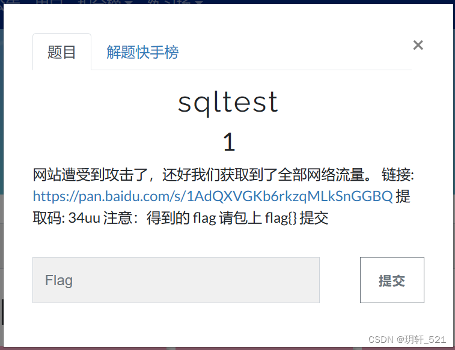
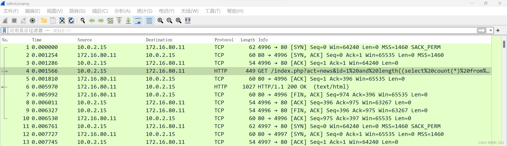
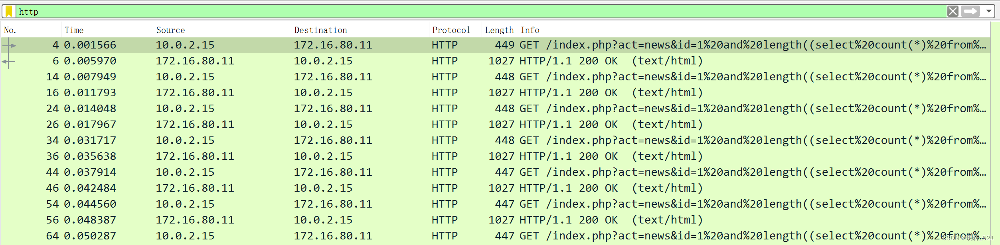
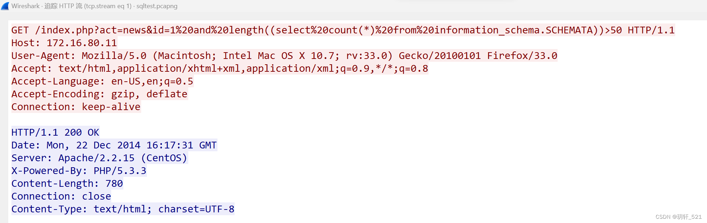
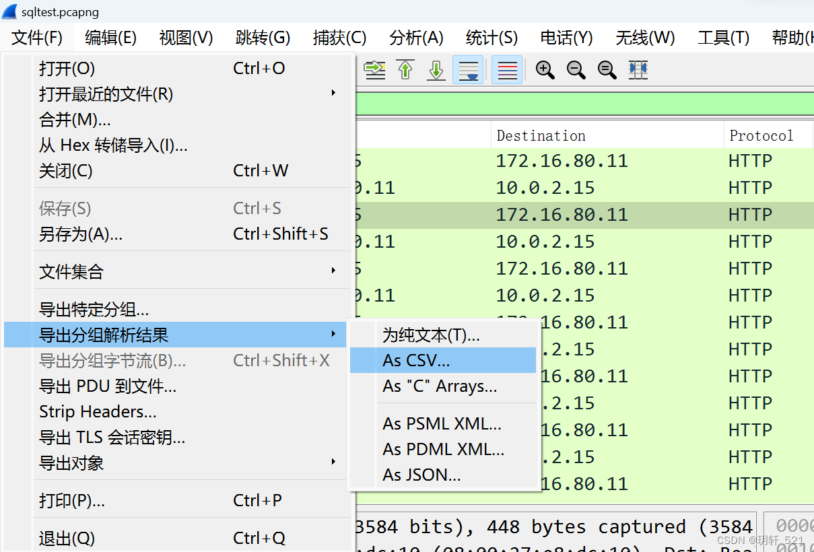
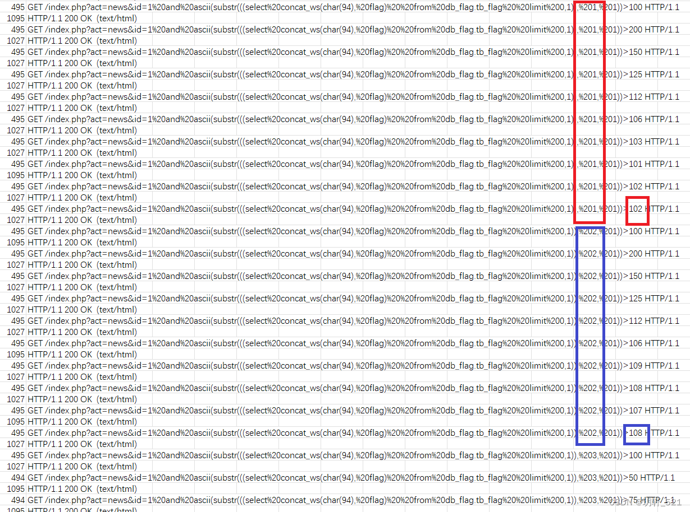
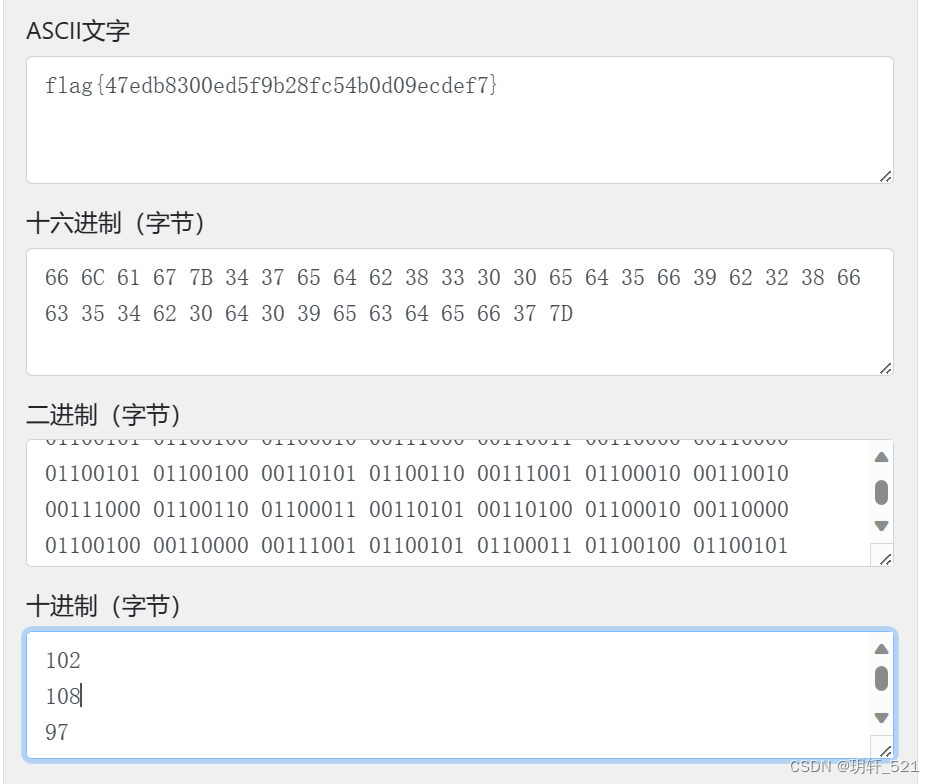

**BUUCTF: [https://buuoj.cn/challenges](https://buuoj.cn/challenges)** 

---

相关阅读

- [CTF Wiki](https://ctf-wiki.org/)


 

### 题目描述：

网站遭受到攻击了，还好我们获取到了全部网络流量。 链接: [https://pan.baidu.com/s/1AdQXVGKb6rkzqMLkSnGGBQ](https://pan.baidu.com/s/1AdQXVGKb6rkzqMLkSnGGBQ) 提取码: 34uu 注意：得到的 flag 请包上 flag{} 提交

### 密文：

下载附件，得到一个.pcapng文件，双击在Wireshark中打开，内容如下。

 

---

### 解题思路：

1、根据题目提示，认为网络攻击类型为SQL注入，过滤出http的流量。

 

随便看一条流量的追踪流，确认为SQL注入。

 

按如下步骤，将所有HTTP请求导出为CSV文件。

 

2、查看该CSV文件，可以更直观得看到SQL注入攻击。在文件的末尾，发现已经爆破出数据库名、表名、字段名，并且开始使用ascii码来判断值。我们可以从中推断出正确的ascii值，在对一个字符进行bool判断时，被重复判断的ASCII值就是正确的字符，最后提取到：

```bash
102
108
97
103
123
52
55
101
100
98
56
51
48
48
101
100
53
102
57
98
50
56
102
99
53
52
98
48
100
48
57
101
99
100
101
102
55
125
```



使用在线网站将ASCII码转换为字符串，得到flag。

 

### flag：

```bash
flag{47edb8300ed5f9b28fc54b0d09ecdef7}
```