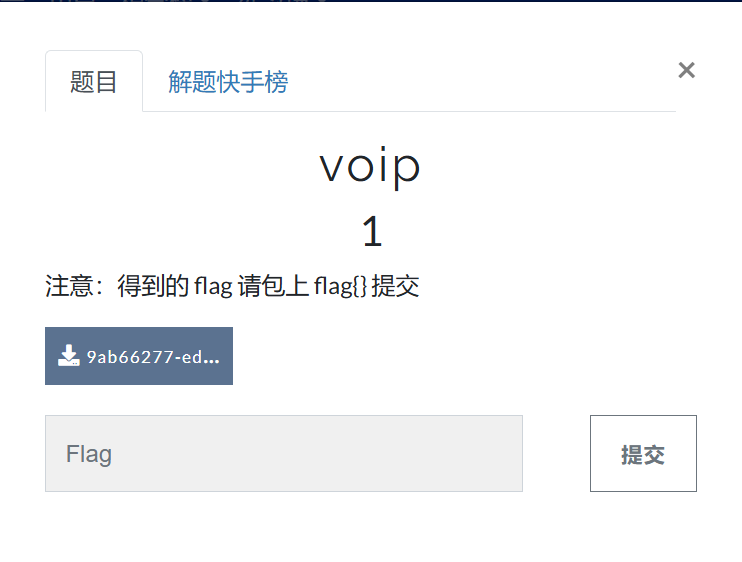
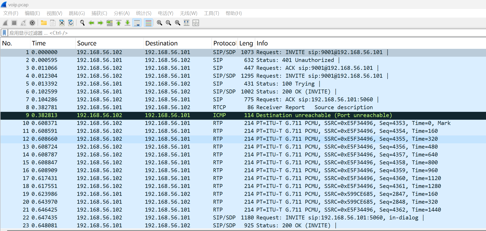
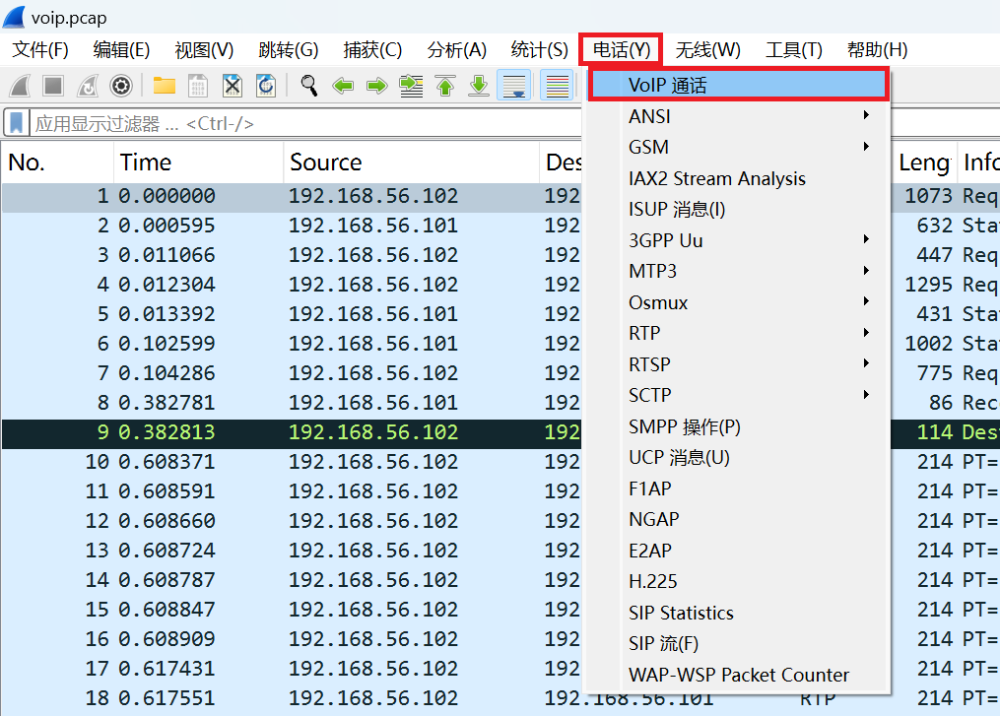
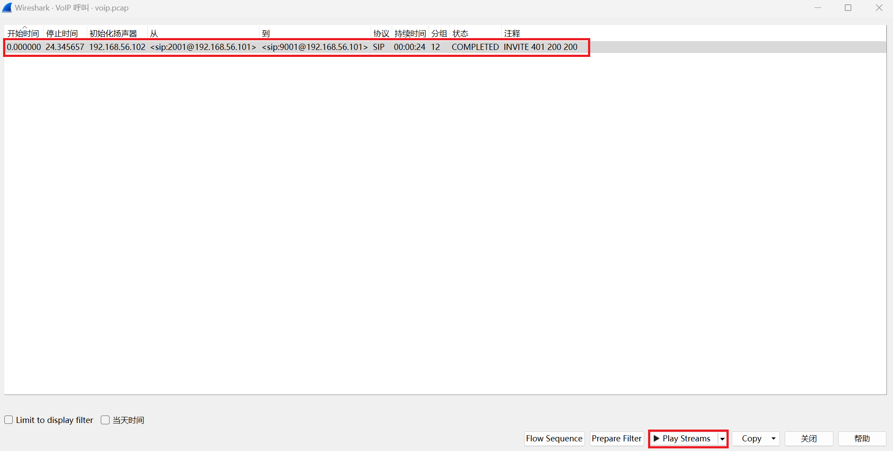
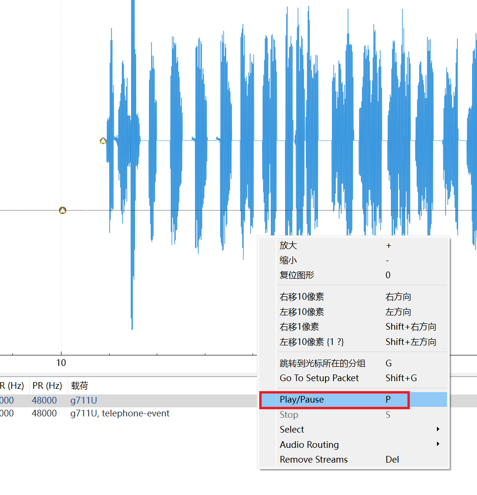
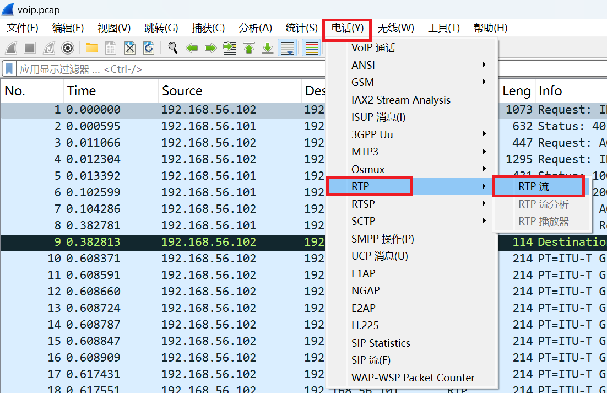
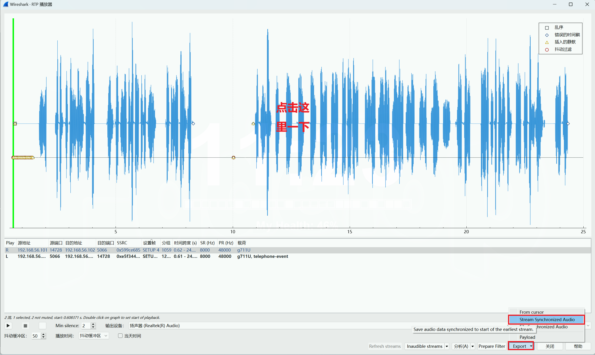
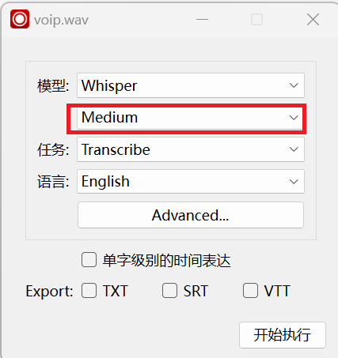
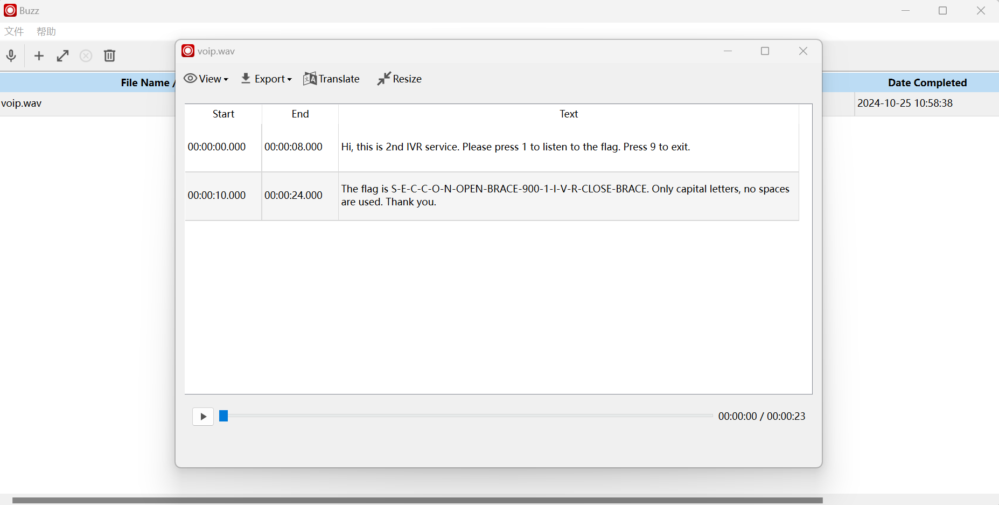

**BUUCTF: [https://buuoj.cn/challenges](https://buuoj.cn/challenges)** 

---

相关阅读

- [CTF Wiki](https://ctf-wiki.org/)
- [buuctf-voip两种解题思路酷软BUZZ再现](https://blog.csdn.net/weixin_34979095/article/details/142429105)


 

### 题目描述：

注意：得到的 flag 请包上 flag{} 提交

### 密文：

下载附件，解压得到voip.pcap

 

---

### 解题思路：

1、根据题目得知，本题与VoIP有关。

> **基于IP的语音传输** （英语：Voice over Internet Protocol，缩写为 **VoIP** ）是一种语音通话技术，经由网际协议（IP）来达成语音通话与多媒体会议，也就是经由互联网来进行通信。其他非正式的名称有IP电话（IP telephony）、互联网电话（Internet telephony）、宽带电话（broadband telephony）以及宽带电话服务（broadband phone service）。
> VoIP可用于包括VoIP电话、智能手机、个人计算机在内的诸多互联网接入设备，通过蜂窝网络、Wi-Fi进行通话及发送短信。

打开voip.pcap，发现大量RTP流量

> **RTP定义** ：Real-time Transport Protocol，是由IETF的多媒体传输工作小组于1996年在RFC 1889中公布的。RTP为IP上的语音、图像等需要实时传输的多媒体数据提供端对端的传输服务，但本身无法保证服务质量（QoS），因此，需要配合实时传输控制协议（RTCP）一起使用。

 

WireShark可以播放VoIP通话流量，选择 `主菜单->电话->VoIP通话` 

 

选择VoIP呼叫，点击 `Play Streams` 

 

右键选择 `Play/Pause` ，播放音频。听英语听力，获得flag。

 

2、也可以直接选择 `主菜单->电话->RTP->RTP流` ，来播放音频，步骤相同。

 

因为我实在听不出来，音频的内容是是什么。所以，我使用Buzz工具将音频转换为文本，得到flag。

Buzz下载地址： [https://github.com/chidiwilliams/buzz/releases](https://github.com/chidiwilliams/buzz/releases) 

流程如下：

导出wav音频文件

 

将导出的wav音频文件，拖入Buzz中，选择中型语音库 `Medium` ，开始执行。

 

得到文本如下：

```bash
Hi, this is 2nd IVR service. Please press 1 to listen to the flag. Press 9 to exit.
The flag is S-E-C-C-O-N-OPEN-BRACE-900-1-I-V-R-CLOSE-BRACE. Only capital letters, no spaces are used. Thank you.
```

 

### flag：

```bash
flag{9001IVR}
```