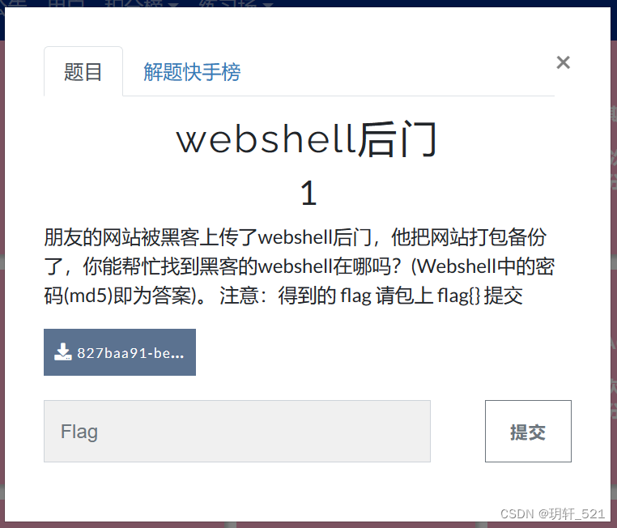
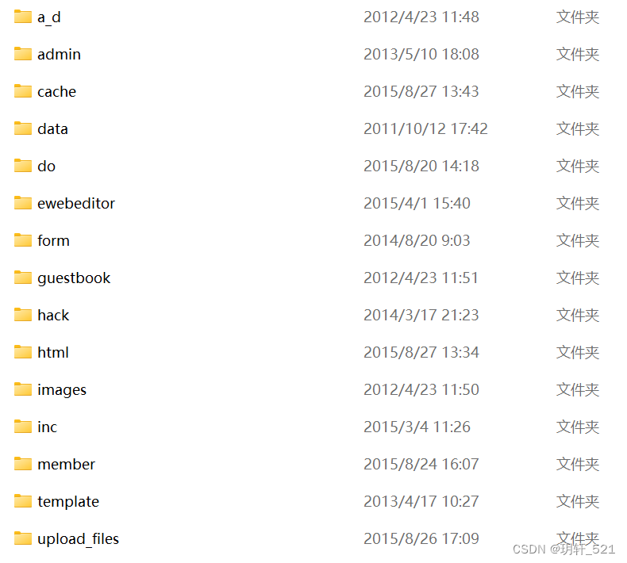
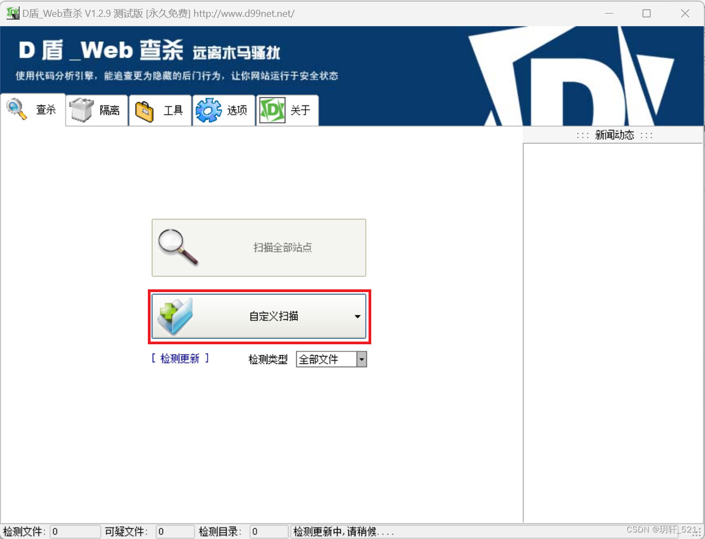
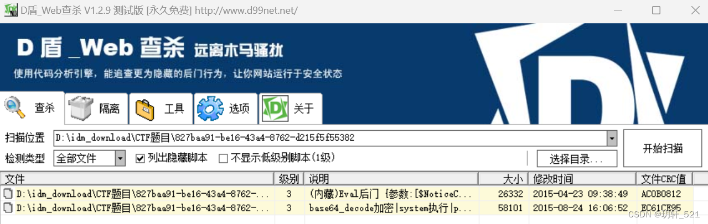
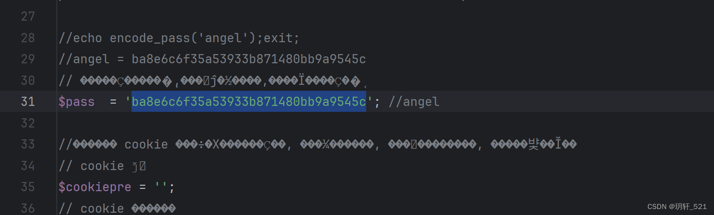

**BUUCTF: [https://buuoj.cn/challenges](https://buuoj.cn/challenges)** 

---

相关阅读

- [CTF Wiki](https://ctf-wiki.org/)




### 题目描述：

朋友的网站被黑客上传了webshell后门，他把网站打包备份了，你能帮忙找到黑客的webshell在哪吗？(Webshell中的密码(md5)即为答案)

### 密文：

下载附件，解压得到一个网站文件夹。



---

### 解题思路：

1、使用工具扫描附件所给的文件夹，可以使用D盾、火绒安全之类的工具，这里我使用D盾。
打开D盾，点击自定义扫描，选择附件给的网站文件夹，点击确定。



检查出两个文件，我们来挨个查看。



2、第一个文件没有flag，但我们在第二个文件中找到了Webshell中的密码，密码也符合md5的格式，这个就是flag值。



### flag：

```bash
flag{ba8e6c6f35a53933b871480bb9a9545c}
```