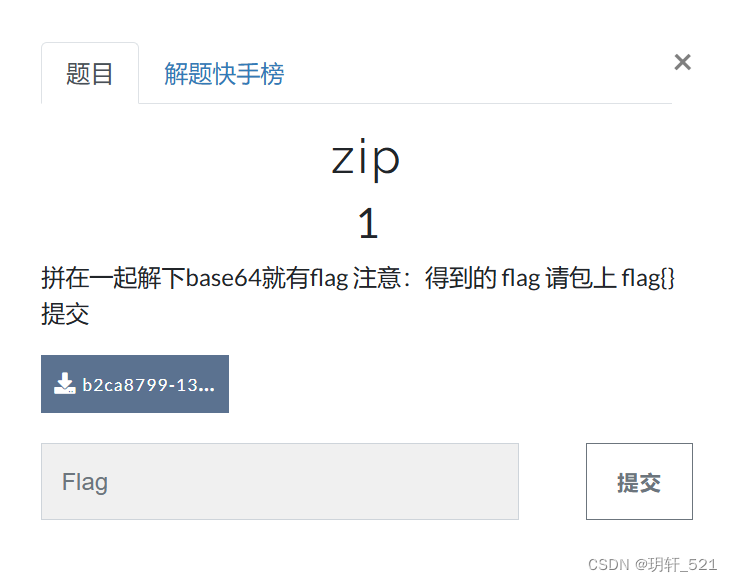
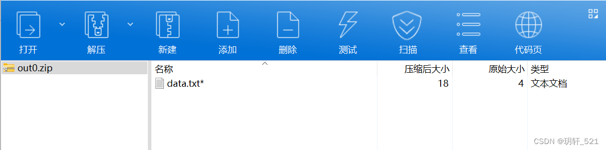
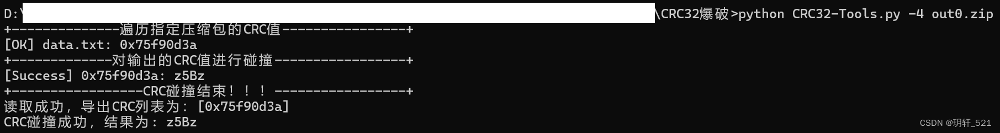
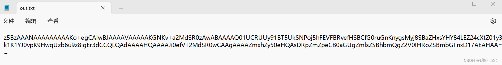
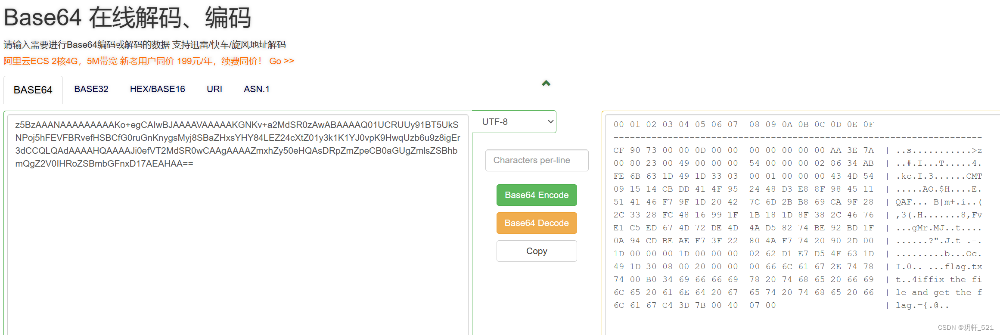
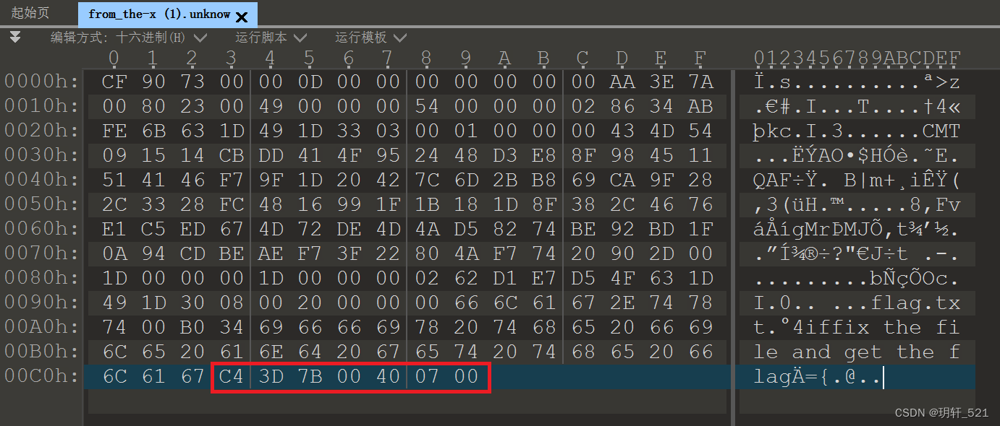
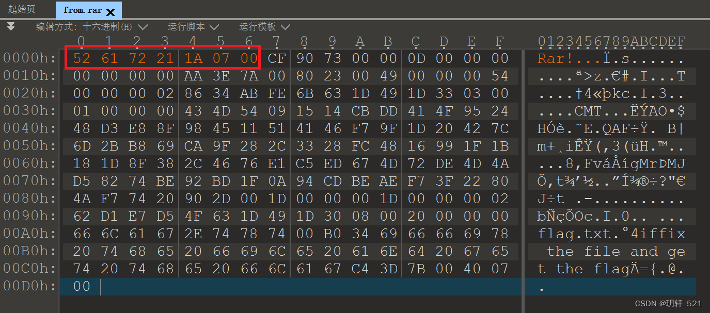
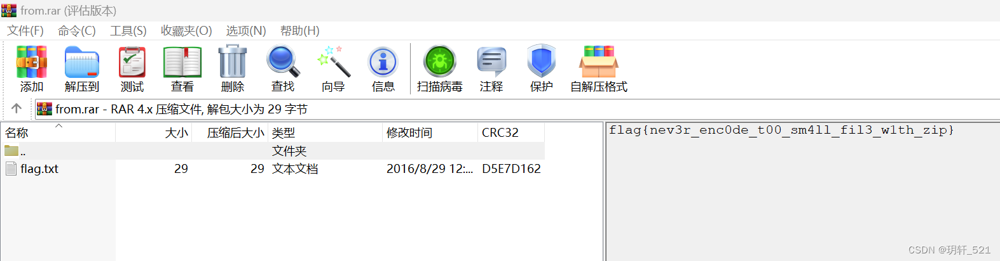

**BUUCTF: [https://buuoj.cn/challenges](https://buuoj.cn/challenges)** 

---

相关阅读

- [CTF Wiki](https://ctf-wiki.org/)


 

### 题目描述：

拼在一起解下base64就有flag 注意：得到的 flag 请包上 flag{} 提交

### 密文：

---

### 解题思路：

1、将下载的压缩包解压，得到68个小压缩包，压缩包内部文件4个字节，符合CRC32爆破条件

> 注意：一般数据内容小于5Bytes(<=4Bytes)即可尝试通过爆破CRC32穷举数据内容

 

2、使用CRC32爆破脚本尝试爆破第一个压缩包out0.zip，爆破成功得到文件内容 `z5Bz` ，根据题目提示，这是base64编码文件的一部分，需要将所有out*.zip压缩包的文件拼接才能拿到完整的文件
 

编写Python脚本进行自动化爆破，借鉴其他人的脚本

```bash
#python3
import zipfile
import string
import binascii

def CrackCrc(crc):
	for i in dic:
		for j in dic:
			for k in dic:
				for h in dic:
					s = i + j + k + h
					if crc == (binascii.crc32(s.encode())):
						f.write(s)
						return

def CrackZip():
	for i in range(0,68):
		# 压缩包文件路径
		file = 'out'+str(i)+'.zip'
		crc = zipfile.ZipFile(file,'r').getinfo('data.txt').CRC
		CrackCrc(crc)
		print('\r'+"loading：{:%}".format(float((i+1)/68)),end='')

dic = string.ascii_letters + string.digits + '+/='
f = open('out.txt','w')
print("\nCRC32begin")
CrackZip()
print("CRC32finished")
f.close()
```

运行脚本，得到out.txt文件

```bash
z5BzAAANAAAAAAAAAKo+egCAIwBJAAAAVAAAAAKGNKv+a2MdSR0zAwABAAAAQ01UCRUUy91BT5UkSNPoj5hFEVFBRvefHSBCfG0ruGnKnygsMyj8SBaZHxsYHY84LEZ24cXtZ01y3k1K1YJ0vpK9HwqUzb6u9z8igEr3dCCQLQAdAAAAHQAAAAJi0efVT2MdSR0wCAAgAAAAZmxhZy50eHQAsDRpZmZpeCB0aGUgZmlsZSBhbmQgZ2V0IHRoZSBmbGFnxD17AEAHAA==
```

 

3、使用在线工具进行解密，看到解出的明文中有如下提示信息：
[Base64 在线解码、编码](https://the-x.cn/encodings/Base64.aspx) 

```bash
flag.txt
fix the file and get the flag
```

 

提示我们修复这个文件，可以拿到flag。文件尾与RAR文件尾一致（ `C4 3D 7B 00 40 07 00` ），可以确定为rar压缩包，但缺少文件头，需要补上缺失的文件头。
 

```bash
52 61 72 21 1A 07 00   # RAR文件头
C4 3D 7B 00 40 07 00   # RAR文件尾
```

用010 Editor打开，补上文件头，另存为.rar文件。
 

最后在rar压缩包的注释中找到flag。
 

### flag：

```bash
flag{nev3r_enc0de_t00_sm4ll_fil3_w1th_zip}
```