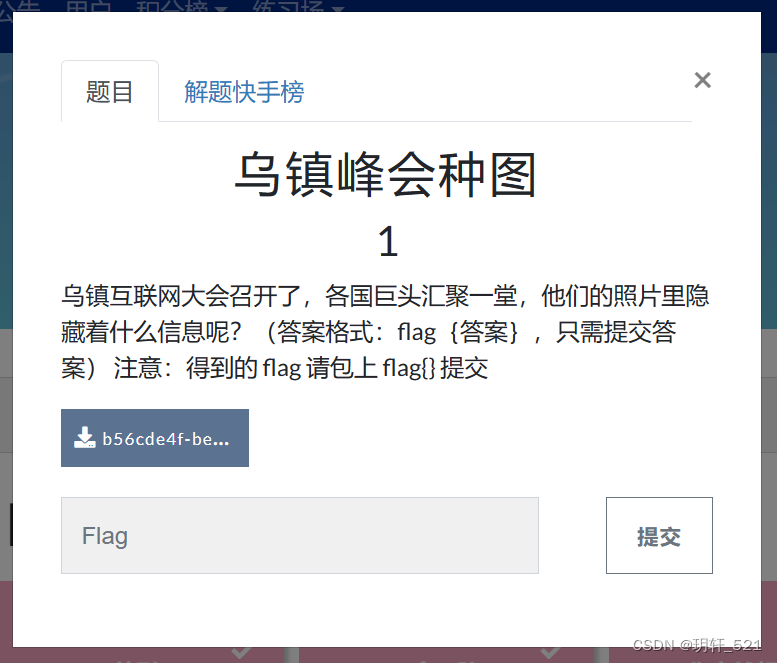
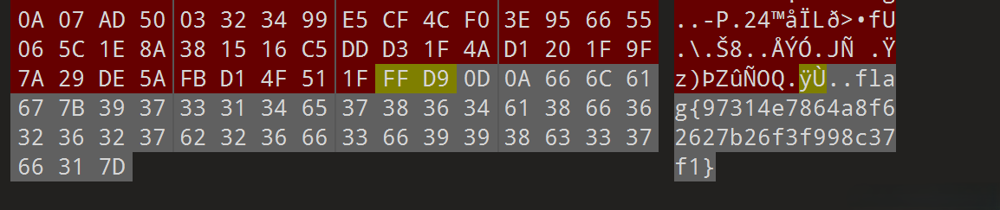
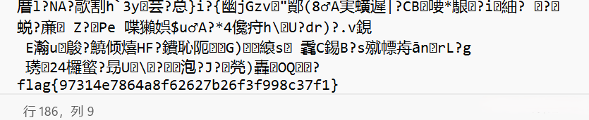

**BUUCTF: [https://buuoj.cn/challenges](https://buuoj.cn/challenges)** 



**题目描述：** 
乌镇互联网大会召开了，各国巨头汇聚一堂，他们的照片里隐藏着什么信息呢？（答案格式：flag｛答案｝，只需提交答案）
**密文：** 
下载附件，得到一张图片


**解题思路：** 
1、分析题目，题目类型为图片隐写。尝试使用StegSolve对图片做各种分析，没有什么结果。
2、尝试010Editor，将图片放入010 Editor进行分析，翻到最后，找到flag。（可以用记事本打开，也可以找到flag）





**flag：** 

```bash
flag{97314e7864a8f62627b26f3f998c37f1}
```