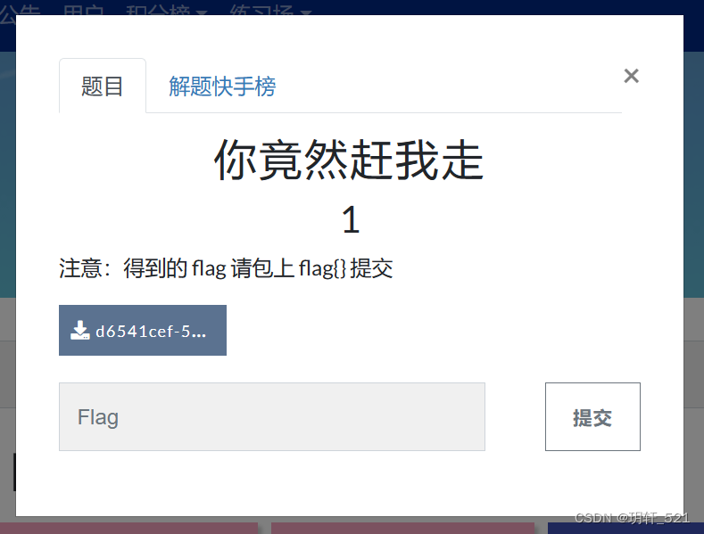
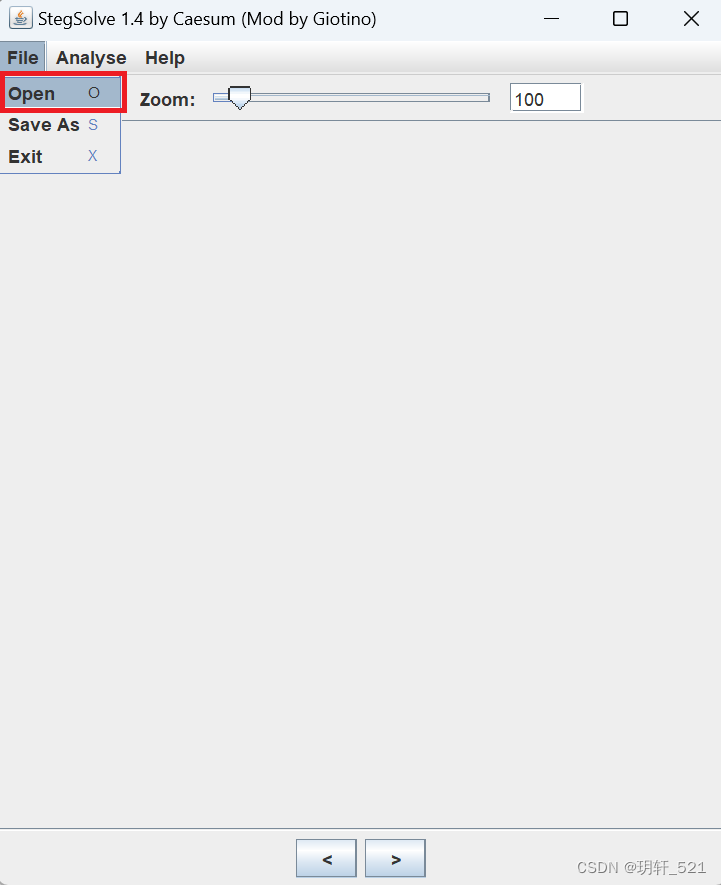
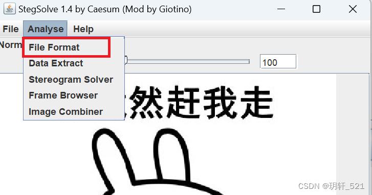
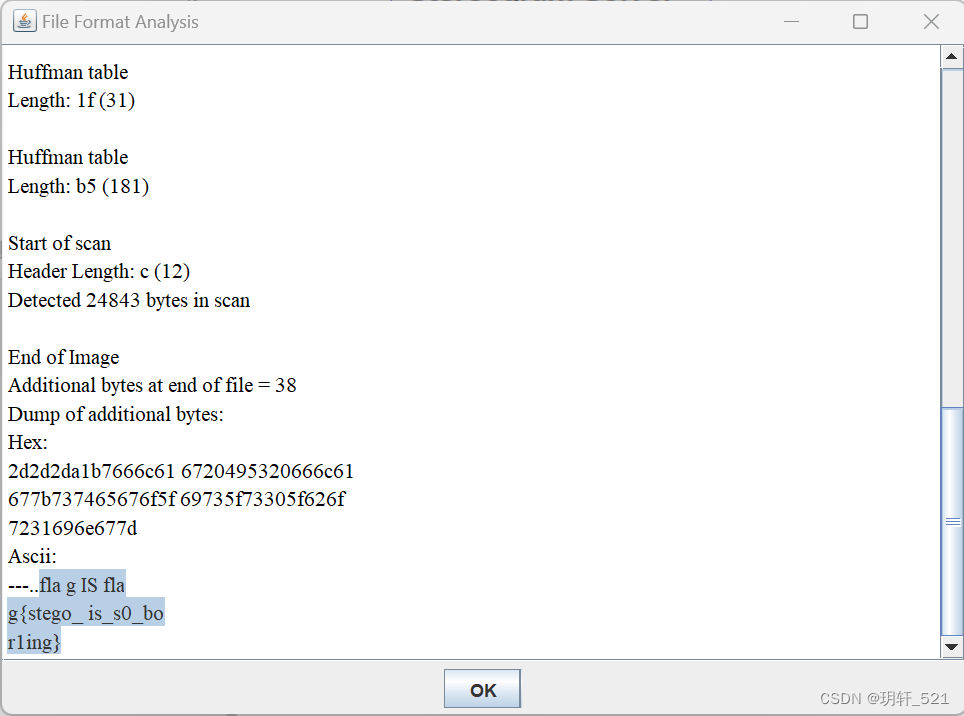
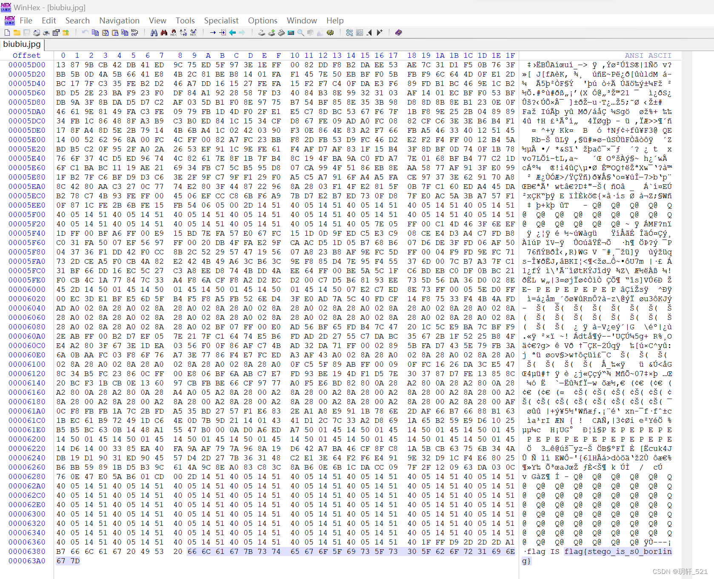

**BUUCTF: [https://buuoj.cn/challenges](https://buuoj.cn/challenges)** 

---

相关阅读

- [CTF Wiki](https://ctf-wiki.org/)




### 题目描述：

下载附件后有一张图片。

### 密文：


### 解题思路：

有两种解题方法

#### 方法一：

1、使用StegSolve打开图片。



2、打开FileFormat（文件格式）



3、拉到最下面，找到flag。（注意要消除所有的空格）



#### 方法二：

1、使用WinHex打开图片，找到flag。



### flag：

```bash
flag{stego_is_s0_bor1ing}
```