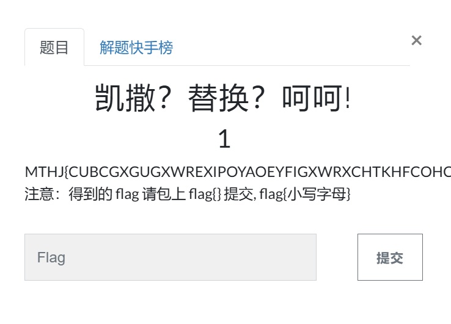
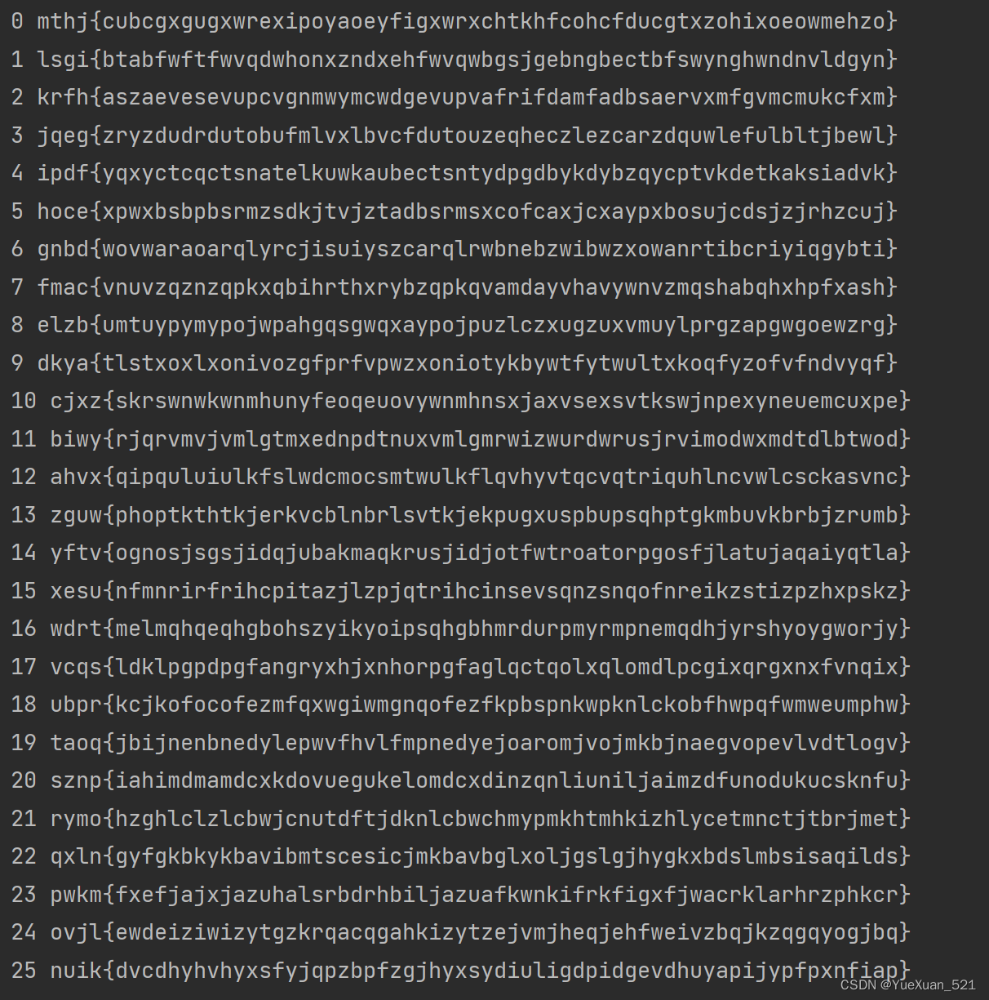
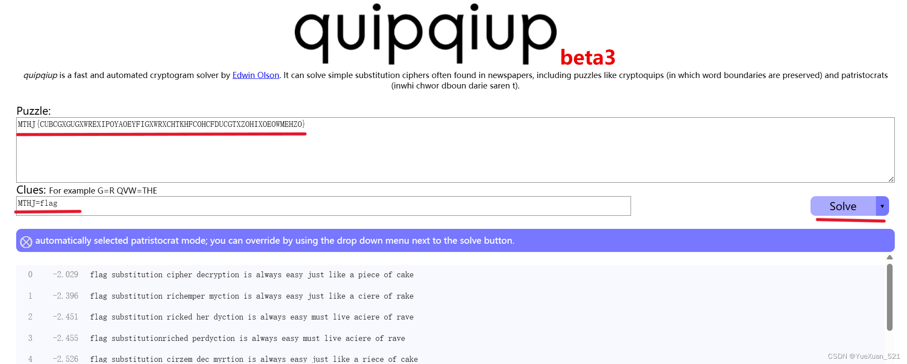
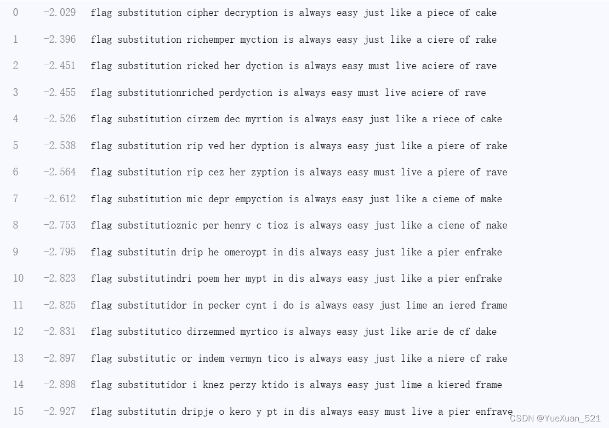

**BUUCTF: [https://buuoj.cn/challenges](https://buuoj.cn/challenges)** 

---

相关阅读

- [CTF Wiki](https://ctf-wiki.org/)


 

### 题目描述：

```
MTHJ{CUBCGXGUGXWREXIPOYAOEYFIGXWRXCHTKHFCOHCFDUCGTXZOHIXOEOWMEHZO}
```

---

### 解题步骤：

1、根据题目提示与密文特征，猜测为凯撒加密。尝试后，发现不是普通的凯撒加密。



2、经过分析发现没有规律，尝试暴力破解。首先，可以肯定MTHJ的明文为flag，利用在线工具 [quipqiup](https://quipqiup.com/) ，破解所有的可能。



3、
第一步：输入密文（MTHJ{CUBCGXGUGXWREXIPOYAOEYFIGXWRXCHTKHFCOHCFDUCGTXZOHIXOEOWMEHZO}）
第二步：输入提示（MTHJ=flag）
第三步：点击Solve按钮，开始破解。



4、选择第一个结果，去除空格，加上花括号，作为flag。

### flag：

```
flag{substitutioncipherdecryptionisalwayseasyjustlikeapieceofcake}
```

**结束** 