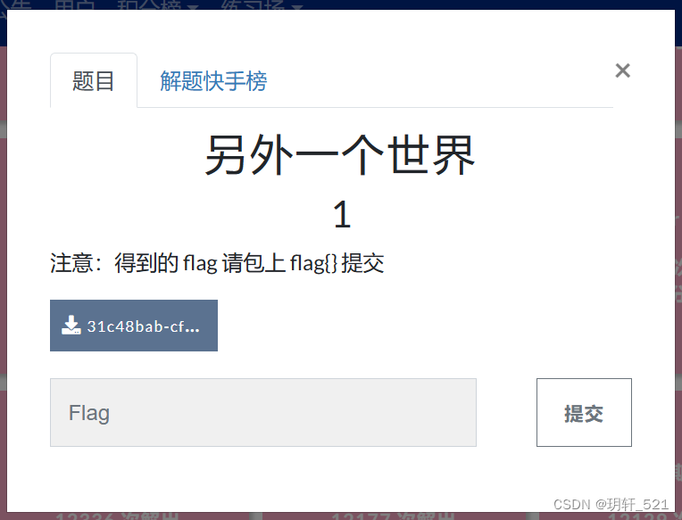
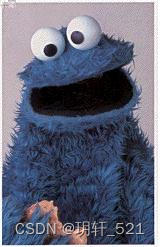
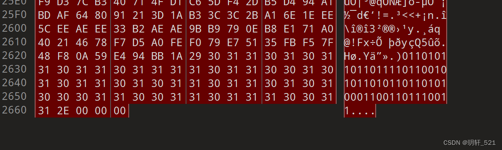
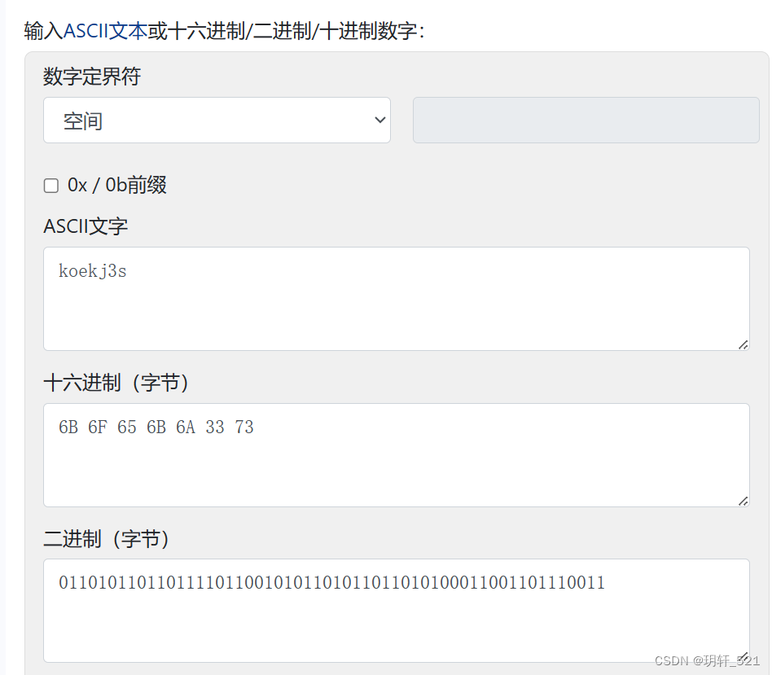

**BUUCTF: [https://buuoj.cn/challenges](https://buuoj.cn/challenges)** 

---

相关阅读

- [CTF Wiki](https://ctf-wiki.org/)




### 题目描述：

下载附件，解压得到一个.jpg图片。

### 密文：



---

### 解题思路：

1、这道题我尝试了很多方法，知道看了别人的wp才知道flag在我忽略的地方。将图片在010 Editor中打开，从上到下浏览一遍，发现最后的数据有些异常，由“0”和“1”组成。



```bash
01101011011011110110010101101011011010100011001101110011
字符共计：56 个
数量为8的倍数
```

2、将这串字符分成8个字符一组，先转成十进制数字，再转成ASCII码，就可以得到flag值。这里使用工具直接完成。（我感觉这个flag没什么规律）
[转换工具](https://www.rapidtables.org/zh-CN/convert/number/ascii-hex-bin-dec-converter.html) 



### flag：

```bash
flag{koekj3s}
```