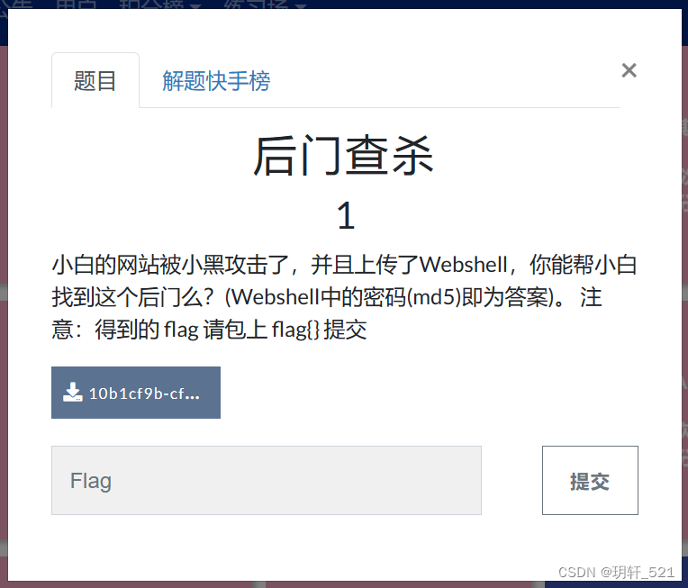
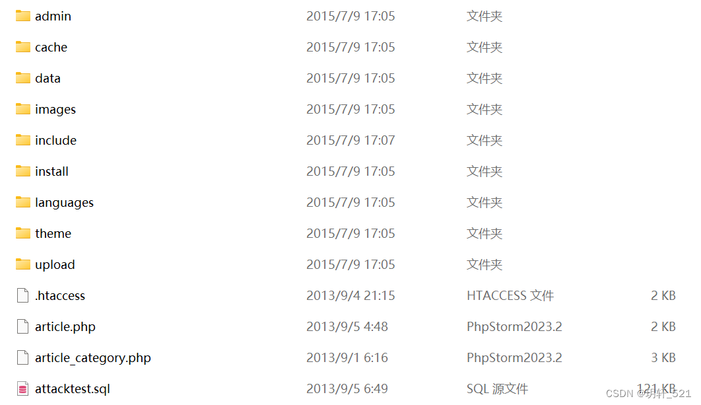
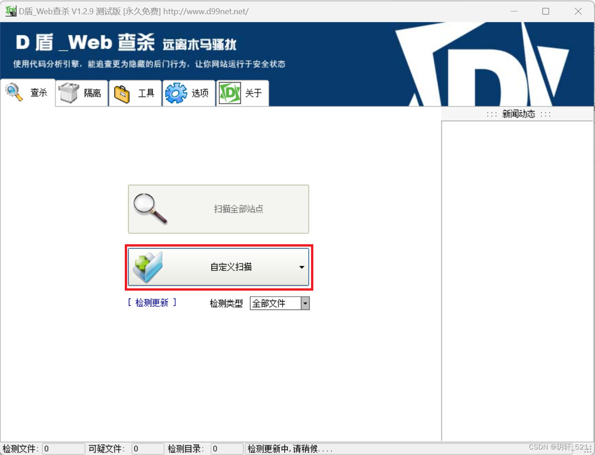
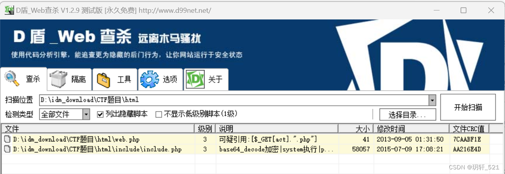
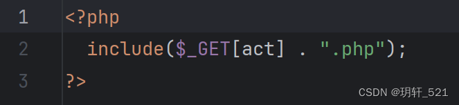
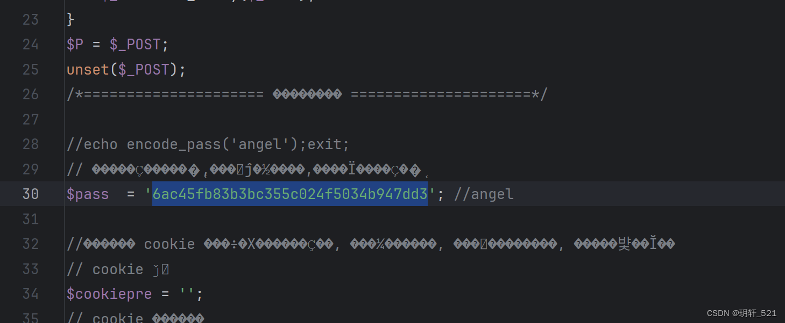

**BUUCTF: [https://buuoj.cn/challenges](https://buuoj.cn/challenges)** 

---

相关阅读

- [CTF Wiki](https://ctf-wiki.org/)




### 题目描述：

小白的网站被小黑攻击了，并且上传了Webshell，你能帮小白找到这个后门么？(Webshell中的密码(md5)即为答案)。

### 密文：

下载附件，解压得到一个网站文件夹。



---

### 解题思路：

1、使用工具扫描附件所给的文件夹，可以使用D盾、火绒安全之类的工具，这里我使用D盾。
打开D盾，点击自定义扫描，选择附件给的网站文件夹，点击确定。



检查出两个文件，我们挨个查看。



2、第一个文件没有flag，但我们在第二个文件中找到了Webshell中的密码，密码也符合md5的格式，这个就是flag值。





### flag：

```bash
flag{6ac45fb83b3bc355c024f5034b947dd3}
```