**BUUCTF: [https://buuoj.cn/challenges](https://buuoj.cn/challenges)** 

---

相关阅读

- [CTF Wiki](https://ctf-wiki.org/)


 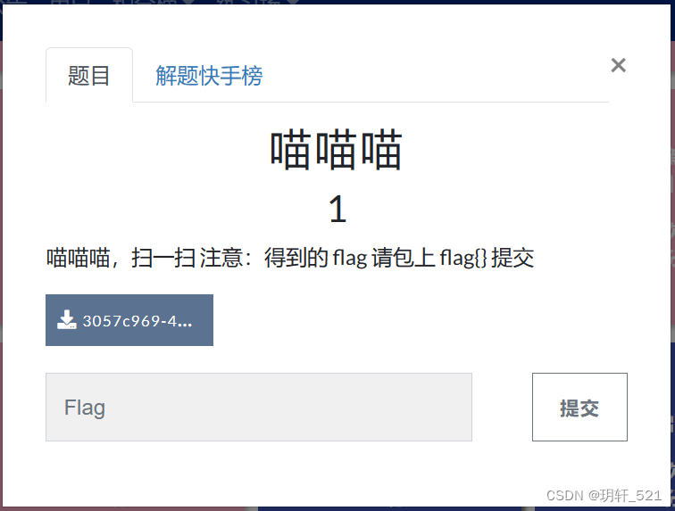

### 题目描述：

喵喵喵，扫一扫 注意：得到的 flag 请包上 flag{} 提交

### 密文：

下载附件，解压得到一张.png图片。
 

---

### 解题思路：

1、使用StegSolve工具，在RGB的0通道发现异常，猜测存在LSB隐写。

 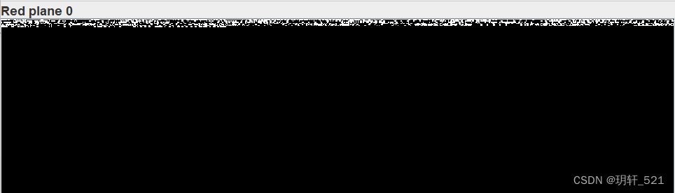

 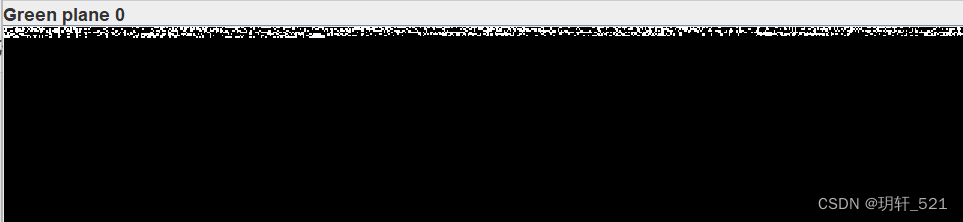

 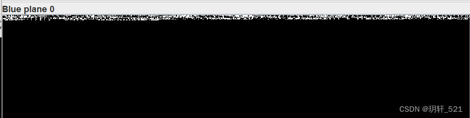

打开Analyse（分析）选项卡，使用DataExtract（数据提取）选项，进行分析。

 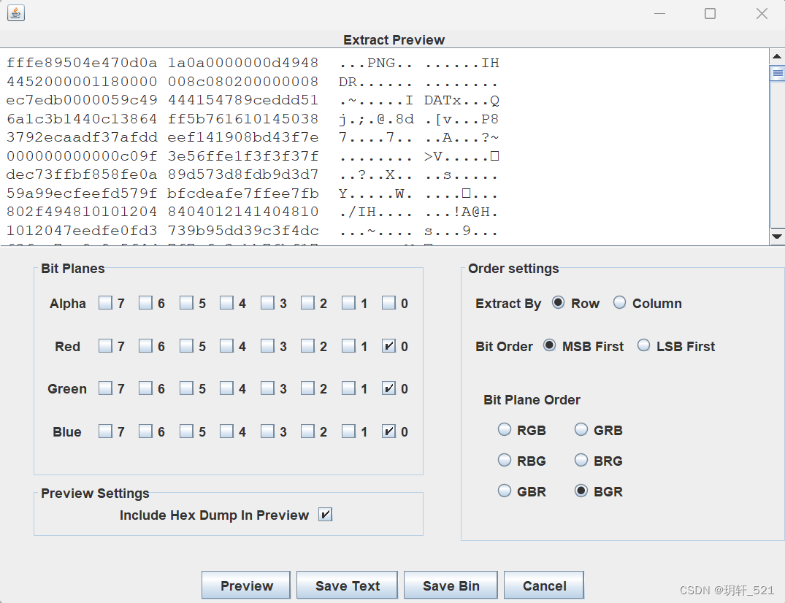

由PNG文件头可以看出隐写内容为PNG文件，按save Bin键保存为flag.png文件。

 

2、文件无法查看，使用010Editor打开flag.png文件，可以看到PNG文件头有多余的字符。

```bash
PNG (png) 　　 文件头：89 50 4E 47
```

 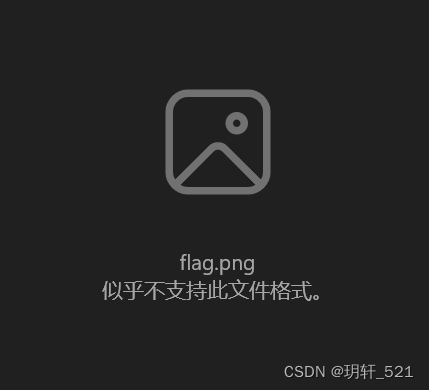

 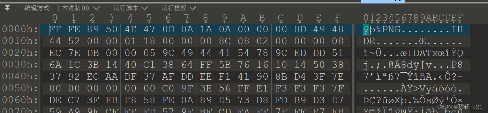

将多余的字符删除，保存文件查看，得到半张二维码。

 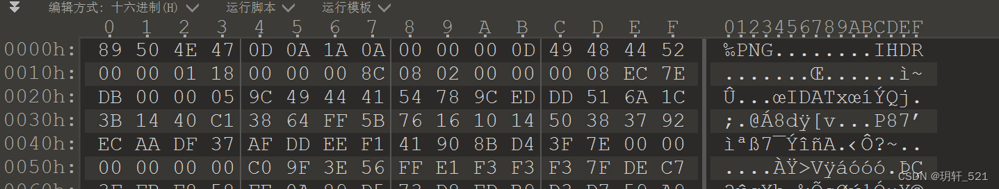

 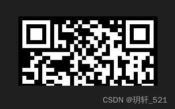

3、使用010 Editor打开，提示CRC校验错误，认为图片被修改了宽高。

 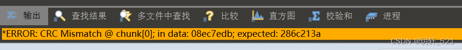

通过爆破宽高，得到正确的宽高，然后修改图片的宽高数据，得到正确的图片。爆破所用代码如下。

```python
import os
import binascii
import struct

crcbp = open("repair.png", "rb").read()    #打开图片（修改图片路径）
for i in range(2000):
    for j in range(2000):
        data = crcbp[12:16] + \
            struct.pack('>i', i)+struct.pack('>i', j)+crcbp[24:29]
        crc32 = binascii.crc32(data) & 0xffffffff
        if(crc32 == 0x9BF1293B):    #图片当前CRC（修改CRC）
            print(i, j)
            print('hex:', hex(i), hex(j))
```

得到正确的宽高值。

 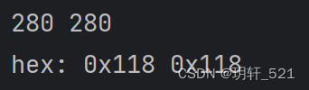

修改图片中的宽高参数，然后保存图片查看。（从左到右依次是宽度、高度、CRC校验参数）

 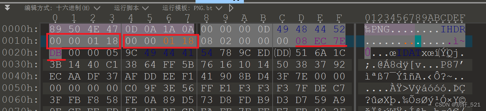

 

4、使用QR research扫码，得到一个网址，下载一个压缩包flag.rar。

```bash
https://pan.baidu.com/s/1pLT2J4f
```

 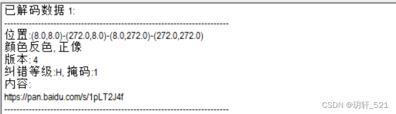

 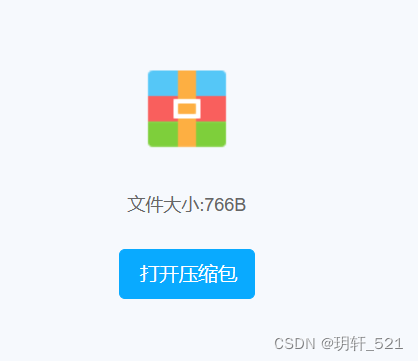

解压得到flag.txt文件，打开如下。

 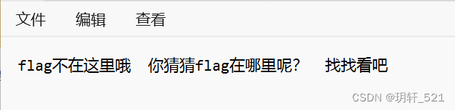

5、猜测存在NTFS文件流隐写，使用工具NtfsStreamsEditor或AlternateStreamView扫描文件所在的文件夹，发现隐藏文件。（这里使用NtfsStreamsEditor演示 ）
[AlternateStreamView(跳转页面后，向下滑动，下载对应的32或64位软件)](https://www.nirsoft.net/utils/alternate_data_streams.html) 

 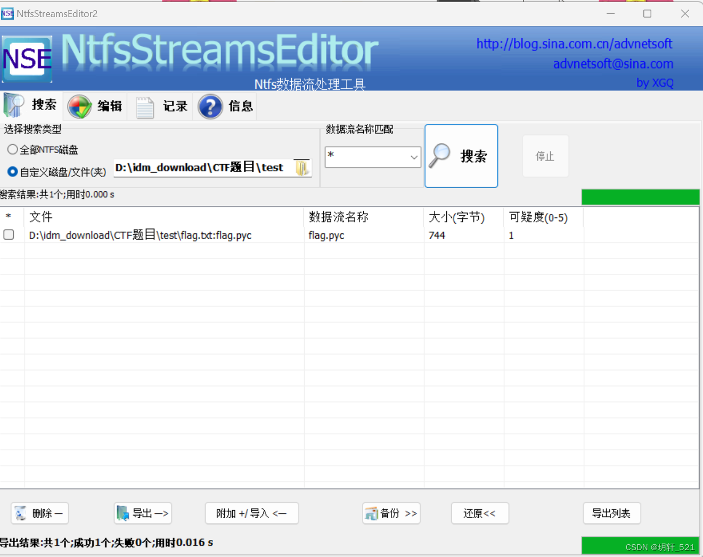

导出flag.pyc文件（pyc文件是由Python文件经过编译后所生成的文件），使用在线网站进行pyc文件的反编译。
[据说这个网站可以，但我没有成功](https://tool.lu/pyc/) 

得到的Python代码如下。（加入注释方便理解）

```python
#!/usr/bin/env python
# visit http://tool.lu/pyc/ for more information
import base64

# 定义一个名为encode的函数，它没有任何输入参数  
def encode():  
    # 明文，被'*'符号遮盖，实际内容未知  
    flag = '*************'  
    # 创建一个空的列表ciphertext，用于存储加密后的字符  
    ciphertext = []  
    # 对明文字符串flag中的每个字符进行遍历，字符的索引从0开始到flag长度-1  
    for i in range(len(flag)):  
        # 对当前字符进行异或操作，将字符的ASCII码与i进行异或  
        s = chr(i ^ ord(flag[i]))  
        # 如果当前字符的索引是偶数  
        if i % 2 == 0:  
            # 对字符的ASCII码加10，转化为数字后存储在s中  
            s = ord(s) + 10  
        # 如果当前字符的索引是奇数  
        else:  
            # 对字符的ASCII码减10，转化为数字后存储在s中  
            s = ord(s) - 10  
        # 将转化后的字符添加到ciphertext列表中  
        ciphertext.append(str(s))  
    # 返回ciphertext列表的反向排列  
    return ciphertext[::-1]  
  

ciphertext = [  
    '96',  
    '65', 
    '93',  
    '123',
    '91',
    '97',
    '22',
    '93',
    '70',
    '102',
    '94',
    '132',
    '46',
    '112',
    '64',
    '97',
    '88',
    '80',
    '82',
    '137',
    '90',
    '109',
    '99',
    '112']
```

手工编写解密脚本，代码如下。

```python
ciphertext = [
    '96',
    '65',
    '93',
    '123',
    '91',
    '97',
    '22',
    '93',
    '70',
    '102',
    '94',
    '132',
    '46',
    '112',
    '64',
    '97',
    '88',
    '80',
    '82',
    '137',
    '90',
    '109',
    '99',
    '112']

ciphertext = ciphertext[::-1]  # 反转字符串
flag = ''

for i in range(len(ciphertext)):  # 遍历数组
    if i % 2 == 0:  # 偶数位减10，奇数位加10
        s = int(ciphertext[i]) - 10
    else:
        s = int(ciphertext[i]) + 10
        
    s = s ^ i  # 将s对i进行异或操作
    flag += chr(s)  # 连接字符
    
print(flag)
```

运行解密脚本，得到flag。

 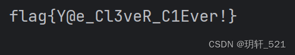

### flag：

```bash
flag{Y@e_Cl3veR_C1Ever!}
```