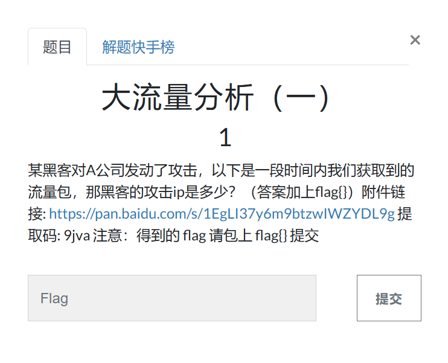
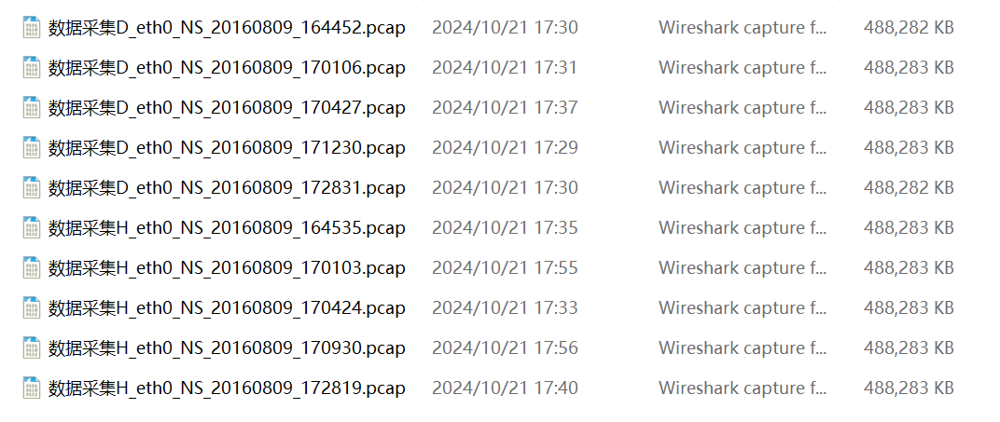
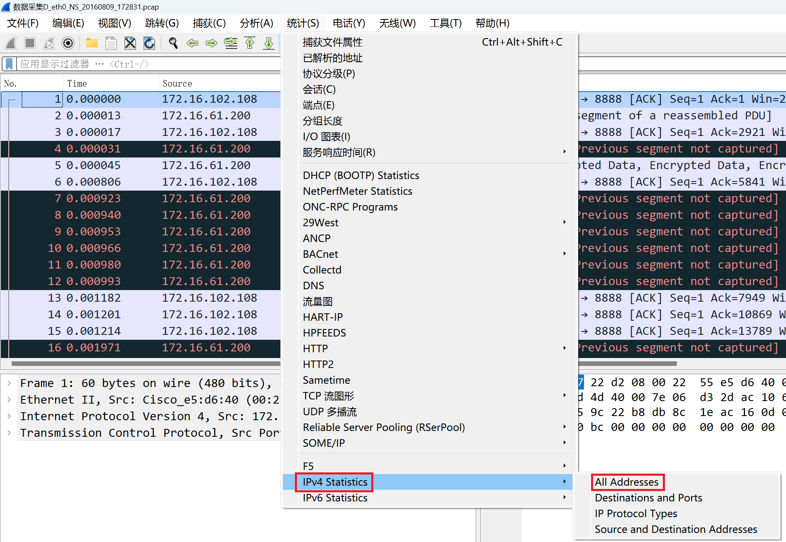
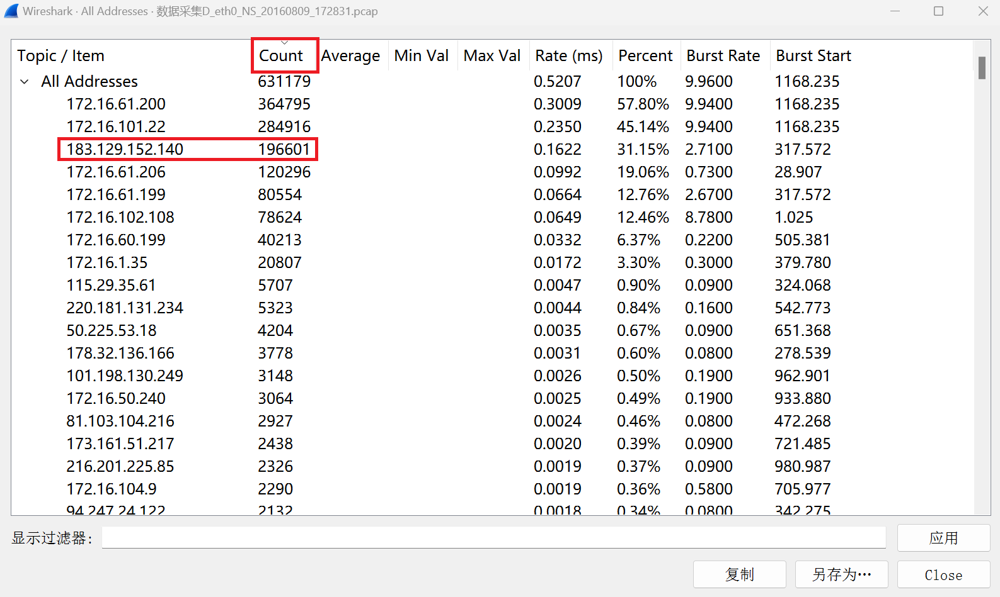
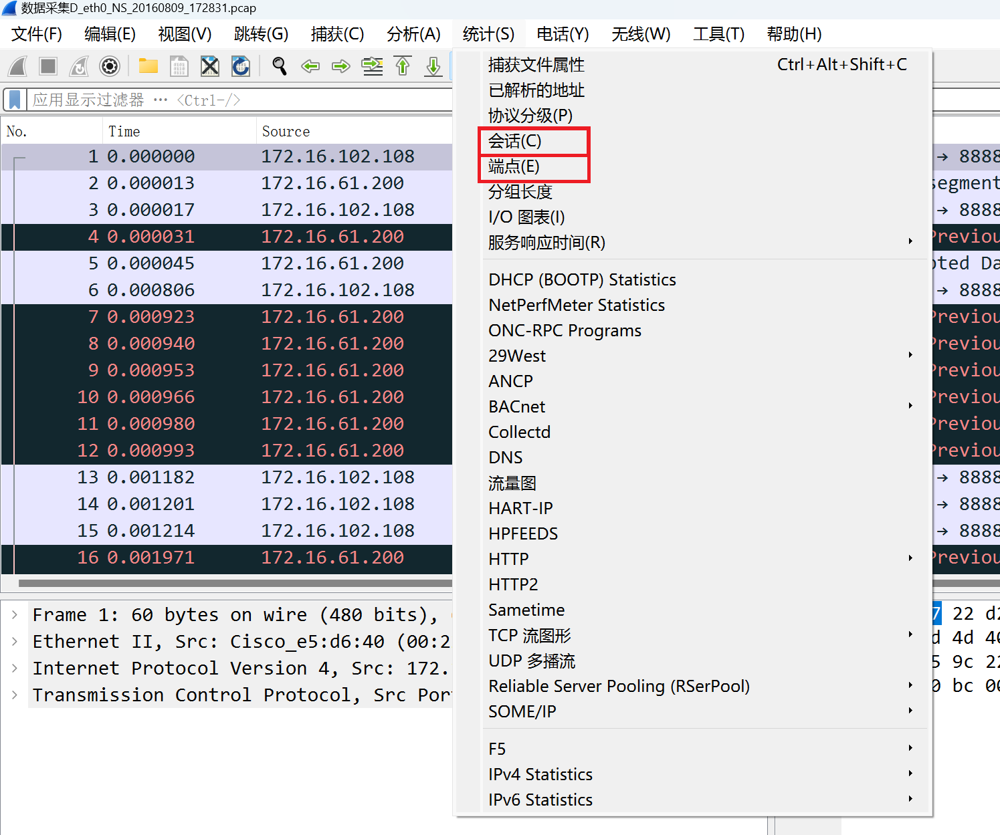
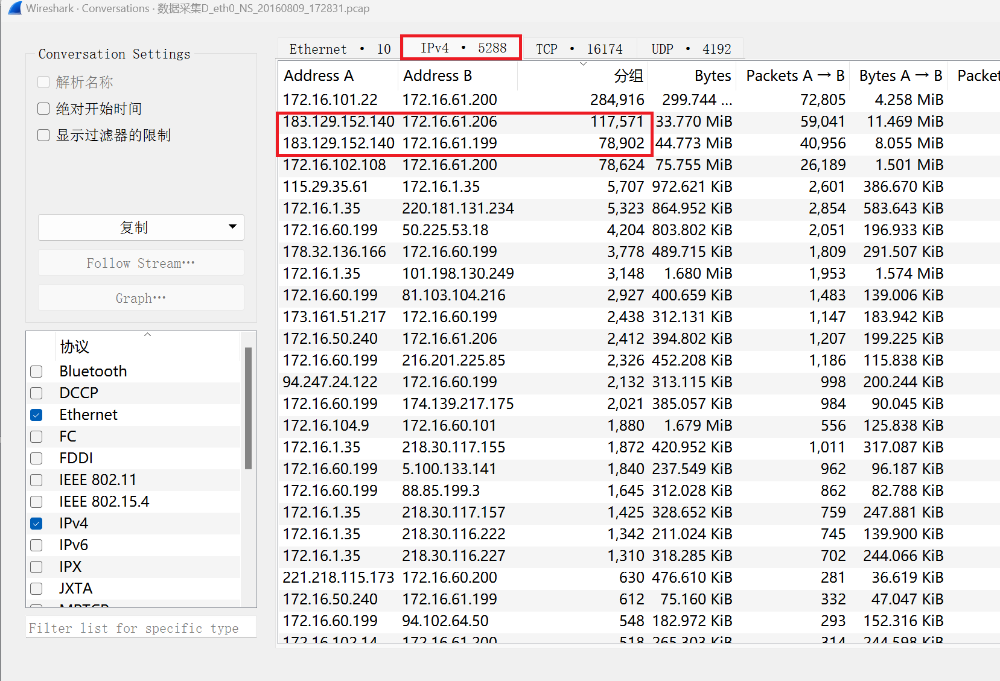
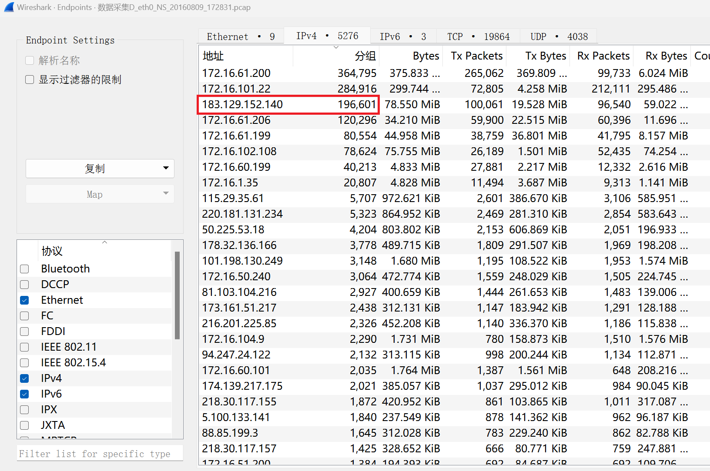

**BUUCTF: [https://buuoj.cn/challenges](https://buuoj.cn/challenges)** 

---

相关阅读

- [CTF Wiki](https://ctf-wiki.org/)
- [BUUCTF:大流量分析（一）](https://blog.csdn.net/wangjin7356/article/details/122525900)


 

### 题目描述：

某黑客对A公司发动了攻击，以下是一段时间内我们获取到的流量包，那黑客的攻击ip是多少？（答案加上flag{}）附件链接: https://pan.baidu.com/s/1EgLI37y6m9btzwIWZYDL9g 提取码: 9jva 注意：得到的 flag 请包上 flag{} 提交

### 密文：

下载附件，有很多pcap流量包

 

---

### 解题思路：

1、随便打开一个，一般黑客的攻击流量会很多，需要使用Wireshark统计功能。

先统计IP，统计 → IPv4 Statistics → All Addresses

 

将IP出现数量Count进行排序，发现除了 `183.129.152.140` ，其它全部是内网IP。

> 常见内网IP段：
> 10.0.0.0 – 10.255.255.255
> 172.16.0.0 – 172.31.255.255
> 192.168.0.0 – 192.168.255.255

 

2、统计会话和端点，发现 `183.129.152.140` 的分组数，是除内网IP最多的。

 

会话

 

端点

 

最后，确认黑客的攻击ip是 `183.129.152.140` 。

### flag：

```bash
flag{183.129.152.140}
```