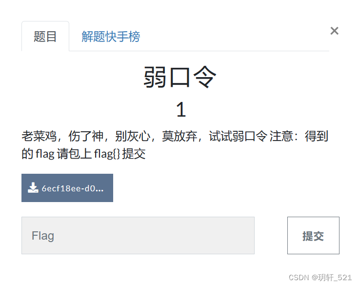
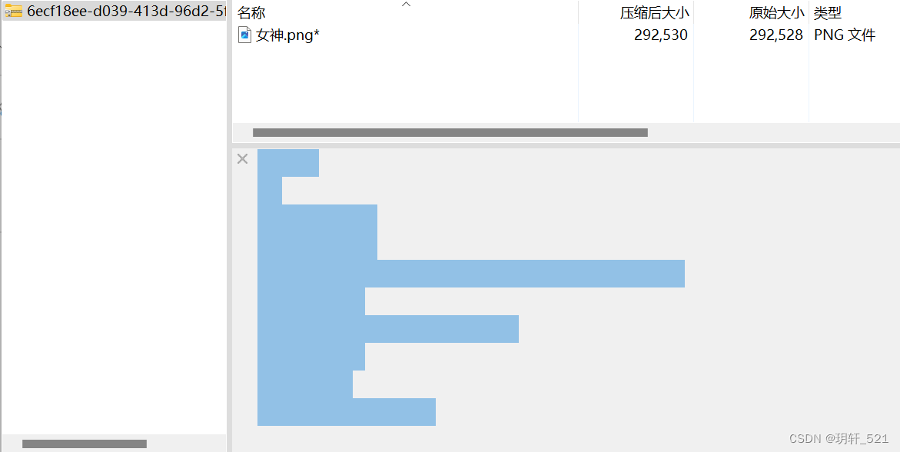
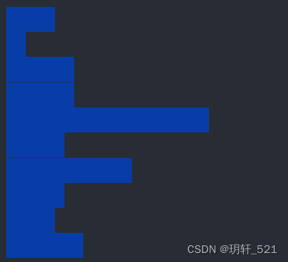
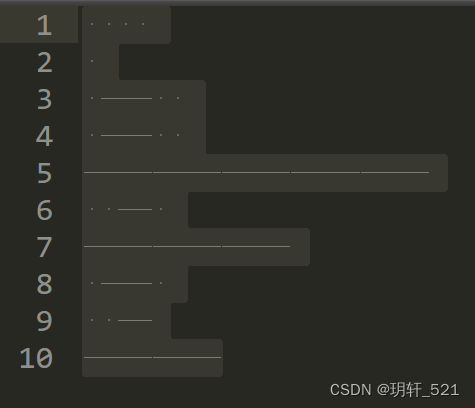
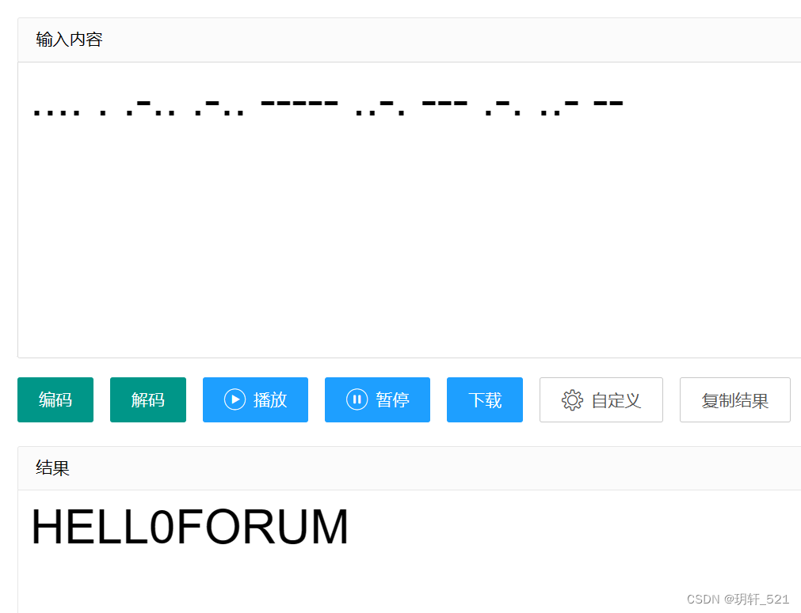
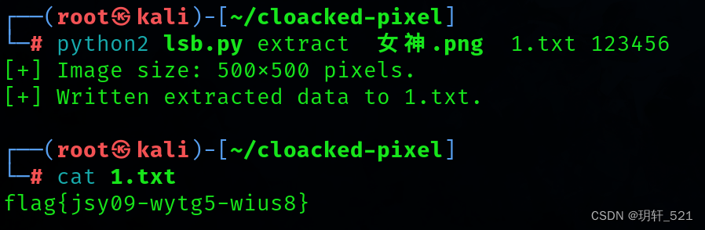

**BUUCTF: [https://buuoj.cn/challenges](https://buuoj.cn/challenges)** 

---

相关阅读

- [CTF Wiki](https://ctf-wiki.org/)


 

### 题目描述：

老菜鸡，伤了神，别灰心，莫放弃，试试弱口令注意：得到的 flag 请包上 flag{} 提交

### 密文：

---

### 解题思路：

得到一个zip压缩包，但是有密码。用Bandizip打开，得到一些空格和换行符组成的信息。如下
 

```bash
    
 
 	  
 	  
					
  	 
			
 	 
  	
		
```

 

使用SublimeText打开，选中可以更清楚地看到，看着很像摩斯密码，实际上就是。

 

用记事本手抄一下

```bash
.... . .-.. .-.. ----- ..-. --- .-. ..- --
```

使用在线工具解码，得到zip压缩包的密码

[在线摩斯密码翻译器](https://www.lddgo.net/encrypt/morse) 
 

解压缩zip压缩包，得到一张名为“女神.png”的图片
 

尝试了各种方法均无效，最后使用lsb隐写提取出flag，使用密钥123456，对应题目“弱口令”。（虽说是lsb隐写，但用Stegsolve没有发现）
 

这里使用工具cloacked-pixel，python2环境配置比较麻烦。 [https://github.com/livz/cloacked-pixel](https://github.com/livz/cloacked-pixel) 

### flag：

```bash
flag{jsy09-wytg5-wius8}
```