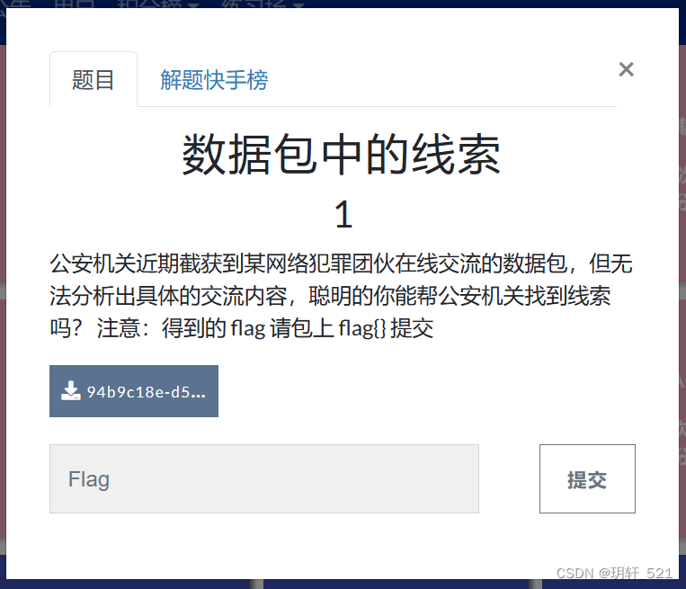
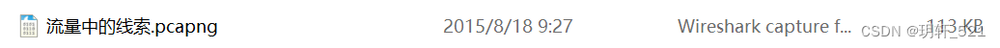
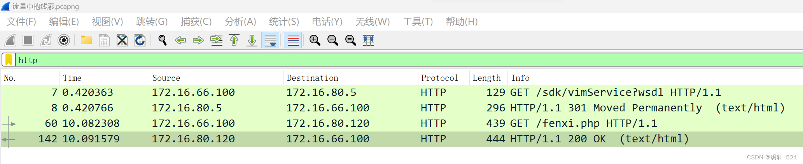
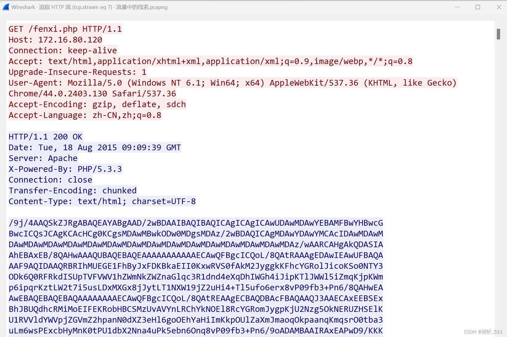
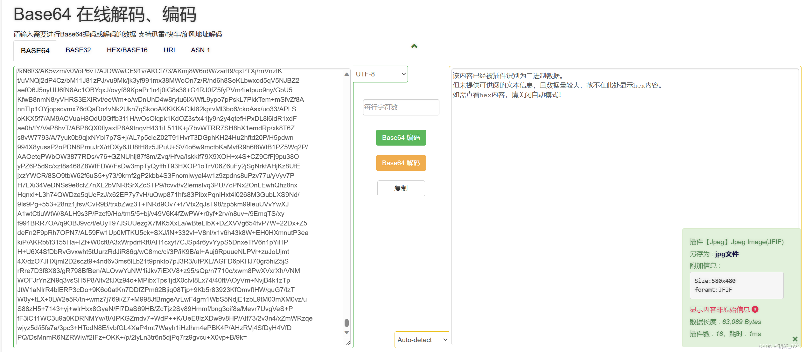

**BUUCTF: [https://buuoj.cn/challenges](https://buuoj.cn/challenges)** 

---

相关阅读

- [CTF Wiki](https://ctf-wiki.org/)




### 题目描述：

公安机关近期截获到某网络犯罪团伙在线交流的数据包，但无法分析出具体的交流内容，聪明的你能帮公安机关找到线索吗？

### 密文：

下载附件，解压得到一个.pcapng文件。



---

### 解题思路：

1、双击.pcapng文件，进入Wireshark中。我们首先过滤HTTP流量，然后追踪HTTP流，找到很多的特殊信息，似乎经过Base64编码加密。



```bash
base64的编码表是由（A-Z、a-z、0-9、+、/）64个可见字符构成，“=”符号用作后缀填充。

base64: aGVsbG8sd29ybGQuMTIzNDY1
特征：大小写字母（A-Z，a-z）和数字（0-9）以及特殊字符‘+’，‘/’，不满3的倍数，用‘=’补齐。
```



2、我使用Base64编码工具进行解码，得到的都是乱码，没有有意义的文本。看了别人的题解，才知道解码出的内容是一个jpg图片的数据。我们使用这个Base64 在线网站，将得到的密文进行解码，网站提醒我们可以另存为jpg文件，点击另存为，我们会下载一张jpg图片。
[Base64 在线解码、编码](https://the-x.cn/encodings/Base64.aspx) 



3、查看图片得到flag。


### flag：

```bash
flag{209acebf6324a09671abc31c869de72c}
```