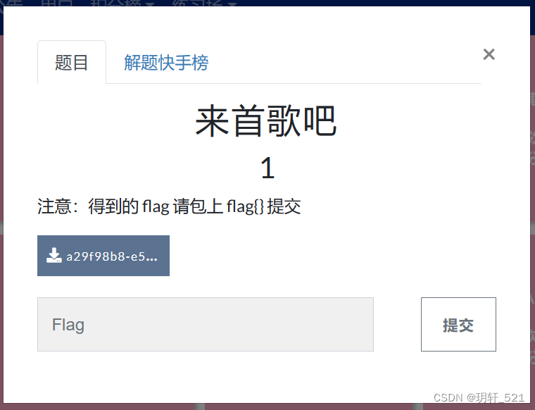
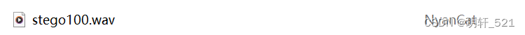
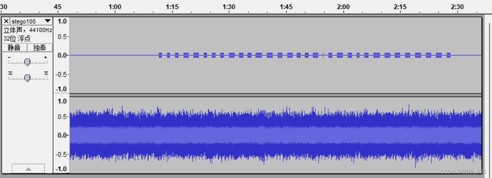
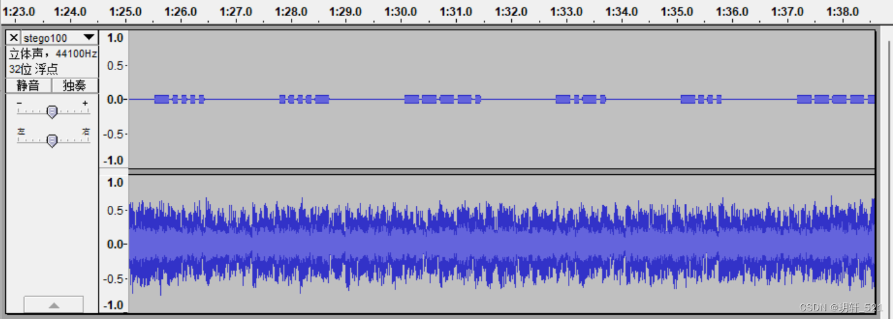
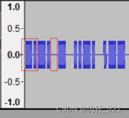
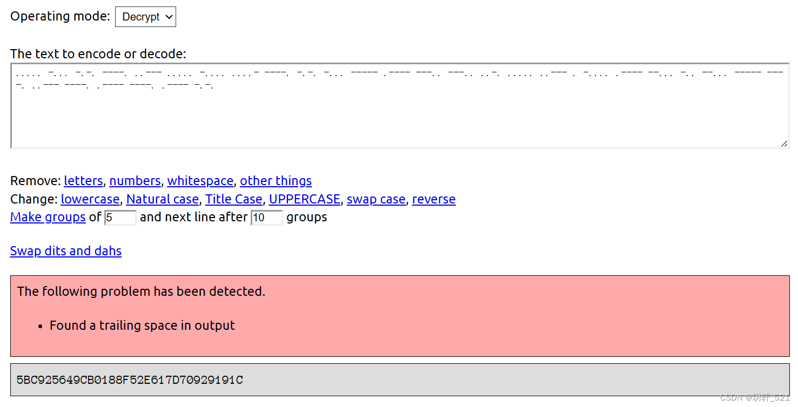

**BUUCTF: [https://buuoj.cn/challenges](https://buuoj.cn/challenges)** 

---

相关阅读

- [CTF Wiki](https://ctf-wiki.org/)




### 题目描述：

注意：得到的 flag 请包上 flag{} 提交

### 密文：

下载附件，解压得到一个.wav音频文件。



---

### 解题思路：

1、得到一个音频文件，放到Audacity看看。看到有两条音轨，放大上面的那条音轨，看到这一串音频，有很多分组，分组内由粗的音块和细的音块组成，类似莫尔斯电码的“-”和“.”。





2、举例如下图。按照这样的对应将音轨上的分组全部转译为莫尔斯电码，转换为“… -… -.-. ----. …— … -… …- ----. -.-. -… ----- .---- —… —… …-. … …— . -… .---- --… -… --… ----- ----. …— ----. .---- ----. .---- -.-. ”。



```bash
第一个红框代表“-.”，第二个红框代表“ ”（空格）。
..... -... -.-. ----. ..--- ..... -.... ....- ----. -.-. -... ----- .---- ---.. ---.. ..-. ..... ..--- . -.... .---- --... -.. --... ----- ----. ..--- ----. .---- ----. .---- -.-. 
```

3、使用在线网站，将莫尔斯电码转换为明文字符，得到flag值。
[在线网站](https://rumkin.com/tools/cipher/morse-code/) 



### flag：

```bash
flag{5BC925649CB0188F52E617D70929191C}
```