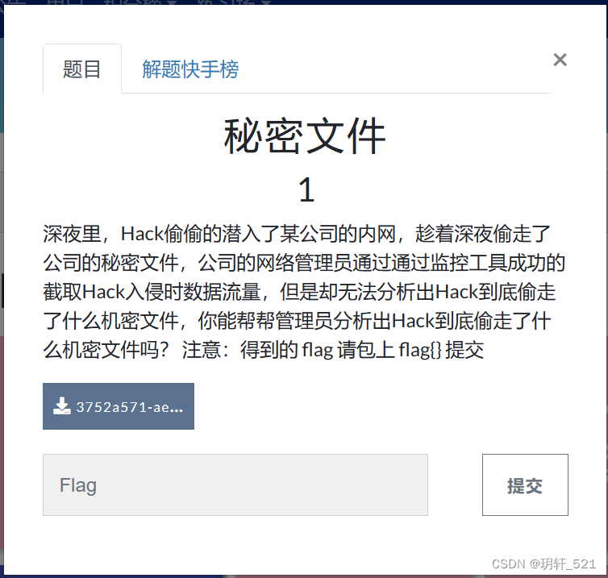
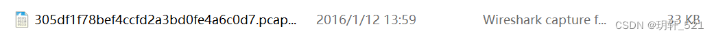
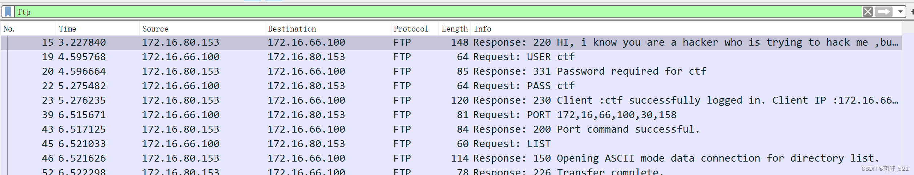
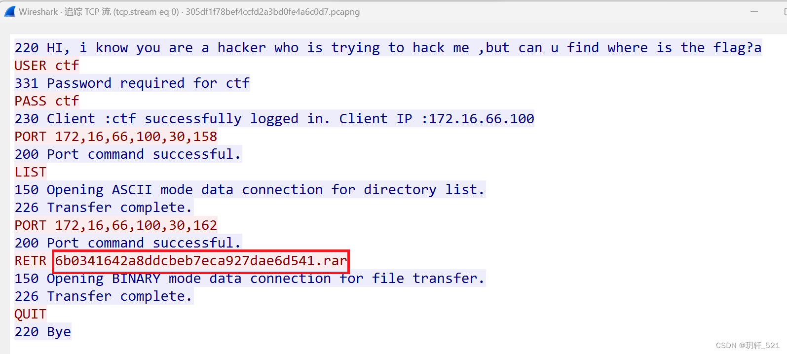
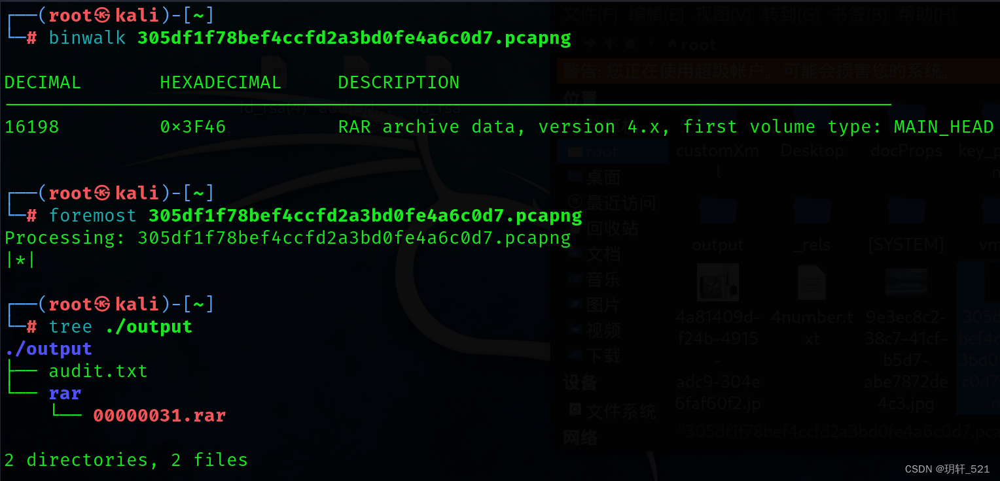
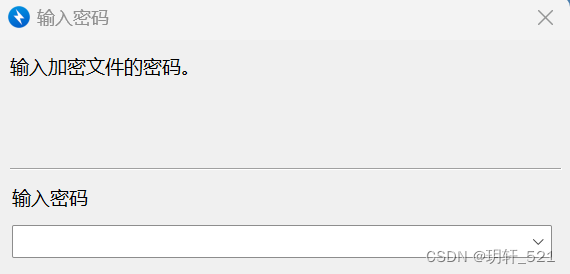
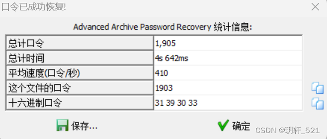
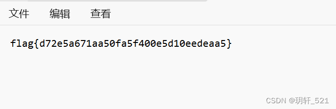

**BUUCTF: [https://buuoj.cn/challenges](https://buuoj.cn/challenges)** 

---

相关阅读

- [CTF Wiki](https://ctf-wiki.org/)

 

### 题目描述：

深夜里，Hack偷偷的潜入了某公司的内网，趁着深夜偷走了公司的秘密文件，公司的网络管理员通过通过监控工具成功的截取Hack入侵时数据流量，但是却无法分析出Hack到底偷走了什么机密文件，你能帮帮管理员分析出Hack到底偷走了什么机密文件吗？

### 密文：

下载附件，解压得到一个.pcapng文件。
 

---

### 解题思路：

1、双击文件，打开wireshark。翻阅流量时找到ftp的流量，将ftp流量过滤下来。
 

追踪ftp流量，有出题者留下的话，并且发现流量中有flag.rar压缩包。

```bash
原文：HI, i know you are a hacker who is trying to hack me ,but can u find where is the flag？
翻译：你好，我知道你是黑客，想黑我，但你能找到flag在哪里吗？
```



2、使用Kali中的foremost工具，将rar压缩包从pcapng文件中提取出来。（wireshark 截取的流量中，会截取文件传输对应的流量，也就是说，这个流量包将包括 flag.rar压缩包）
 

尝试解压压缩包，需要密码。

 

3、因为没有关于密码的提示，所以使用常用的4位纯数字进行破解。使用ARCHPR工具，选定参数，破解得到密码为1903。

 

使用密码解压压缩包，得到txt文件，打开得到flag。
 

### flag：

```bash
flag{d72e5a671aa50fa5f400e5d10eedeaa5}
```