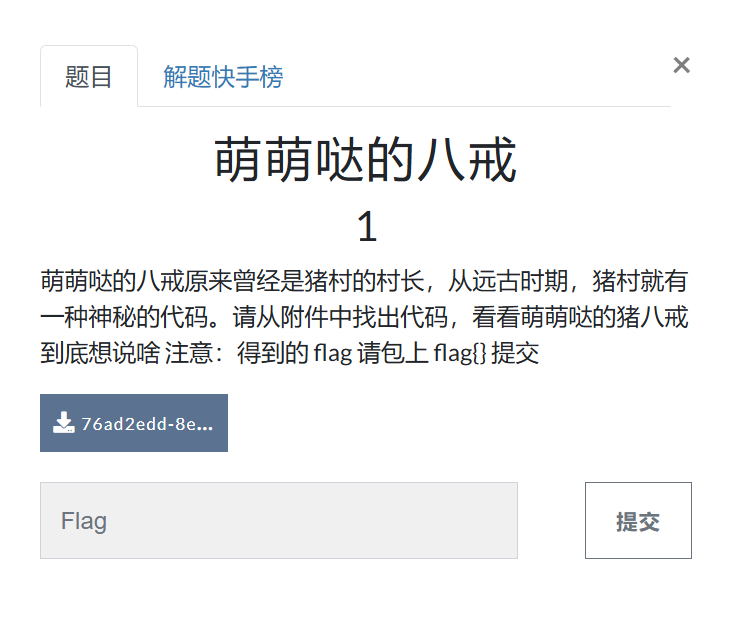
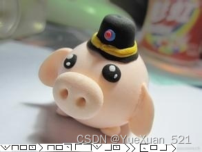
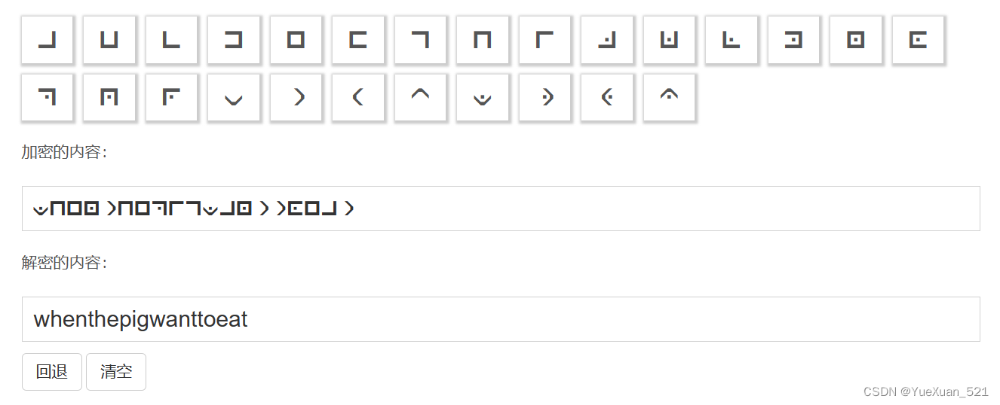

**BUUCTF: [https://buuoj.cn/challenges](https://buuoj.cn/challenges)** 

---

相关阅读

- [CTF Wiki](https://ctf-wiki.org/)


 

### 题目描述：

萌萌哒的八戒原来曾经是猪村的村长，从远古时期，猪村就有一种神秘的代码。请从附件中找出代码，看看萌萌哒的猪八戒到底想说啥

### 密文：

解压是一张图片



---

### 解题步骤：

1、看图，观察密文特征，结合题目，判断为猪圈加密。直接使用在线工具。
[猪圈密码解密工具](http://www.metools.info/code/c90.html) 



2、直接对应密文输入，解出密文，得到flag。

---

### flag:

```
whenthepigwanttoeat
```